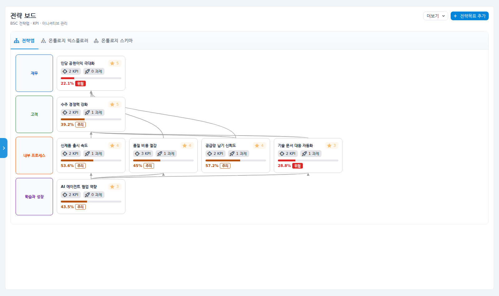
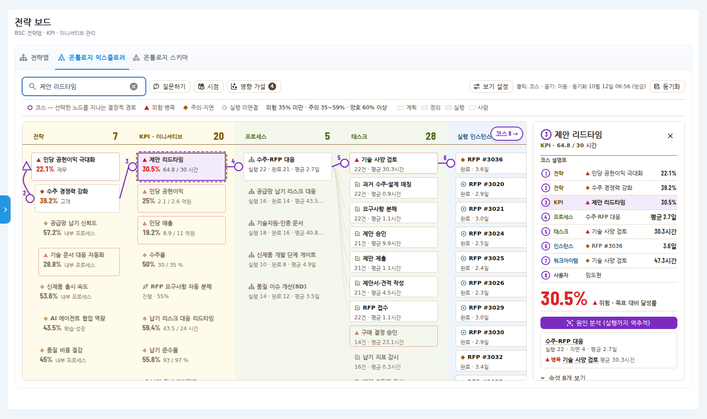
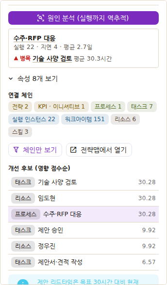
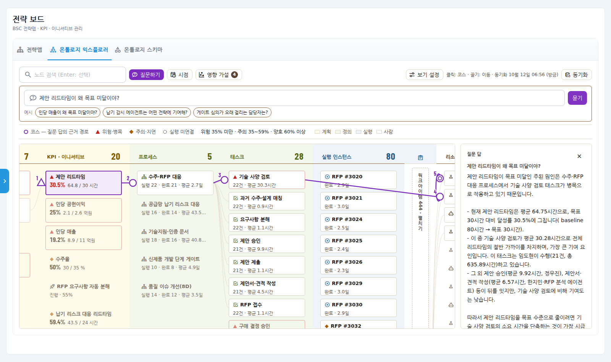
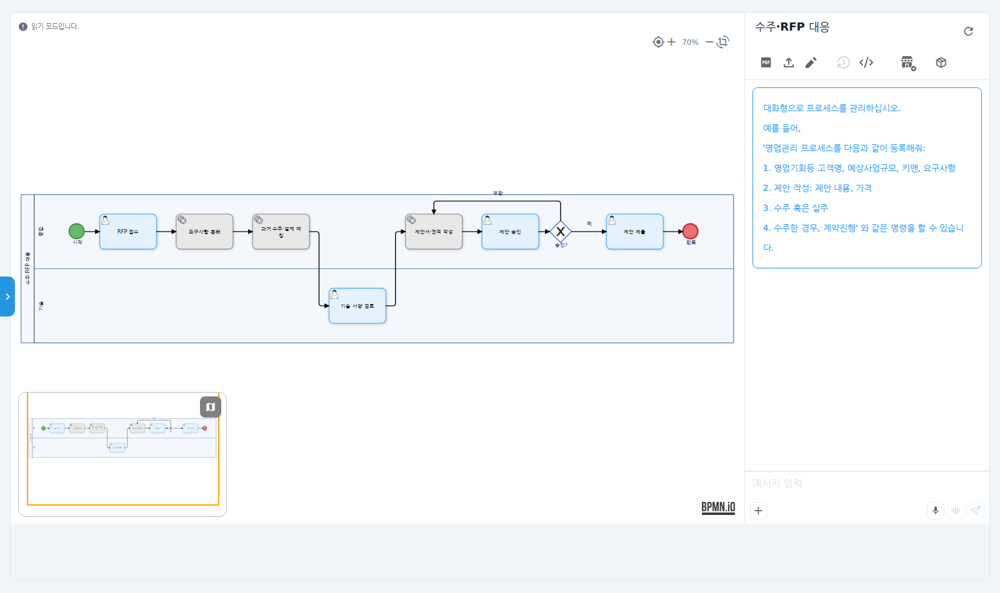
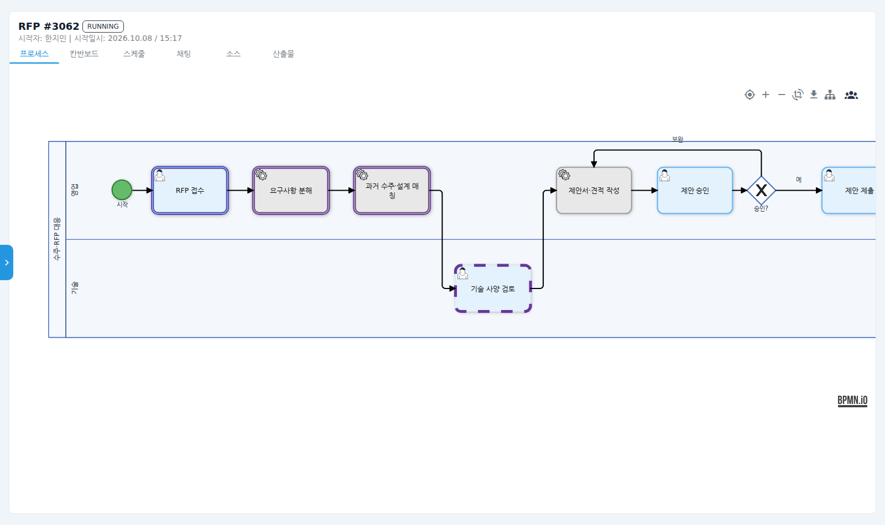
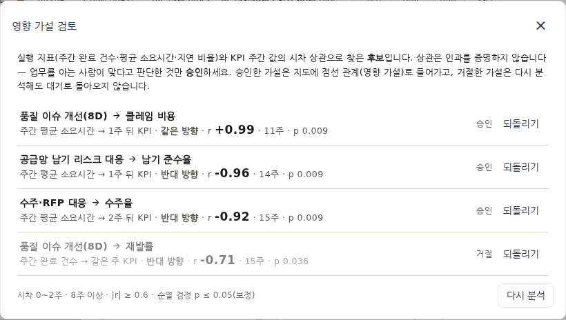
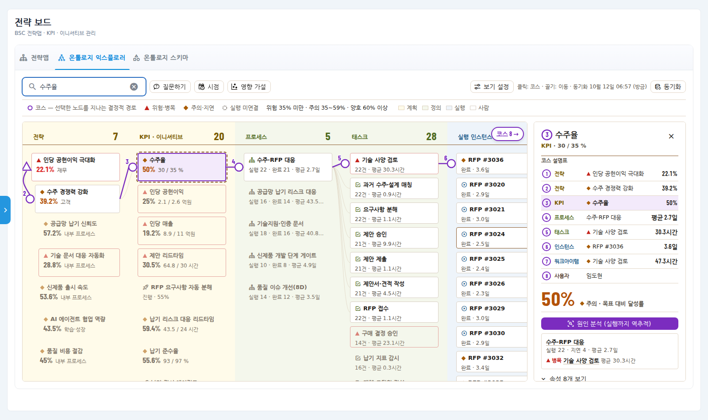
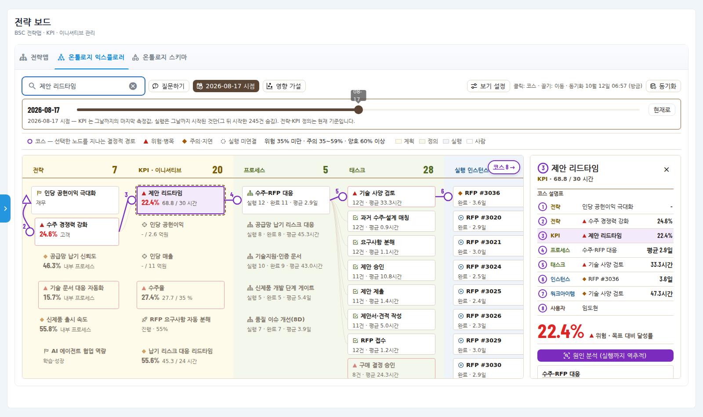
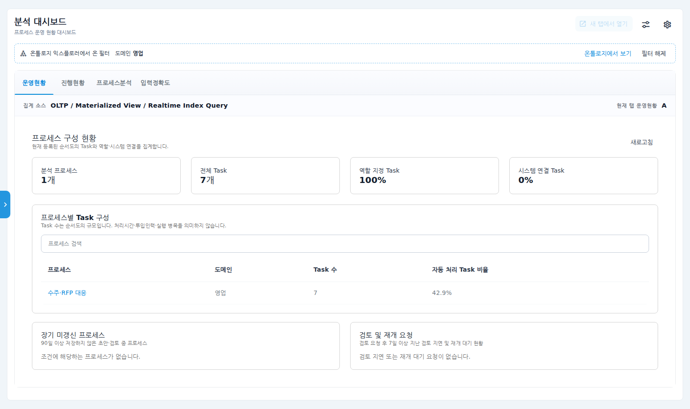

# 쏠리드(SOLiD) AX 설명회 — 진행안과 라이브 시연 대본

> **고지(화면·발표 공통)**: 시연 화면의 회사 구조·인물·수치·이력은 쏠리드 공개자료(KPI 트리 가설)를 바탕으로 만든
> **가상 예시**다. 쏠리드 실적처럼 말하지 않는다. 쏠리드 수치는 공개자료(제안 전략 플랜 PDF 의 출처)만 인용한다.

고객 요청 B(단기 목표)에 대한 답:
1. **AX 선도 기업은 어떻게 준비·실행하고 성과를 얻나(CASE 1·2·3, 사례 몇 건)** → 세션 2 + [cases.md](cases.md)
2. **유엔진 솔루션으로 쏠리드에 어떤 AX 체계를 만들 수 있나** → 세션 3·4·6 (이 대본의 중심은 세션 4 라이브 시연)

## 설명회 구성 (약 2시간 30분 · 사장 + 개발·품질·SCM·영업 임원)

| # | 시간 | 세션 | 핵심 | 고객이 가져갈 답 | 자료 |
|---|---|---|---|---|---|
| 1 | 20분 | 왜 "도입"이 아니라 "재설계"인가 | 디플로이 vs 재설계, 성패의 70% 는 사람과 조직 | 사장 관심사(성과 중심 경영 재설계)에 대한 직접 답 | 제안 PDF |
| 2 | 30분 | 선도 기업은 어떻게 하고 있나 | CASE 1·2·3 은 택일이 아니라 층위 — 사례 카드(준비 → 실행 → 성과) | 요청 B-1 | [cases.md](cases.md) |
| 3 | 30분 | 쏠리드 가설: 인당 성과 KPI 트리 | 인당 매출 약 8.4억 원(2025 매출 2,948억 ÷ 350명)에서 내려온 목표 1 · 동인 · 핵심 프로세스 5 | "우리 회사에서는 어디인가" 초안 | 시연 화면 S1 |
| 4 | 30분 | **라이브 시연** | 아래 대본 | 유엔진 솔루션으로 무엇이 가능한지 눈으로 | 아래 |
| 5 | 30분 | 우선순위 워크숍 | 5개 후보 프로세스를 "성과 영향도 × 실행 용이성"으로 투표 | 파일럿 1~2개 잠정 선정 | 투표판 |
| 6 | 10분 | 다음 단계 | 4~6주 AX 진단, 경영진 교육 Track A 옵션 | 진단 착수 여부 결정 | 제안 PDF 로드맵 |

## 세션 4 · 라이브 시연 대본 (30분)

시연 환경: 쏠리드 데모 테넌트(`solid`), 계정 `solid-demo@uengine.org`. 준비는 맨 아래 "시연 전 준비".
각 장면에 **이 화면이 답하는 질문**을 먼저 말하고 클릭한다.

### 장면 1 · 전략맵 — "성과 중심 경영 재설계를 화면으로" (3분)
- **답하는 질문** 인당 공헌이익을 움직이는 것은 무엇이고, 지금 어디가 위험한가?
- **클릭** 분석 → 전략 보드(전략맵 탭).
- **보여 줄 것** 최상위 "인당 공헌이익 극대화" 아래 동인 — 수주 경쟁력, 신제품 출시 속도, 품질 비용, 공급망 납기, 기술 문서 자동화,
  AI 에이전트 협업 역량. 빨간 표식(위험)이 몇 개뿐인 것 — 경보는 진짜 위험에만.
- **멘트** "세션 3에서 본 KPI 트리가 그대로 전략맵입니다. 여기 숫자는 보고용으로 가공한 숫자가 아니라 — 잠시 뒤 보시듯 — 실행 기록에서
  나옵니다."

### 장면 2 · 온톨로지 익스플로러 — 전략에서 실행까지 한 장 (4분)
- **답하는 질문** 이 KPI 는 어떤 업무·사람·에이전트로 실행되나?
- **클릭** 온톨로지 익스플로러 탭 → 검색창에 "제안 리드타임" Enter.
- **보여 줄 것** 보라색 번호 코스: ① 인당 공헌이익 → ② 수주 경쟁력 → ③ **제안 리드타임 30.5%(위험, 64.8시간 / 목표 30시간)** →
  ④ 수주·RFP 대응 → ⑤ **▲ 기술 사양 검토(병목, 평균 30.3시간)** → ⑥ 인스턴스 → ⑦ 워크아이템 → ⑧ 담당 엔지니어.
  오른쪽 코스 설명표가 지점마다 값을 보여 준다.
- **멘트** "위에서 아래로 읽으면 전략이 어떤 일로 실행되는지, 아래에서 위로 읽으면 이 엔지니어의 일이 어떤 전략에 기여하는지가 보입니다."

### 장면 3 · 원인 분석 — "무엇이 나빠졌나"에서 "누가 무엇을 고치면 되나"로 (3분)
- **클릭** 패널의 **원인 분석(실행까지 역추적)**.
- **보여 줄 것** 개선 후보 순위: 태스크 "기술 사양 검토" → 담당자 → 프로세스. 사람 판단 단계(기술 사양 검토·제안 승인)가 시간을
  쓰고, 에이전트 단계(요구사항 분해·과거 수주 매칭)는 1시간 안팎이다.
- **멘트** "결정적 분석이라 같은 데이터면 같은 답이 나옵니다. 아래 AI 진단은 이 결과를 근거로 서술만 덧붙입니다."

### 장면 4 · 질문하기 — 말로 묻고, 근거 경로를 지도에서 확인 (3분)
- **클릭** 툴바 **질문하기** → "제안 리드타임이 왜 목표 미달이야?" → 묻기(약 10초).
- **보여 줄 것** 답 문장(64.75시간 · 달성률 30.5% · 기술 사양 검토 평균 30.3시간)과 지도의 보라 코스. **에이전트가 한 일**을 펼쳐
  "이름 찾기 → 원인 분석" 2단계만으로 답했음을 보여 준다.
- **덧붙여 보여 줄 것(선택, 30초)** "한빛 ELS 제9999회 위험등급은?"처럼 없는 것을 물으면 "근거 없음" — **모르면 모른다고 답한다.**
- **멘트** "Process GPT 의 에이전트도 같은 도구로 이 지도를 읽습니다. 업무 중에 '이 KPI 의 병목이 뭐지?'를 물을 수 있다는 뜻입니다."

### 장면 5 · 프로세스로 바로 — 고칠 곳에서 바로 고친다 (4분)
- **클릭** 코스의 "수주·RFP 대응" → 패널 **프로세스 정의 열기**(또는 주소 `/definitions/demo-solid-rfp`).
- **보여 줄 것** 영업·기술 레인, 톱니 아이콘(에이전트가 맡는 단계: 요구사항 분해·과거 수주·설계 매칭·제안서 초안)과 사람 단계(기술 사양
  검토·제안 승인), 승인 반려 시 보완으로 돌아가는 게이트.
- **멘트(재설계 제안)** "기술 사양 검토가 병목입니다. 에이전트가 요구사항별로 과거 설계 대응표를 먼저 붙여 엔지니어는 '예외만' 보게
  바꾸면 — 이것이 CASE 2 가 말하는 'AI 에 맞는 BPM 재설계'입니다." (편집 모드에서 단계 하나를 추가해 보여도 좋다 — 저장하지 않는다.)

### 장면 6 · 지금 진행 중인 건 — 사람–에이전트 혼합 실행 (4분)
- **클릭** 주소 `/instancelist/demo-solid-rfp_DOT_3062` (RFP #3062).
- **보여 줄 것** RFP 접수 → 요구사항 분해(에이전트) → 과거 수주·설계 매칭(에이전트)은 끝났고, **지금 기술 사양 검토(엔지니어)에서
  대기 중** — 지도에서 본 병목이 실제 건에서 보인다.
- **멘트** "돈이 나가는 결정·기술 판단은 사람이, 찾고 정리하는 일은 에이전트가. 이 실행 기록이 그대로 KPI 실적이 됩니다."
- **라이브 실행(선택, +2분)** 프로세스 **KPI 미달 원인 보고**를 새로 시작 → 분석 요청에 "제안 리드타임 — 왜 목표에 못 미치나, 어느
  단계·누가 병목인가" 입력 후 제출 → **KPI 분석 에이전트**가 온톨로지 MCP(`strategy-ontology`)로 KPI 를 찾고(`ontology_resolve_entity`)
  원인을 역추적(`ontology_kpi_root_cause`)해 30초~1분 안에 결과를 남기고, 다음 단계 "결과 검토"가 CTO 에게 온다. 결과에는 장면 3 과
  같은 답(기술 사양 검토 평균 30.3시간·담당 임도현)이 나온다. 멘트: "에이전트도 사람과 같은 지도를 보고 일합니다."
  — 새 **RFP** 는 라이브로 시작하지 않는다. RFP 의 에이전트 단계(요구사항 분해 등)는 연결된 도구(MCP)가 없어 멈춘다.
  **연결이 불안하면 진행 중인 건만 보여 주고 넘어간다**(아래 분기).

### 장면 7 · 영향 가설 — 수동 KPI 도 실행과 잇는다 (4분)
- **답하는 질문** 수주율·클레임 비용·납기 준수율처럼 손으로 입력하는 KPI 는 어떤 업무가 움직이나?
- **클릭** 툴바 **영향 가설** → 후보 목록.
- **보여 줄 것** 실행 지표와 KPI 주간 값의 시차 상관 후보 — 예: "수주·RFP 대응 평균 소요시간이 길어지면 2주 뒤 수주율이 떨어진다
  (r −0.92)", "공급망 납기 리스크 대응 소요시간 → 1주 뒤 납기 준수율(r −0.96)", "품질 이슈 처리 소요시간 → 1주 뒤 클레임 비용
  (r +0.99)". 셋은 **승인**, 상관이 약하고 말이 안 되는 후보(시드마다 0~2개, r ≈ ±0.7 · p ≈ 0.04)가 있으면
  **거절**한다 — 없으면 "우연히 맞아떨어진 후보는 이렇게 거른다"고 말로만 설명.
- **멘트** "통계가 제안하고 사람이 정합니다 — 상관은 인과가 아니니까요. 승인하는 순간 수주율도 원인 분석이 됩니다." → 검색 "수주율" 로
  코스가 수주·RFP 대응까지 이어지는 것을 보여 준다.

### 장면 8 · 시점 — 개선되고 있나 (2분)
- **클릭** 툴바 **시점** → 손잡이를 8주 전으로.
- **보여 줄 것** 8주 전 제안 리드타임 68.8시간(달성률 22%) → 오늘 64.8시간(30.5%). 에이전트 단계 도입 이후 개선 추세가 실행 기록으로
  보인다. **현재로**.
- **멘트** "파일럿의 성과도 이렇게 보고 없이 확인합니다 — 90일 안에 측정 가능한 KPI 1~2개를 미리 합의하자는 이유입니다."

### 장면 9 · 분석 대시보드와 이어 보기 (2분)
- **클릭** 코스의 "수주·RFP 대응" 패널 → **분석 대시보드에서 보기**.
- **보여 줄 것** 도메인 "영업"으로 걸린 대시보드 — 수주·RFP 대응의 Task 7개 중 자동 처리 비율 42.9%. 안내줄의 **온톨로지에서 보기**로
  다시 지도로.

### 마무리 (1분)
"판단(온톨로지)과 실행(프로세스)을 한 스택으로 — 오늘 본 지도는 쏠리드의 판단 자산이 쌓이는 그릇이고, 그 위에서 사람과 에이전트가
함께 일합니다. 오픈소스·BPMN 표준이라 쏠리드 개발 조직이 직접 확장할 수 있습니다." → 세션 5 워크숍으로.

## 실패 시 분기

| 상황 | 대응 |
|---|---|
| 질문하기 응답이 15초 넘게 없음 | "원인 분석" 버튼 결과(장면 3)로 같은 내용을 설명하고 넘어간다. 원인은 LLM 연결 — 결정적 분석은 LLM 없이 동작 |
| KPI 분석 에이전트 단계가 1분 넘게 "제출됨"에 머묾 | 진행 중인 RFP #3062 로 설명(장면 6 기본 흐름). 원인 확인: `~/logs/systemd/polling.log` 의 `MCP`·`ERROR` |
| 네트워크 불가 | 이 문서의 스크린샷(`images/`)으로 진행. 로컬 스택은 인터넷 없이 동작하지만 LLM 기능(질문하기·AI 진단)은 빠진다 |
| 영향 가설이 이미 승인돼 있음 | "되돌리기"로 대기로 바꿔 다시 판정하거나, 시연 전 시드를 다시 실행 |

## 시연 전 준비 (전날 · 당일)

1. 서비스 기동: `~/start-all.sh` (strategy-service 는 ontological-db 그래프 — `supabase/ontological/install.sh` 가 한 번 필요).
2. 시연 계정(1회): `scripts/demo/seed-solid-ax-demo.py` 머리말의 명령으로 `solid-demo@uengine.org` 생성.
3. 데모 데이터: `python3 scripts/demo/seed-solid-ax-demo.py` (약 2분, 다시 실행하면 처음 상태 — 영향 가설은 다시 대기).
4. 쏠리드 테넌트 화면: `VITE_TENANT_OVERRIDE=solid npx vite --port 5174` → `http://localhost:5174` 로그인.
5. LLM: strategy-service 의 질문하기·AI 진단은 `process-gpt-strategy/.env.llm`(OpenAI 호환 키). 장면 6 라이브 실행을 하려면
   Process GPT 실행 엔진(completion·polling)의 LLM 키도 유효해야 한다(`process-gpt-completion/.env`, `LLM_PROXY_URL`).
   시드가 solid 테넌트 MCP 에 `strategy-ontology`(X-Tenant-Id: solid)를 등록하고 KPI 분석 에이전트에 배정한다.
   리허설 확인(2026-10-14): 분석 요청 제출 → 에이전트 단계 완료까지 약 1분, 도구 2개 호출 성공.
6. 리허설 자동 재생(스크린샷 갱신):
   `E2E_USER=solid-demo@uengine.org E2E_PASS=solid-demo-pw node .claude/skills/write-feature-manual/shoot.mjs docs/demo/solid-ax/rehearsal.json`
   — 재생은 영향 가설을 승인·거절하므로 끝나면 3번을 다시 실행한다.
7. 프로젝터: 1920×1080, 브라우저 확대 125% 에서 장면 2·4 글자가 읽히는지 확인.

## 사전 질문지(설명회 2주 전) — 데모를 쏠리드 실제로 바꾸는 입력

- 사용 중인 ERP·PLM·QMS·SCM·문서/협업·고객지원 도구
- AI 활용 현황(전사 계정, 부서별 시도, 외부 LLM 사용 가능 범위)
- 사장이 가장 개선하고 싶은 경영 지표 1~2개
- 반복 업무 부담이 가장 큰 부서·업무(부서장 1줄)
- 해외 고객·정부 과제 관련 데이터 반출 제약
