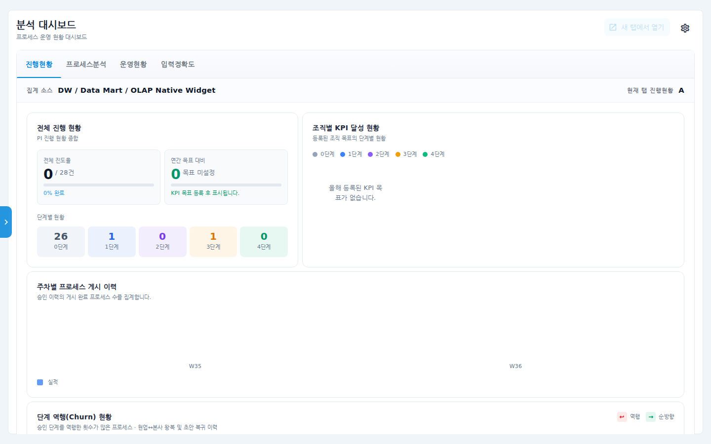
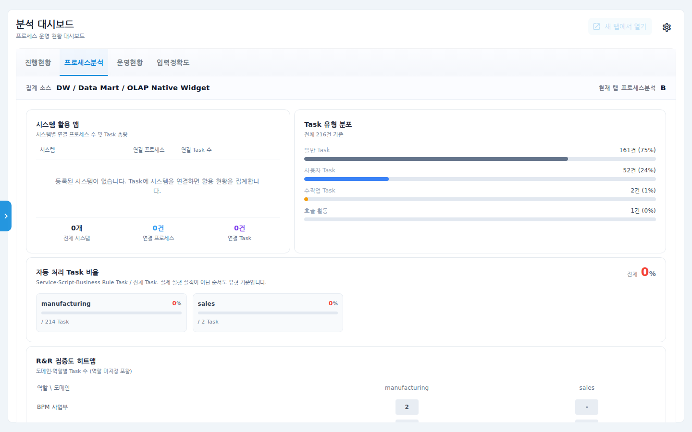
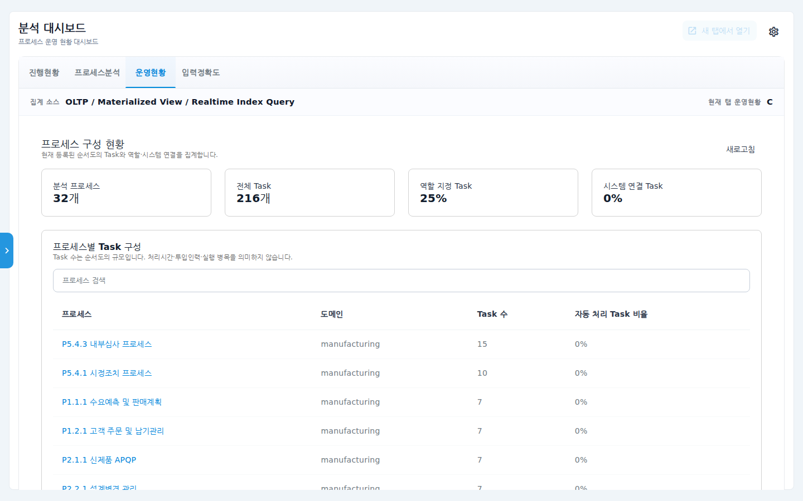
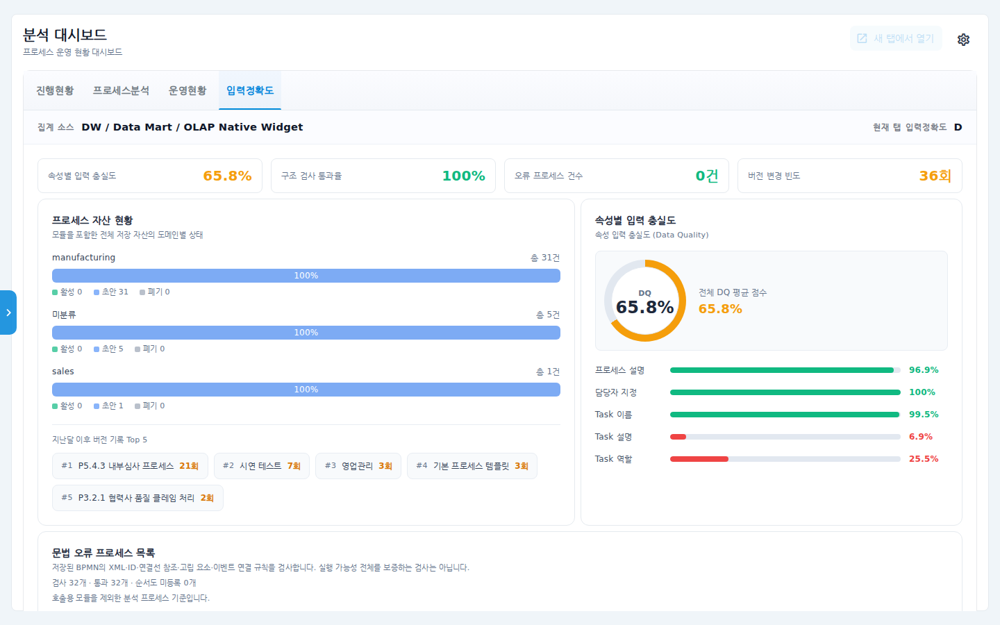

# 분석 대시보드 사용 매뉴얼

프로세스 운영 현황을 한 화면에서 보는 대시보드입니다. 기본으로
**진행현황 · 프로세스분석 · 운영현황 · 입력정확도** 4개 탭이 제공되며,
관리자는 탭 구성을 직접 바꿀 수 있습니다(Grafana 보드 연결 포함).

## 시나리오 개요

PI 추진 담당자인 여러분은 월간 보고를 앞두고 (1) 전체 프로세스의 단계별
진행 현황, (2) Task 유형·역할 구성, (3) 프로세스 데이터 입력 품질을
확인하려고 합니다.

## 사전 조건

- 검토자(Reviewer) 이상 권한. 좌측 **분석 > 분석 대시보드** 메뉴로 진입합니다.
- 탭 설정(톱니 아이콘)과 Grafana 연결 보드는 관리자(Admin) 전용입니다.

## 단계별 따라 하기

### 1. 진행현황 탭

1. 좌측 메뉴 **분석 대시보드**를 클릭합니다. 첫 탭 **진행현황**이 열립니다.

   

   - **전체 진행 현황** — PI 진행 진도율과 단계별(0~4단계) 프로세스 수.
   - **조직별 KPI 달성 현황** — 등록된 KPI 목표의 단계별 현황.
   - **주차별 프로세스 게시 이력**, **단계 역행(Churn) 현황** 등 승인 흐름
     지표가 이어집니다.

### 2. 프로세스분석 탭

2. **프로세스분석** 탭에서는 프로세스 구성의 구조 지표를 봅니다.

   

   - **시스템 활용 맵** — 시스템별 연결 프로세스·Task 수.
   - **Task 유형 분포** — 일반/사용자/수작업 Task와 호출 활동 비율.
   - **자동 처리 Task 비율** — 도메인별 Service·Script·Rule Task 비중.
   - **R&R 집중도 히트맵** — 도메인·역할별 Task 수로 업무 쏠림을 확인.

### 3. 운영현황 탭

3. **운영현황** 탭은 현재 등록된 순서도의 Task·역할·시스템 연결을 실시간
   집계합니다(주기적 자동 새로고침).

   

   - 상단 카드: 분석 프로세스 수, 전체 Task 수, 역할 지정 Task 비율,
     시스템 연결 Task 비율.
   - **프로세스별 Task 구성** 표에서 프로세스명을 클릭하면 해당 순서도로
     이동합니다.

### 4. 입력정확도 탭

4. **입력정확도** 탭은 프로세스 데이터의 입력 품질(Data Quality)을 보여줍니다.

   

   - 상단 카드: 속성별 입력 충실도, 구조 검사 통과율, 오류 프로세스 건수,
     버전 변경 빈도.
   - **속성별 입력 충실도** — 프로세스 설명·담당자·Task 이름/설명/역할 등
     항목별 입력률. 낮은 항목이 보강 대상입니다.
   - **문법 오류 프로세스 목록** — 저장된 순서도의 XML·ID·연결선 규칙 검사
     결과.
   - **프로세스 자산 현황** — 도메인별 활성/초안/폐기 상태와 최근 버전 기록
     Top 5.

### 5. (관리자) 탭 구성 변경

5. 우상단 **톱니(설정)** 아이콘을 누르면 탭 구성 다이얼로그가 열립니다.
   탭 이름·순서를 바꾸거나, Grafana 대시보드 URL을 연결한 embed 탭을 추가할
   수 있습니다. Grafana 탭이 있으면 **새 탭에서 열기** 버튼이 활성화됩니다.
   설정 변경은 활동 로그에 기록됩니다.

## 확인 포인트

- 각 탭 상단의 **집계 소스** 라벨(DW/Data Mart, OLTP/Realtime 등)로 데이터
  출처와 갱신 방식을 확인할 수 있습니다.
- 운영현황 탭의 수치는 순서도를 수정·저장하면 잠시 후 자동으로 반영됩니다.
- 입력정확도의 충실도가 낮은 항목을 클릭 지표로 삼아 순서도 보강 작업을
  계획하세요.

## 자주 묻는 질문

- **메뉴가 안 보여요** — 분석 대시보드는 검토자 이상에게 표시됩니다. 권한을
  확인하세요.
- **KPI 카드가 비어 있어요** — KPI 목표(관리자 > KPI 목표)가 등록돼야 표시됩니다.
