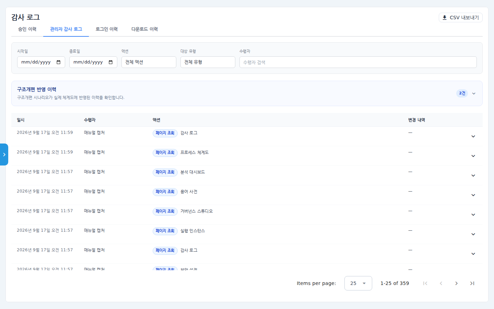
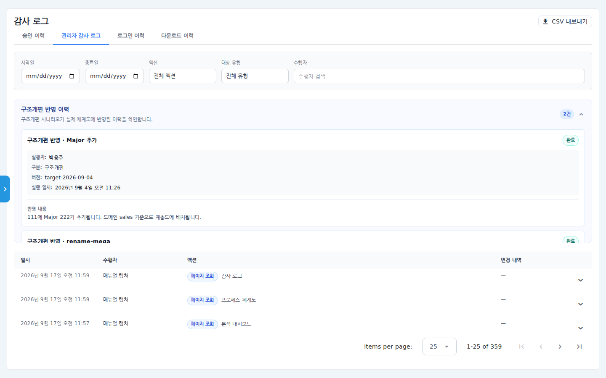
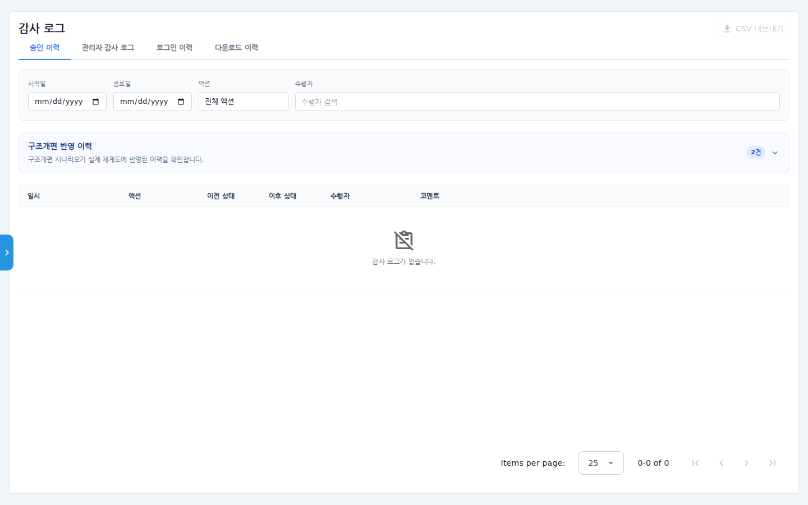
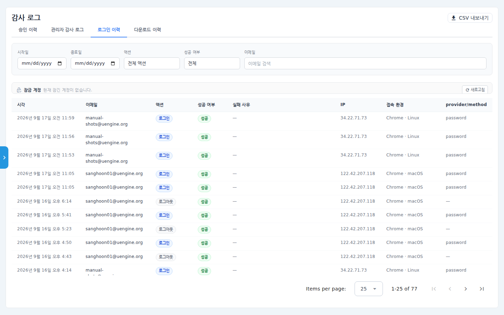
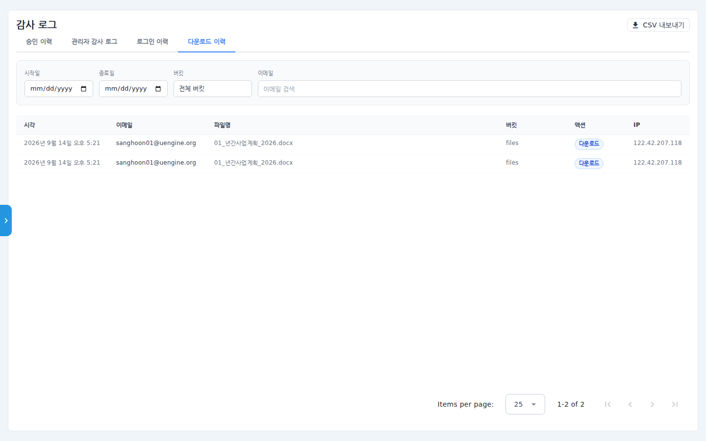

# 감사 로그 사용 매뉴얼

조직 안에서 "누가, 언제, 무엇을 했는지"를 확인하는 관리자 화면입니다.
**승인 이력 · 관리자 감사 로그 · 로그인 이력 · 다운로드 이력** 4개 탭으로
구성되고, 각 탭은 기간·액션·수행자 등으로 걸러 **CSV로 내보낼** 수 있습니다.
구조개편(체계도 개편)이 실제 반영된 이력도 이 화면에서 확인합니다.

## 시나리오 개요

내부 감사 대응으로 관리자인 여러분은 (1) 지난달 관리자들이 어떤 설정을
바꿨는지, (2) 특정 계정의 로그인 실패 기록, (3) 문서 다운로드 이력을
증적으로 제출해야 합니다. 감사 로그 화면에서 탭별로 조회해 CSV로 내려받습니다.

## 사전 조건

- 관리자(Admin) 권한. 좌측 **관리자 > 감사 로그** 메뉴로 진입합니다.

## 단계별 따라 하기

### 1. 관리자 감사 로그 탭

1. 좌측 메뉴 **관리자 > 감사 로그**를 클릭하고 **관리자 감사 로그** 탭을
   선택합니다.

   

   - 필터: 시작일/종료일, 액션, 대상 유형, 수행자 검색.
   - 목록: 일시 / 수행자 / 액션(페이지 조회·설정 변경 등) / 변경 내역.
   - 행 오른쪽 화살표를 펼치면 변경 전후 값과 변경 사유가 표시됩니다.

2. 우상단 **CSV 내보내기**를 누르면 현재 탭의 조회 결과가 CSV 파일로
   저장됩니다. (탭마다 각각 내보낼 수 있습니다.)

### 2. 구조개편 반영 이력

3. 관리자 감사 로그 탭 상단의 **구조개편 반영 이력** 카드를 펼치면,
   구조개편 시나리오가 실제 체계도에 반영된 이력(실행자·구분·버전·실행 일시·
   반영 내용)이 표시됩니다.

   

### 3. 승인 이력 탭

4. **승인 이력** 탭은 프로세스 승인 단계 변화(액션, 이전 상태 → 이후 상태,
   수행자, 코멘트)를 보여줍니다.

   

### 4. 로그인 이력 탭

5. **로그인 이력** 탭에서 로그인/로그아웃/로그인 실패/SSO 로그인 기록을
   확인합니다.

   

   - 컬럼: 시각·이메일·액션·성공 여부·실패 사유·IP·접속 환경(브라우저/OS)·
     인증 방식(provider/method).
   - 필터에 **성공 여부**와 이메일 검색이 추가로 제공됩니다.
   - 목록 위 **잠금 계정** 영역에서 현재 잠긴 계정을 확인하고 해제할 수
     있습니다. (잠금 정책은 보안 설정 매뉴얼 참고)

### 5. 다운로드 이력 탭

6. **다운로드 이력** 탭은 파일 다운로드 기록(누가 어떤 파일을 언제)을
   보여줍니다. 다운로드 이상 탐지 알림을 받았을 때 상세 확인 용도로 씁니다.

   

## 확인 포인트

- 필터를 적용하면 목록 하단의 전체 건수(1-25 of N)가 조건에 맞게 줄어듭니다.
- CSV 내보내기 파일에는 화면과 같은 조건의 데이터가 담깁니다.
- 보안 설정을 바꾼 직후 관리자 감사 로그 탭에 해당 변경이 기록되는지로
  로그 수집이 정상인지 확인할 수 있습니다.

## 자주 묻는 질문

- **오래된 기록이 안 보여요** — 보안 설정의 "감사 로그 보관 정책" 기간이 지난
  기록은 보관용 테이블로 이관됩니다(삭제 아님). 필요 시 관리자에게 이관 데이터
  조회를 요청하세요.
- **승인 이력이 비어 있어요** — 아직 승인 단계 변화(상신/승인/반려)가 발생하지
  않은 조직에서는 비어 있는 것이 정상입니다.
