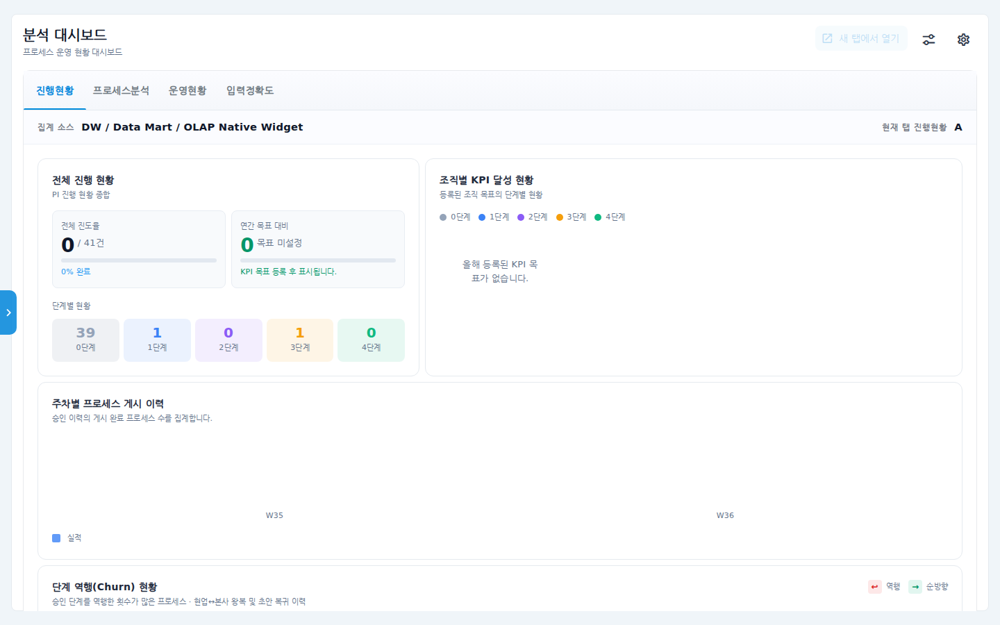
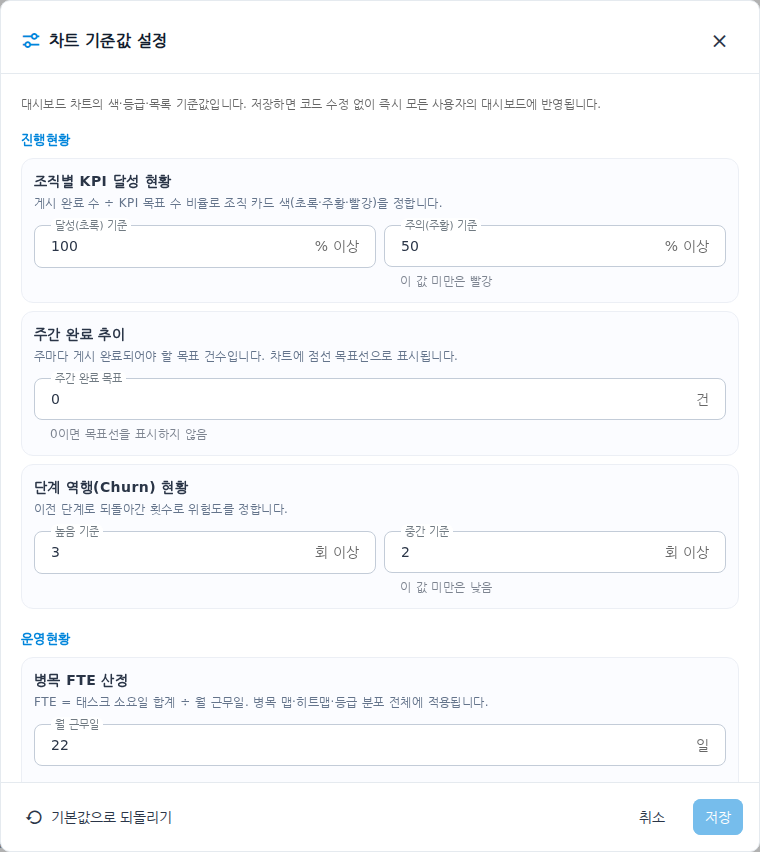
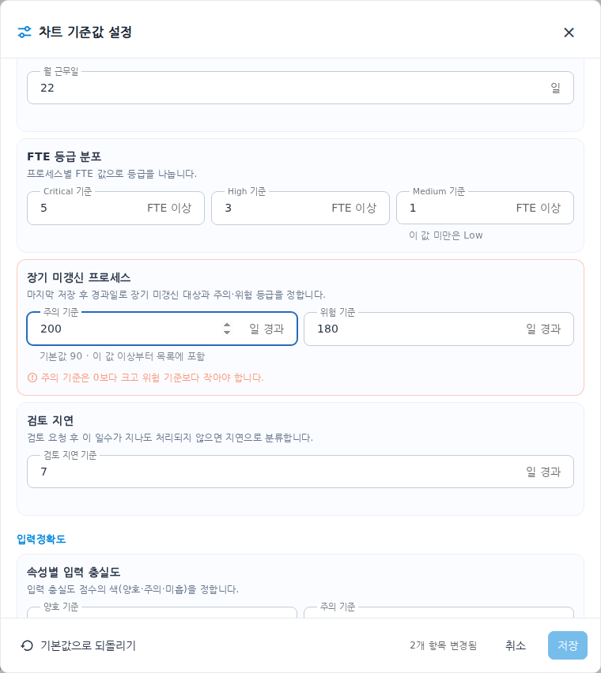
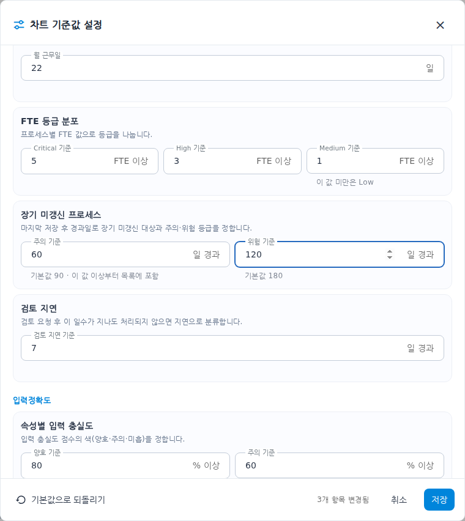
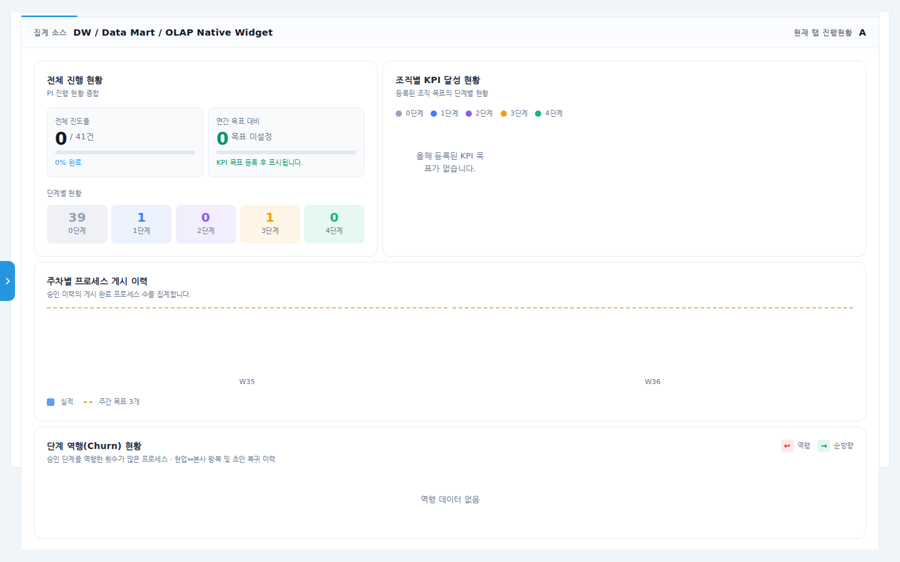
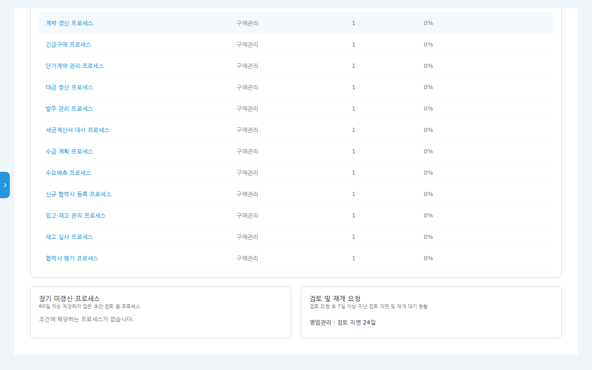
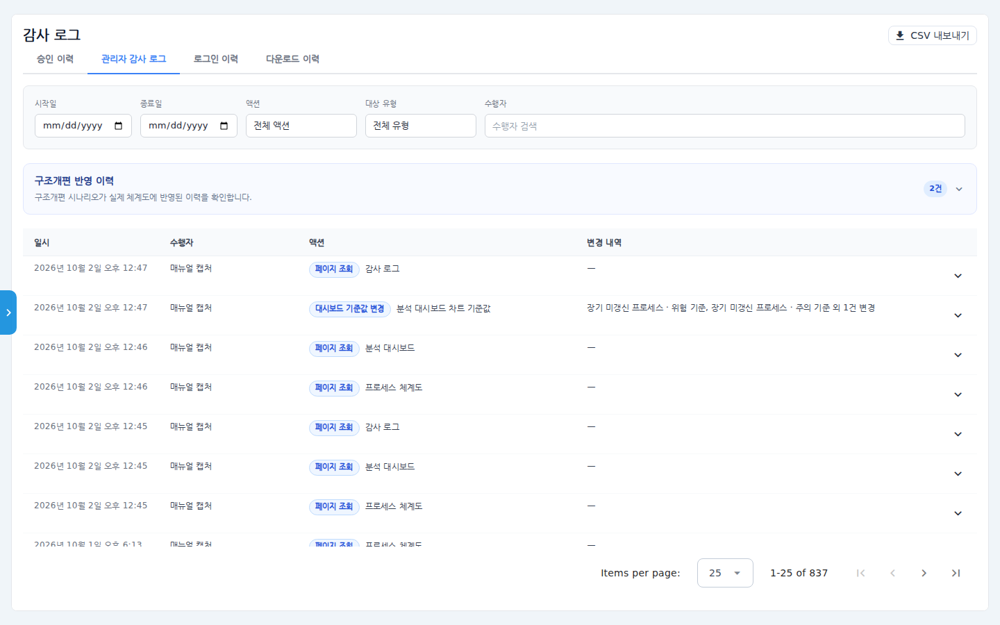
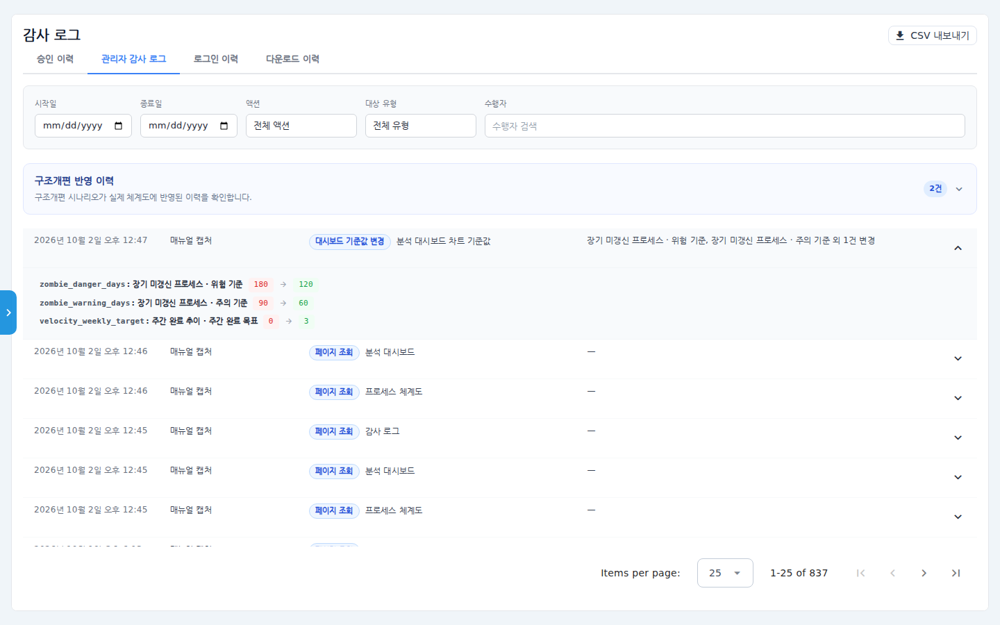

# 분석 대시보드 차트 기준값 설정 매뉴얼

분석 대시보드의 차트는 몇 가지 **기준값**으로 색·등급·목록을 정합니다.
"90일 넘게 수정되지 않은 프로세스는 주의", "KPI 달성률 50% 미만은 빨강" 같은 값입니다.
이제 관리자가 이 기준값을 화면에서 직접 바꿀 수 있습니다.
바꾼 값은 저장 즉시 모든 사용자의 대시보드에 반영되고, 누가 언제 무엇을 바꿨는지
**감사 로그**에 자동으로 남습니다.

## 시나리오 개요

품질팀은 올해부터 "장기 미갱신" 기준을 90일에서 **60일**로, "위험" 기준을 180일에서
**120일**로 앞당기기로 했습니다. 또 매주 프로세스 **3건**을 게시하는 목표를 세웠습니다.
관리자인 여러분은 분석 대시보드에서 기준값을 바꾸고, 차트에 반영됐는지 확인한 뒤,
감사 로그에서 변경 이력을 확인합니다.

## 사전 조건

- **관리자(Admin)** 권한. 관리자가 아니면 기준값 버튼이 보이지 않습니다.
- 좌측 메뉴 **분석 대시보드**에 들어갈 수 있어야 합니다.

## 바꿀 수 있는 기준값

| 대시보드 탭 | 차트 | 기준값 | 기본값 |
|---|---|---|---|
| 진행현황 | 조직별 KPI 달성 현황 | 달성(초록) / 주의(주황) 기준 | 100% / 50% |
| 진행현황 | 주간 완료 추이 | 주간 완료 목표 (0이면 목표선 없음) | 0건 |
| 진행현황 | 단계 역행(Churn) 현황 | 높음 / 중간 기준 | 3회 / 2회 |
| 운영현황 | 병목 FTE 산정 | 월 근무일 | 22일 |
| 운영현황 | FTE 등급 분포 | Critical / High / Medium 기준 | 5 / 3 / 1 FTE |
| 운영현황 | 장기 미갱신 프로세스 | 주의 / 위험 기준 | 90일 / 180일 |
| 운영현황 | 검토 지연 | 검토 지연 기준 | 7일 |
| 입력정확도 | 속성별 입력 충실도 | 양호 / 주의 기준 | 80% / 60% |

## 단계별 따라 하기

### 1. 기준값 설정 창 열기

1. 좌측 메뉴 **분석 대시보드**를 클릭합니다.
2. 화면 오른쪽 위 **톱니바퀴 왼쪽에 있는 조절 아이콘**(가로 막대 두 개)을 누릅니다.
   마우스를 올리면 "차트 기준값 설정"이라고 표시됩니다.

   

3. **차트 기준값 설정** 창이 열립니다. 기준값이 대시보드 탭(진행현황·운영현황·
   입력정확도)별로, 차트마다 묶여 있습니다. 각 묶음 위에 그 값이 어떤 차트에서
   무엇을 정하는지 설명이 있습니다.

   

### 2. 기준값 바꾸기

4. **진행현황 › 주간 완료 추이**의 **주간 완료 목표**에 `3`을 입력합니다.
5. 창을 아래로 내려 **운영현황 › 장기 미갱신 프로세스**의 **주의 기준**을 바꿉니다.
   규칙에 맞지 않는 값을 넣으면 묶음 테두리가 빨갛게 바뀌고 아래에 이유가
   표시되며, **저장** 버튼이 눌리지 않습니다. 예를 들어 주의 기준(200)이 위험
   기준(180)보다 크면 아래처럼 표시됩니다.

   

6. 주의 기준을 `60`, 위험 기준을 `120`으로 입력합니다. 기본값과 다른 칸 아래에는
   "기본값 90"처럼 원래 값이 함께 표시되고, 아래쪽에 변경된 항목 수가 나옵니다.

   

7. 오른쪽 아래 **저장**을 누릅니다. 창이 닫히고 대시보드가 새 기준으로 다시
   계산됩니다.

> 처음 값으로 돌아가고 싶으면 창 왼쪽 아래 **기본값으로 되돌리기**를 누른 뒤
> **저장**합니다.

### 3. 차트에 반영됐는지 보기

8. **진행현황** 탭의 **주차별 프로세스 게시 이력** 차트에 주황색 점선
   **목표선**이 생기고, 범례에 "주간 목표 3개"가 표시됩니다.

   

9. **운영현황** 탭 아래쪽 **장기 미갱신 프로세스** 카드 설명이 "60일 이상 저장하지
   않은…"으로 바뀌고, 목록도 60일 기준으로 다시 뽑힙니다.

   

### 4. 감사 로그에서 변경 이력 보기

10. 좌측 메뉴 **관리자 › 감사 로그**로 이동해 **관리자 감사 로그** 탭을 엽니다.
    액션이 **대시보드 기준값 변경**인 행이 보입니다. 수행자는 저장한 관리자,
    변경 내역에는 바뀐 항목 이름이 표시됩니다.

    

11. 행 오른쪽 화살표를 펼치면 항목별 **이전 값 → 새 값**이 표시됩니다.
    실제로 바뀐 항목만 기록됩니다.

    

## 확인 포인트

- 다른 사용자(관리자가 아닌 사용자 포함)가 대시보드를 새로 열어도 같은 기준이 적용됩니다.
- 감사 로그에 저장 1번당 **대시보드 기준값 변경** 1건이 남습니다. 값을 하나도 바꾸지
  않으면 저장 버튼이 눌리지 않고, 로그도 남지 않습니다.
- 대상 유형 필터에서 **대시보드 차트 기준값**을 고르면 기준값 이력만 볼 수 있습니다.

## 자주 묻는 질문

**Q. 조절 아이콘이 보이지 않습니다.**
관리자 권한이 있어야 보입니다. 권한은 관리자에게 요청하세요.

**Q. 저장 버튼이 눌리지 않습니다.**
빨갛게 표시된 묶음이 있는지 확인하세요. "주의 < 위험", "Critical > High > Medium" 처럼
값 사이의 순서가 맞아야 합니다. 바꾼 값이 하나도 없어도 눌리지 않습니다.

**Q. 기준값을 바꿨는데 어떤 차트는 그대로입니다.**
기준값은 색·등급·목록 범위만 바꿉니다. 해당 조건에 맞는 프로세스가 없으면 화면이
달라지지 않을 수 있습니다(예: 60일 넘게 저장되지 않은 프로세스가 없으면 장기 미갱신
목록은 그대로 비어 있습니다).

**Q. "대시보드 기준값 초기화"라는 이력은 무엇인가요?**
저장된 기준값 설정이 통째로 지워져 기본값으로 돌아간 경우입니다. 이때도 기본값과
달랐던 항목의 이전 값이 함께 기록됩니다.
