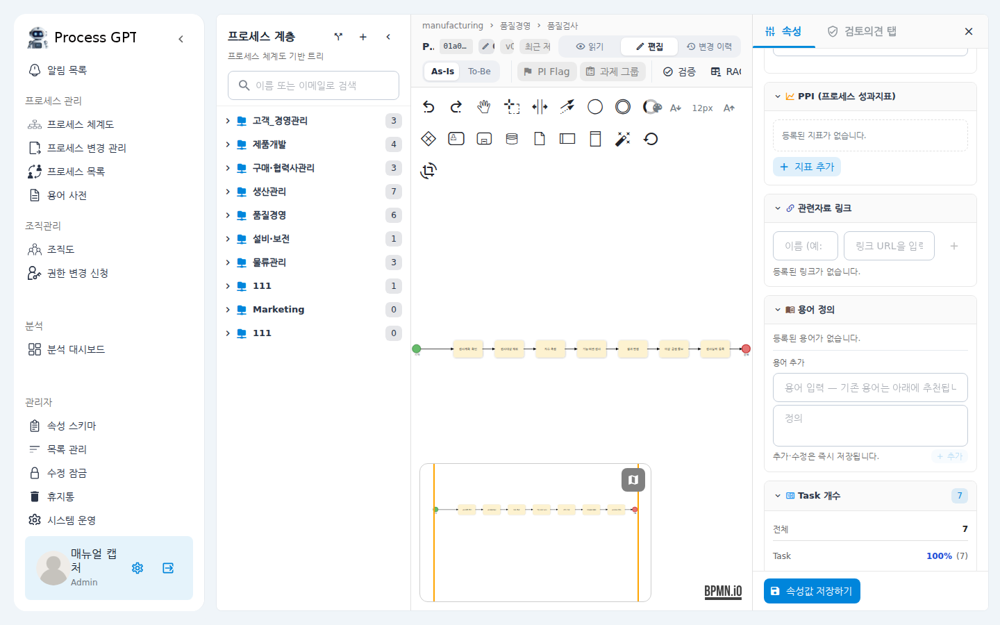
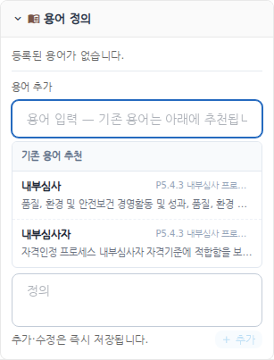
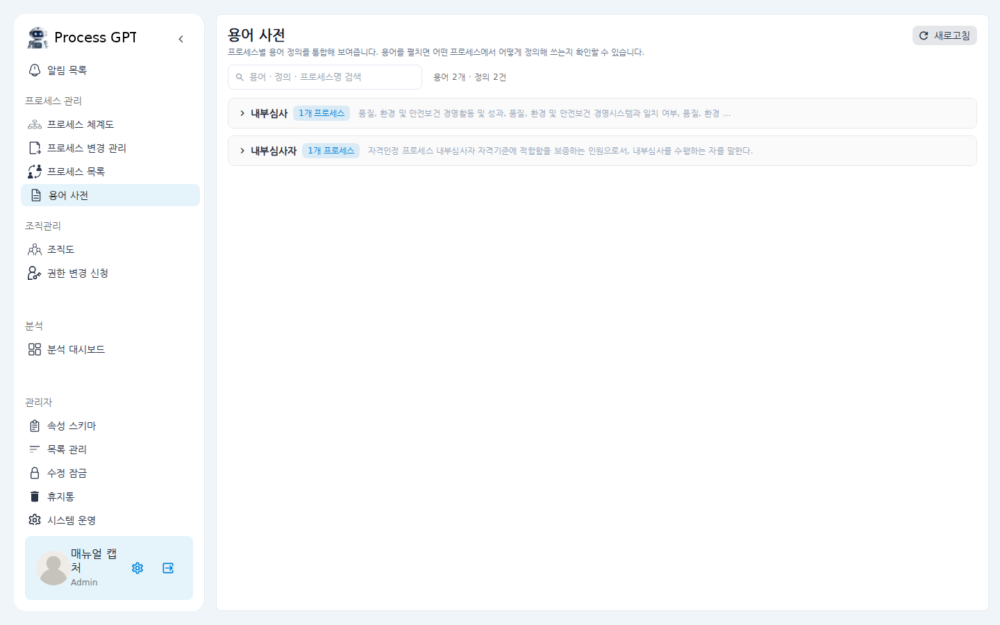
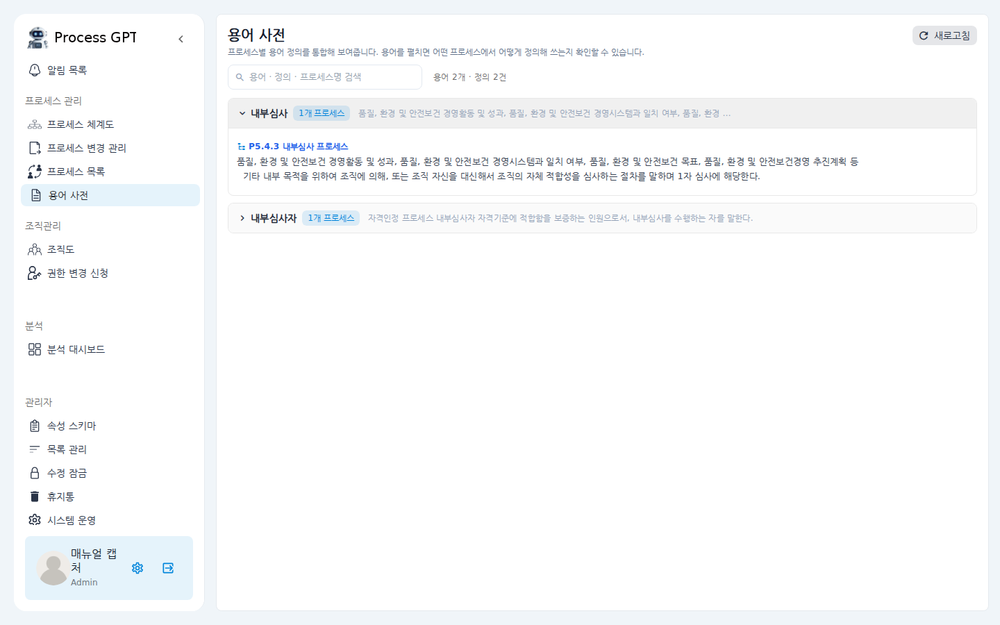

# 용어 사전 사용 매뉴얼

프로세스 규정서에 들어가는 "용어 정의" 표를 시스템에서 관리하는 기능입니다.
각 프로세스 화면에서 그 프로세스가 쓰는 용어를 정의해 두면, 조직 전체의 용어가
**용어 사전** 한 곳에 모여 어떤 프로세스가 어떤 의미로 쓰는지 한눈에 볼 수 있습니다.
이미 다른 프로세스에서 정의한 용어는 다시 입력할 필요 없이 골라서 재사용합니다.

## 시나리오 개요

품질팀의 여러분은 "공정검사" 프로세스 문서를 정리하고 있습니다. 규정서마다 있던
[용어 | 정의] 표를 시스템에 옮기려는데, "내부심사" 같은 용어는 이미 내부심사
프로세스에서 정의되어 있습니다. 새로 타이핑하는 대신 기존 정의를 불러와 쓰고,
전체 용어는 용어 사전에서 통합해 확인하려고 합니다.

## 사전 조건

- 프로세스 편집 권한이 있어야 용어를 추가·수정할 수 있습니다.
  (읽기 모드에서는 등록된 용어 목록만 보입니다.)
- 용어 사전 보기는 구성원 누구나 가능합니다.

---

## 프로세스에 용어 정의하기

1. 좌측 메뉴에서 **프로세스 체계도**를 클릭하고, 용어를 정의할 프로세스를 열어
   **편집** 모드로 전환합니다.

2. 우측 속성 패널(Process 탭)을 아래로 내리면 **용어 정의** 섹션이 있습니다.
   여기에 이 프로세스에서 쓰는 용어 목록과 **용어 추가** 입력란이 표시됩니다.

   

3. **용어** 입력란을 클릭하면 아래에 **기존 용어 추천** 목록이 나타납니다.
   입력 전에는 조직에 등록된 용어 전체가, 입력을 시작하면 일치하는 용어만
   좁혀져 보입니다. 각 항목에는 정의 미리보기와 출처 프로세스명이 함께 표시됩니다.

   

4. 추천 항목을 클릭하면 **용어와 정의가 자동으로 채워집니다**(용어 재사용).
   어느 프로세스의 정의를 불러왔는지 입력란 아래에 안내됩니다.
   새 용어라면 용어와 정의를 직접 입력합니다.

5. **추가**를 클릭합니다. 추가·수정·삭제는 프로세스 저장 버튼과 무관하게
   **즉시 저장**됩니다. 등록된 용어는 목록에 나타나고 연필(수정)·휴지통(삭제)
   아이콘으로 관리합니다.

> 참고: 같은 프로세스 안에서 같은 용어를 중복 등록할 수는 없습니다.
> 이미 등록된 용어는 추천 목록에 "이 프로세스에 등록됨"으로 표시됩니다.

---

## 통합 용어 사전 보기

1. 좌측 메뉴에서 **용어 사전**을 클릭합니다.
   조직의 모든 프로세스에서 정의한 용어가 용어 단위로 묶여 표시되고,
   상단 검색창으로 용어·정의·프로세스명을 검색할 수 있습니다.

   

2. 용어 행을 클릭해 펼치면, 그 용어를 **어떤 프로세스에서 어떻게 정의해 쓰는지**
   프로세스별 정의가 나열됩니다. 같은 용어가 여러 프로세스에 정의되어 있으면
   용어 옆 숫자 칩("N개 프로세스")으로 표시됩니다.

   

3. 파란 프로세스명을 클릭하면 그 프로세스의 화면으로 바로 이동합니다.

---

## 확인 포인트

- 프로세스에서 용어를 추가하면 새로고침 없이 목록에 바로 나타나고,
  **용어 사전** 페이지에도 즉시 반영됩니다.
- 다른 프로세스에서 같은 용어를 재사용해 등록하면, 용어 사전에서 그 용어의
  숫자 칩이 "2개 프로세스"로 늘어나고 펼쳤을 때 두 정의가 모두 보입니다.
- 편집을 마치고 읽기 모드로 돌아가도 용어 목록은 계속 표시됩니다
  (입력란과 수정·삭제 버튼만 사라집니다).

## 자주 묻는 질문

- **용어 정의 섹션이 안 보여요.**
  속성 패널의 Process 탭에서 아래로 스크롤하세요. 섹션 제목을 클릭해 접었다
  펼 수 있습니다. 그래도 없다면 관리자에게 속성 노출 설정을 확인해 달라고 요청하세요.
- **띄어쓰기나 대소문자가 조금 다르면 다른 용어인가요?**
  아니요. 공백과 대소문자를 무시하고 같은 용어로 묶입니다
  (예: `FA(Focus Area)`와 ` fa(focus area) `는 같은 용어).
- **용어를 지우면 다른 프로세스의 정의도 지워지나요?**
  아니요. 용어는 프로세스별로 저장되므로, 한 프로세스에서 삭제해도
  다른 프로세스의 정의는 남아 있습니다.
