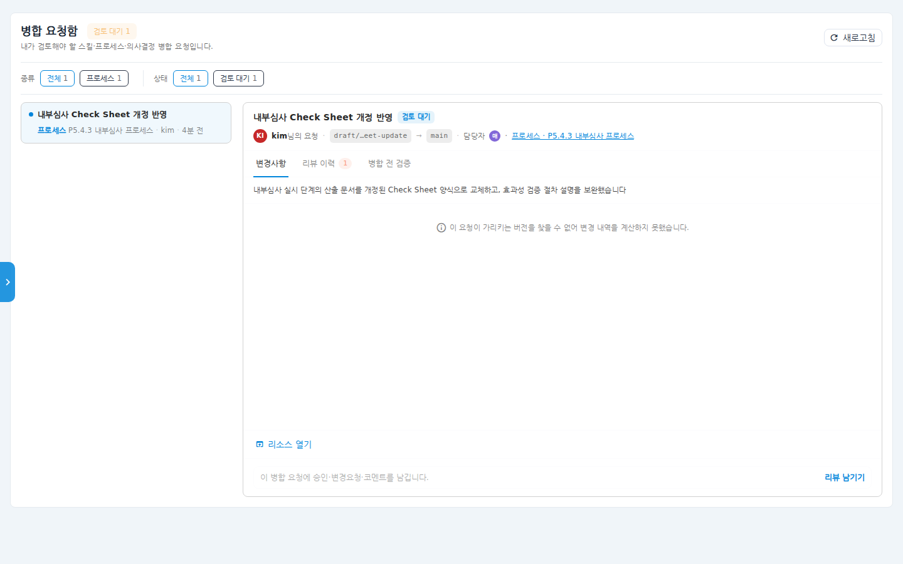
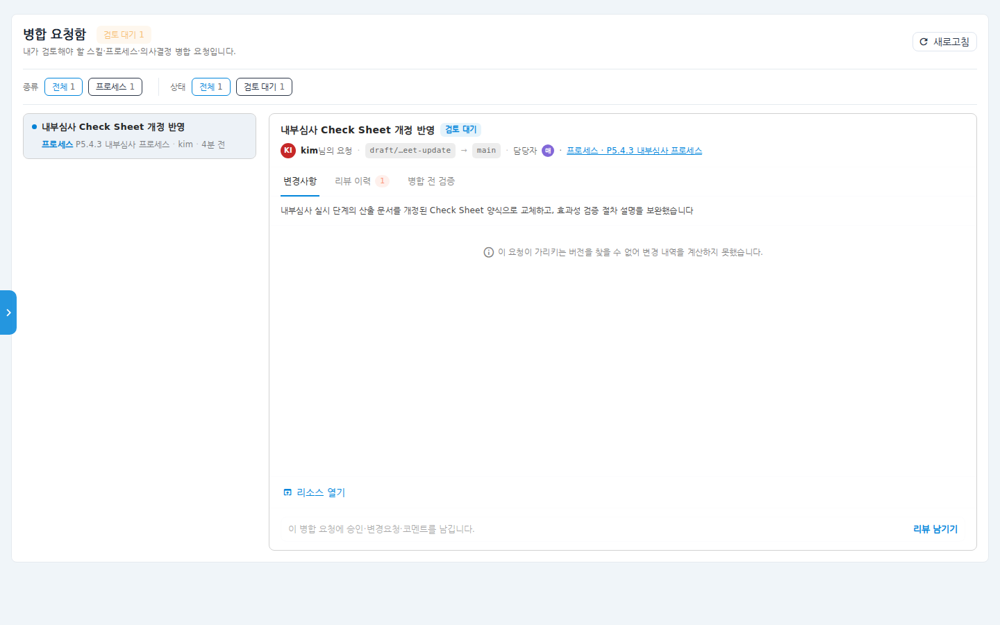
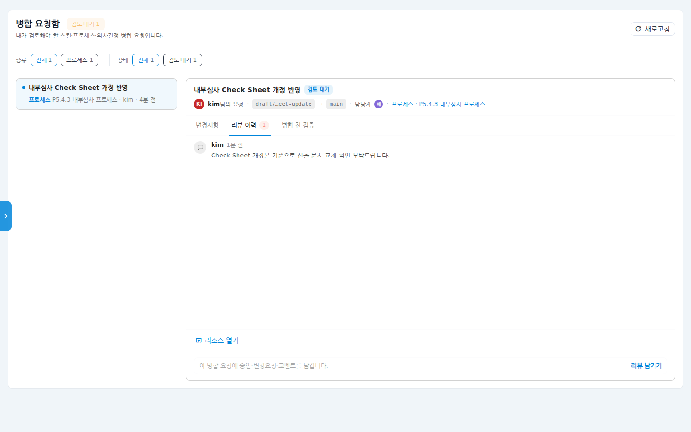
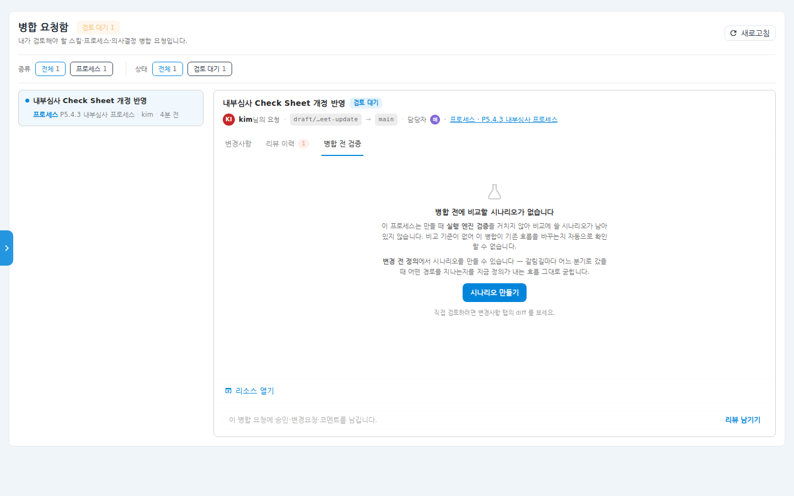

# 병합 요청함 사용 매뉴얼

다른 사용자가 제안한 **스킬·프로세스·의사결정(DMN) 변경안**을 검토하고
승인·병합하는 화면입니다. 내가 검토해야 할 병합 요청이 한 화면에 모이므로,
리소스마다 이력 화면을 찾아다니지 않아도 됩니다. 병합 전에 기존 동작이
깨지는지 확인하는 **병합 전 검증**도 여기서 실행합니다.

## 시나리오 개요

동료가 "P5.4.3 내부심사 프로세스"의 산출 문서를 개정된 Check Sheet 양식으로
바꾸는 변경안을 올렸고, 프로세스 소유자인 여러분에게 검토 요청이 왔습니다.
알림을 받고 병합 요청함에 들어가 변경 내용을 확인한 뒤 승인하려고 합니다.

## 사전 조건

- 검토 대상 리소스의 **소유자(담당자)** 여야 목록에 검토 요청이 나타납니다.
  (소유자가 지정되지 않은 리소스는 누구나 검토할 수 있습니다.)
- 화면 주소는 `/merge-requests` 입니다. **좌측 메뉴에는 항목이 없으므로**
  알림(병합 요청 알림 클릭) 또는 주소 직접 입력으로 진입합니다.

## 단계별 따라 하기

### 1. 병합 요청함 열기

1. 알림에서 **[PROCESS] 병합 요청** 알림을 클릭하거나 주소창에
   `/merge-requests`를 입력합니다.

   

   - 제목 옆에 **검토 대기 N** 칩이 표시됩니다.
   - **종류**(스킬/프로세스/의사결정)와 **상태**(검토 대기/변경 요청됨/승인됨 등)
     칩으로 목록을 거릅니다.
   - 좌측 목록 카드에는 "무엇이 바뀌는가" 요약과 리소스명·요청자·경과 시간이
     표시됩니다.

### 2. 변경사항 검토

2. 목록에서 요청을 클릭하면 우측에 상세가 열립니다. 상단에 요청자, 변경
   브랜치 → 기준 브랜치, 담당자, 대상 리소스 링크가 보입니다.

   

   - **변경사항** 탭 — 변경 설명과 변경 내역(diff)을 확인합니다.
   - **리소스 열기**를 누르면 해당 프로세스/스킬 화면으로 이동해 전체 맥락을
     볼 수 있습니다.

3. **리뷰 이력** 탭에서 지금까지의 승인·변경 요청·코멘트 흐름을 확인합니다.

   

### 3. 병합 전 검증

4. **병합 전 검증** 탭은 이 변경이 기존 동작을 깨뜨리는지 자동으로 비교합니다.

   

   - 비교할 시나리오가 이미 있으면 깨진 단계 수가 칩으로 표시되고, 병합 버튼
     위에도 "이 병합은 기존 동작 N개 단계를 깨뜨립니다" 배너가 나타납니다.
   - 비교 기준이 없으면 위 화면처럼 **시나리오 만들기** 안내가 나옵니다.
     변경 전 정의에서 시나리오를 만들어 두면 이후 병합부터 자동 검증이 됩니다.

### 4. 리뷰 남기고 병합

5. 하단 **리뷰 남기기**를 눌러 **승인** 또는 **변경 요청**과 코멘트를 남깁니다.

6. 병합 실행은 리소스 종류에 따라 다릅니다.
   - **스킬** — 승인 완료(APPROVED) 상태가 되면 이 화면의 **병합** 버튼으로
     바로 병합합니다.
   - **프로세스·의사결정** — 검토·승인까지 여기서 하고, 실제 반영은 해당
     리소스 화면의 버전 이력에서 진행합니다(화면에 안내가 표시됩니다).

## 확인 포인트

- 검토를 마치면 목록 카드의 상태 칩이 **승인됨** 또는 **변경 요청됨**으로
  바뀝니다.
- 리뷰 이력 탭에 내 리뷰가 시간순으로 기록됩니다.
- 병합이 끝난 요청은 상태 필터 **병합·닫힘**에서 확인할 수 있습니다.

## 자주 묻는 질문

- **목록이 비어 있어요** — 이 화면은 "내가 검토할" 요청만 보여줍니다. 내가
  소유한 리소스에 대한 요청이 없으면 비어 있는 것이 정상입니다.
- **좌측 메뉴에서 못 찾겠어요** — 병합 요청함은 사이드바 메뉴에 없습니다.
  알림으로 진입하거나 주소(`/merge-requests`)를 즐겨찾기에 등록해 두세요.
