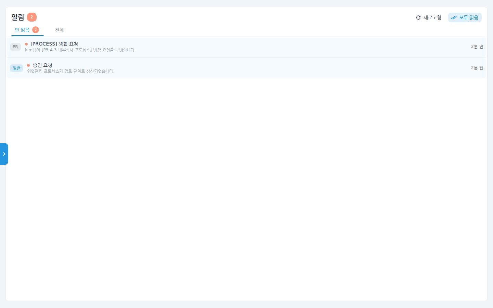
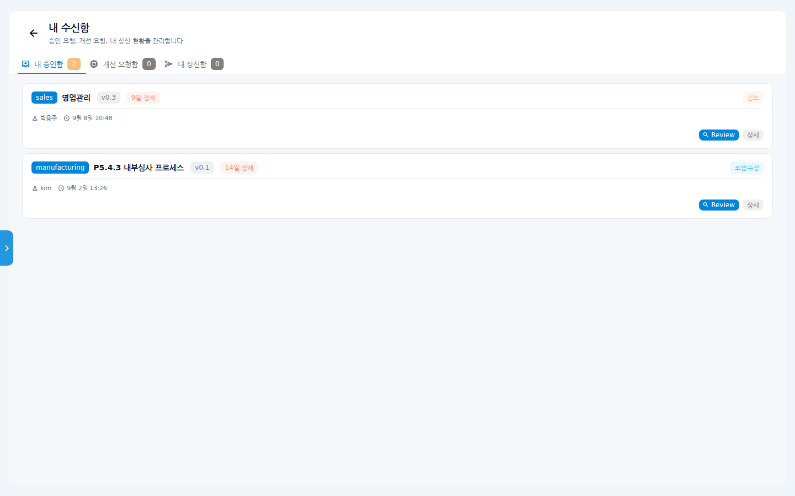
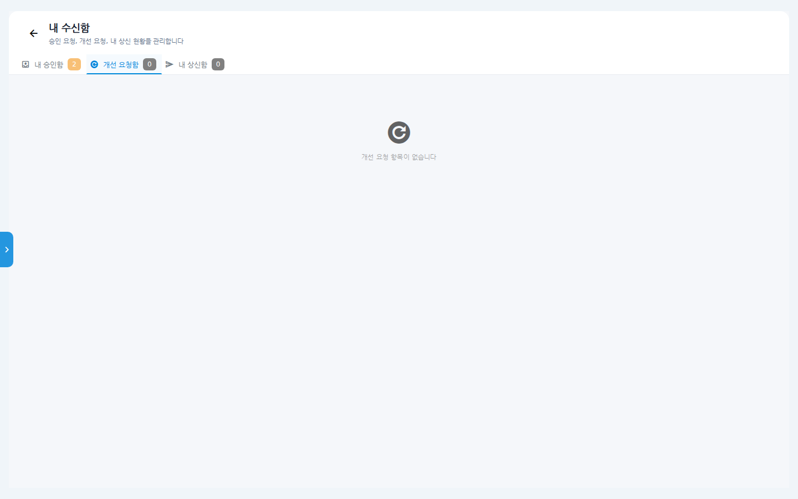
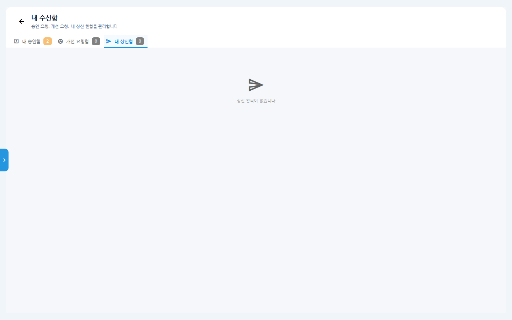

# 알림과 내 수신함 사용 매뉴얼

나에게 온 소식과 처리할 일을 확인하는 두 화면을 설명합니다.

- **알림** — 병합 요청, 승인 요청, 시스템 공지 등 나에게 온 알림 모음.
- **내 수신함** — 내가 승인해야 할 프로세스, 받은 개선 요청, 내가 상신한
  건의 진행 상태.

## 시나리오 개요

출근한 여러분은 어제 온 소식을 확인하려고 합니다. 알림에서 병합 요청 알림을
확인해 검토 화면으로 이동하고, 내 수신함에서 승인 대기 중인 프로세스를
처리하려고 합니다.

## 사전 조건

- 로그인만 하면 누구나 사용할 수 있습니다.
- 알림 진입: 좌측 메뉴의 **알림 목록**(종 아이콘). 새 알림이 있으면 배지가
  붙습니다. 메뉴 클릭 시 작은 패널이 열리고, **전체 알림 보기**를 누르면
  전체 페이지로 이동합니다.
- 내 수신함 진입: 프로세스 변경 관리(리뷰보드) 화면의 뒤로가기(←) 버튼 또는
  주소 `/my-inbox`.

## 단계별 따라 하기

### 1. 알림 확인

1. 좌측 메뉴 **알림 목록**을 클릭하고 **전체 알림 보기**를 누르면 알림
   페이지가 열립니다.

   

   - **안 읽음** / **전체** 탭으로 전환합니다. 제목 옆 숫자가 미읽음 건수입니다.
   - 알림을 클릭하면 관련 화면(예: 병합 요청함)으로 바로 이동하며 읽음
     처리됩니다.
   - 우상단 **새로고침**, **모두 읽음** 버튼을 사용할 수 있습니다.

### 2. 내 수신함 — 내 승인함

2. `/my-inbox`로 이동하면 **내 승인함** 탭이 열립니다. 내가 승인(검토)해야 할
   프로세스가 단계 배지(검토/최종수정 등), 정체 일수와 함께 나열됩니다.

   

   - **Review** 버튼 — 검토 화면으로 이동해 내용을 확인하고 승인·반려합니다.
   - **상세** 버튼 — 프로세스 상세를 봅니다.
   - "N일 정체" 표시로 오래 머문 건을 먼저 처리할 수 있습니다.

### 3. 개선 요청함

3. **개선 요청함** 탭에는 내가 담당한 프로세스에 접수된 개선 요청이
   모입니다. 항목을 열어 내용을 확인하고 처리 상태를 관리합니다.

   

### 4. 내 상신함

4. **내 상신함** 탭에서는 내가 상신(제출)한 프로세스의 진행 상태를
   추적합니다. 어느 단계에서 누구 승인을 기다리는지 확인할 수 있습니다.

   

## 확인 포인트

- 알림에서 항목을 클릭하면 해당 업무 화면으로 정확히 이동해야 합니다.
- 내 승인함에서 승인/반려를 마치면 목록에서 사라지고 탭의 건수 배지가
  줄어듭니다.
- 처리한 알림은 **전체** 탭에 읽음 상태로 남습니다.

## 자주 묻는 질문

- **병합 요청 알림은 어디로 연결되나요?** — 병합 요청함(`/merge-requests`)으로
  이동합니다. 병합 요청함은 사이드바에 메뉴가 없으므로 알림이 주 진입로입니다.
- **내 승인함과 리뷰보드의 차이는?** — 리뷰보드는 조직 전체의 리뷰 대상을
  조망하는 화면이고, 내 승인함은 그중 "내가 승인자로 지정된" 건만 모아 줍니다.
