# 프로세스 생성부터 온톨로지 분석까지 — 한 번에 따라 하기

새 프로세스를 만들어 실행하면, 실행 중에 **AI 에이전트가 전략–실행 온톨로지를 조회해 일하고**, 그 실행 기록이 다시
온톨로지에 쌓여 **온톨로지 익스플로러에서 분석**으로 이어집니다. 이 문서는 그 전 과정을 실제 화면 순서대로 안내합니다.
온톨로지 익스플로러 자체의 기본 사용법은 [온톨로지 익스플로러 매뉴얼](ontology-explorer.md),
질문하기·영향 가설·시점은 [온톨로지 익스플로러 — 질문하기 · 영향 가설 · 시점](ontology-graph-platform.md)을 보세요.

🎬 **영상으로 보기**: [video/ontology-e2e-guide.mp4](video/ontology-e2e-guide.mp4) (약 3분 50초, 한국어 나레이션 ·
자막 [ontology-e2e-guide.srt](video/ontology-e2e-guide.srt))

| 단계 | 화면 | 하는 일 |
|---|---|---|
| ① 프로세스 생성 | 프로세스 체계도 · 순서도 | BPMN 업로드로 만들고 버전 저장 |
| ② 전략 연결 | 전략 보드 | KPI 를 추가하며 이 프로세스를 연결 |
| ③ 실행 | 업무 화면 | 첫 업무 「점검 요청」 작성·제출 |
| ④ 에이전트 | 인스턴스 · 업무 화면 | 에이전트가 온톨로지 도구로 원인을 분석해 보고 |
| ⑤ 검토 완료 | 업무 화면 | 보고서를 검토하고 제출 → 인스턴스 완료 |
| ⑥ 온톨로지 반영 | 온톨로지 익스플로러 | 새 실행이 전략–KPI–프로세스–담당자 코스로 이어짐 |
| ⑦ 분석 | 온톨로지 익스플로러 | 질문하기 · KPI 원인 분석 |

## 시나리오 개요

구매팀장은 매주 목표에 못 미치는 KPI 하나를 골라 원인을 점검하고 싶습니다. 그래서 **「구매 KPI 주간 점검」** 프로세스를
만듭니다 — 구매팀장이 점검할 KPI 를 적으면, **온톨로지 조회 에이전트**가 전략–실행 온톨로지에서 그 KPI 를 찾아 실행
기록까지 거슬러 올라가 병목과 담당자를 보고하고, 구매팀장이 보고서를 검토합니다. 이 프로세스를 전략 보드의 KPI 와
연결해 두면 점검이 끝날 때마다 실적이 쌓이고, 실행 기록은 온톨로지 익스플로러에서 다른 전략·KPI 와 함께 분석됩니다.

## 사전 조건

- 관리자 권한 계정(프로세스 생성·편집, 전략 보드 편집).
- **온톨로지 조회 에이전트**가 조직에 등록되어 있고, 도구로 전략–실행 온톨로지(MCP 서버 `strategy-ontology`)가 연결되어
  있어야 합니다(관리자 설정 → MCP). 에이전트가 쓰는 LLM 이 설정되어 있어야 에이전트 단계가 진행됩니다.
- 전략 보드에 전략·KPI 가 있고, 분석할 KPI(예: 구매 처리 리드타임)와 이어진 프로세스의 실행 이력이 있어야 분석 결과가
  풍부하게 나옵니다.
- 업로드할 BPMN 파일: [assets/ontology-e2e/purchase-kpi-weekly-review.bpmn](assets/ontology-e2e/purchase-kpi-weekly-review.bpmn)
  (구매팀장 레인 + 온톨로지 조회 에이전트 레인, 에이전트 단계에는 담당 에이전트가 지정되어 있음).

## ① 프로세스 생성

1. 왼쪽 메뉴 **프로세스 체계도** → 오른쪽 위 **편집 모드** → **+ 새 프로세스**를 누릅니다.
2. **프로세스 이름**(구매 KPI 주간 점검)과 설명을 적고, **계층 위치**에서 도메인 · Mega 프로세스 · Major 프로세스를
   고릅니다(구매관리 › 구매 운영 › 구매 실행).

   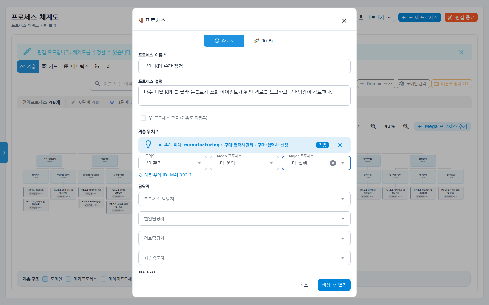

3. 아래로 내려 **생성 방식 → 업로드**를 고르고 BPMN 파일을 선택한 뒤 **생성 후 열기**를 누릅니다.

   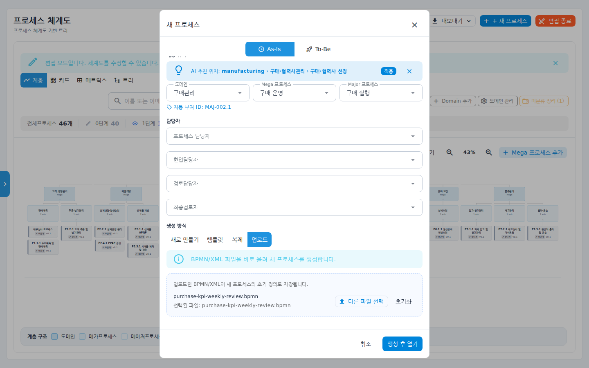

4. 순서도 화면이 열립니다. 위 레인은 **구매팀장**, 아래 레인은 **온톨로지 조회 에이전트**입니다. 톱니 아이콘이 붙은
   「온톨로지 원인 분석」은 **에이전트가 맡는 단계**(서비스 태스크)입니다.

   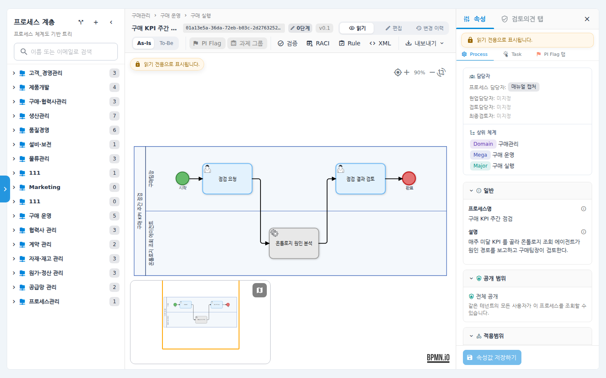

5. **편집** → **저장**을 누르고 변경 사항 메모를 적은 뒤 **저장**합니다. 버전을 저장해야 실행할 수 있는 정의가 만들어집니다.

   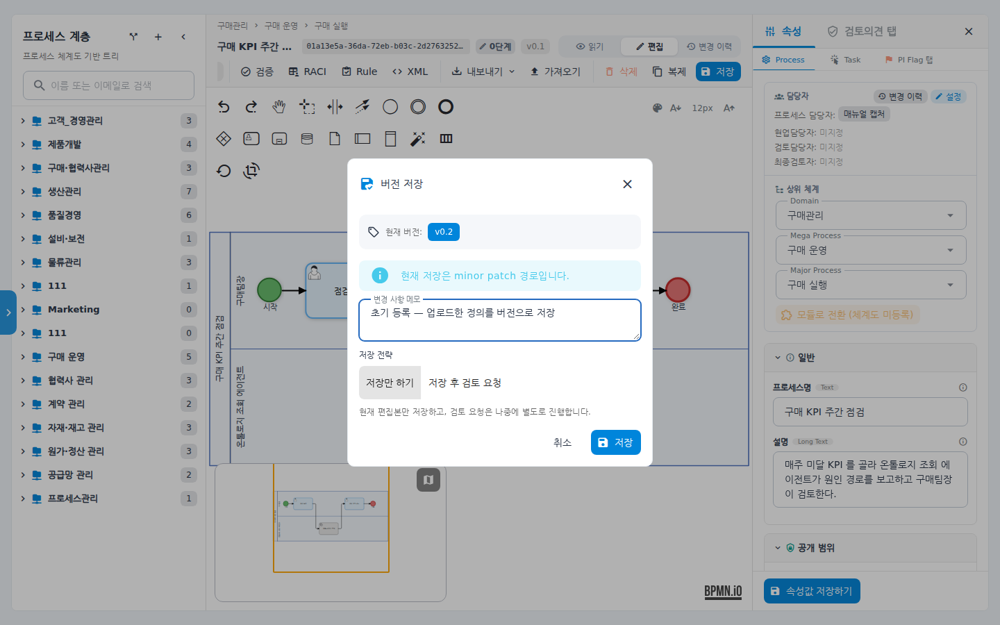

## ② 전략과 잇기

1. 왼쪽 메뉴 **전략 보드** → 전략맵에서 연결할 전략(예: **AI 에이전트 활용 확대**)을 누르고 오른쪽 패널의 **+ KPI 추가**를 누릅니다.
2. 이름(KPI 주간 점검 완료 건수)·설명을 적고 **측정 방식 = 완료 건수**, **연관 프로세스 정의 = 구매 KPI 주간 점검**,
   단위 건 · 기준선 0 · 목표치 4 를 넣고 **저장**합니다.

   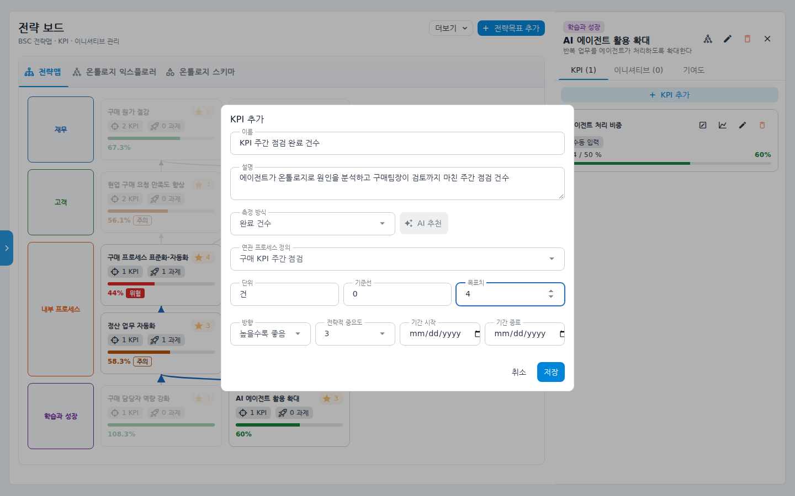

3. KPI 카드에 연관 프로세스가 칩으로 붙습니다. 이제 이 프로세스가 완료될 때마다 실적이 자동으로 쌓입니다(아직 실행 전이라 「미측정」).

   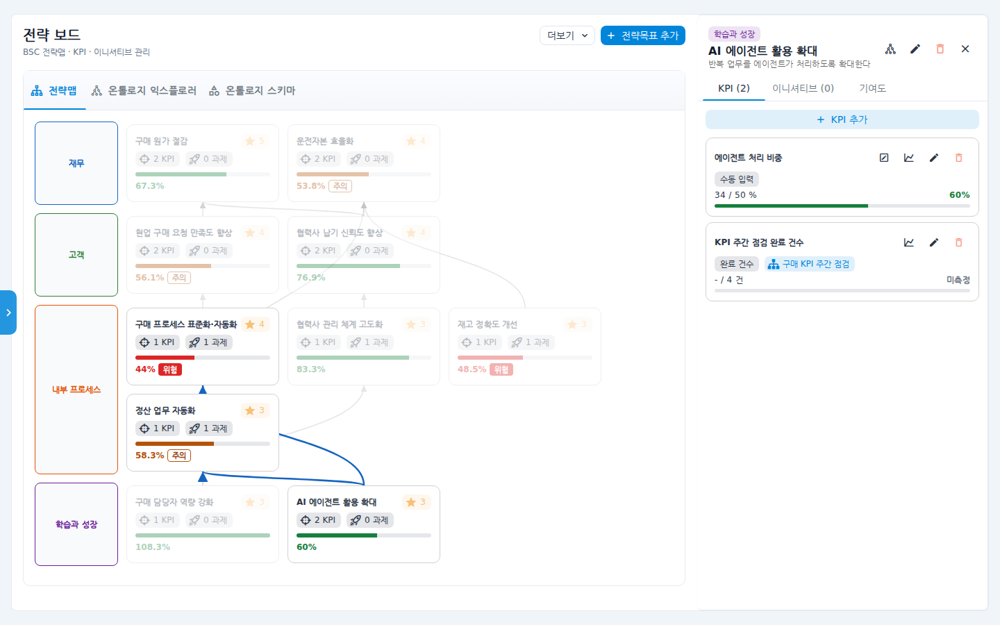

## ③ 실행 — 점검 요청

1. 프로세스를 시작하면 첫 업무 **「점검 요청」**이 구매팀장에게 배정됩니다. 업무를 열고 오른쪽 **자유입력** 칸에 점검할
   KPI 와 궁금한 점을 적습니다.
   > 예: 구매 처리 리드타임 — 목표 48시간인데 왜 못 미치나요? 어느 단계·누가 병목인지, 무엇을 고치면 될지 알려 주세요.

   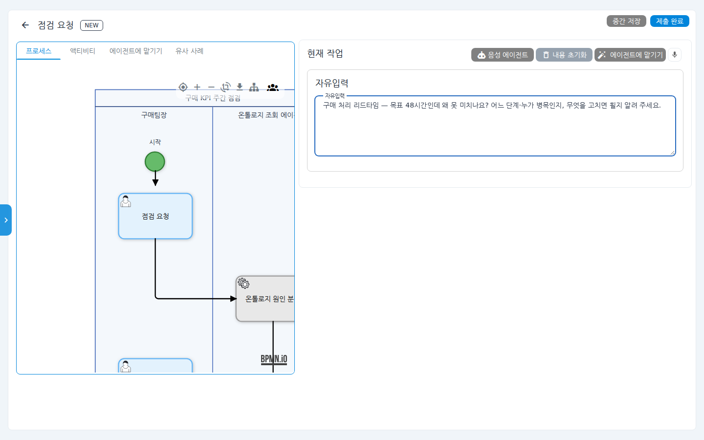

2. **제출 완료**를 누르면 인스턴스 화면으로 이동합니다. **칸반보드** 탭에서 「온톨로지 원인 분석」이 **진행 중 · 제출됨**
   (에이전트가 작업 중)인 것을 볼 수 있습니다. 「점검 결과 검토」는 아직 예정업무입니다.

   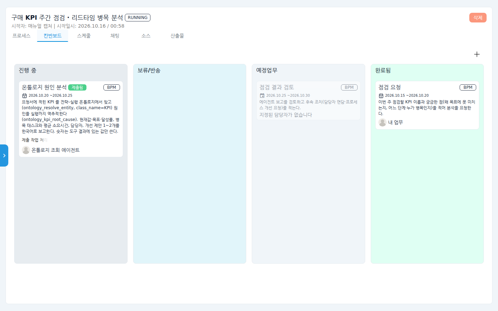

## ④ 에이전트 — 온톨로지로 원인 분석

1. 20초 안팎이 지나면 「온톨로지 원인 분석」이 **완료됨**으로 옮겨 가고, 다음 업무 「점검 결과 검토」가 구매팀장의
   **진행 중**에 나타납니다.

   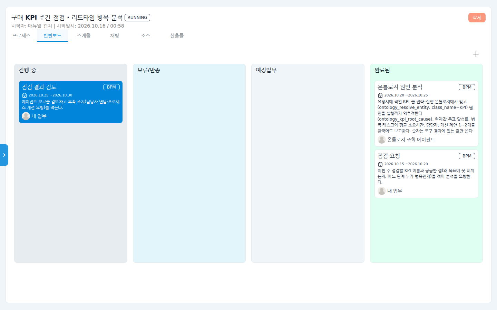

2. 완료된 「온톨로지 원인 분석」 카드를 열면 에이전트의 **보고서**가 있습니다. 에이전트는 전략–실행 온톨로지의 도구를
   두 번 썼습니다 — ① 이름으로 KPI 를 찾고(이름 찾기), ② KPI → 프로세스 → 태스크 → 담당자로 거슬러 올라갔습니다(원인 분석).
   보고서의 숫자(현재 70.5시간 · 달성률 53.1% · 견적 검토 평균 40시간 등)는 도구가 돌려준 값 그대로입니다.

   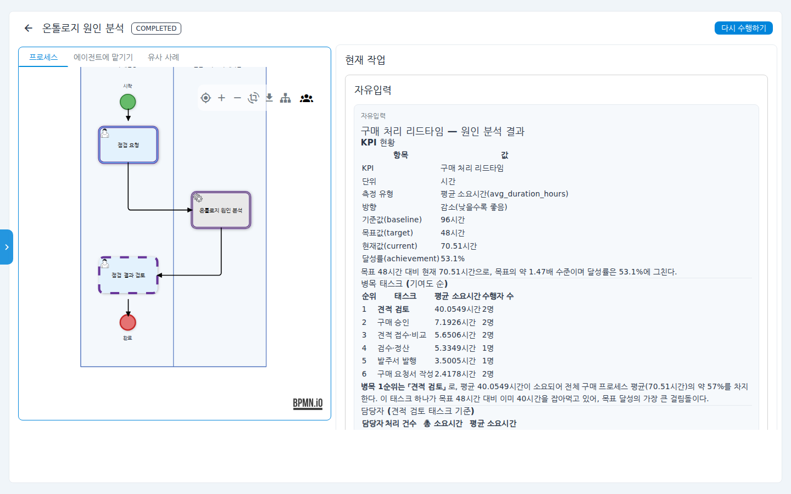

## ⑤ 검토 완료

1. 「점검 결과 검토」 업무를 열고 보고서를 바탕으로 후속 조치를 적은 뒤 **제출 완료**를 누릅니다.

   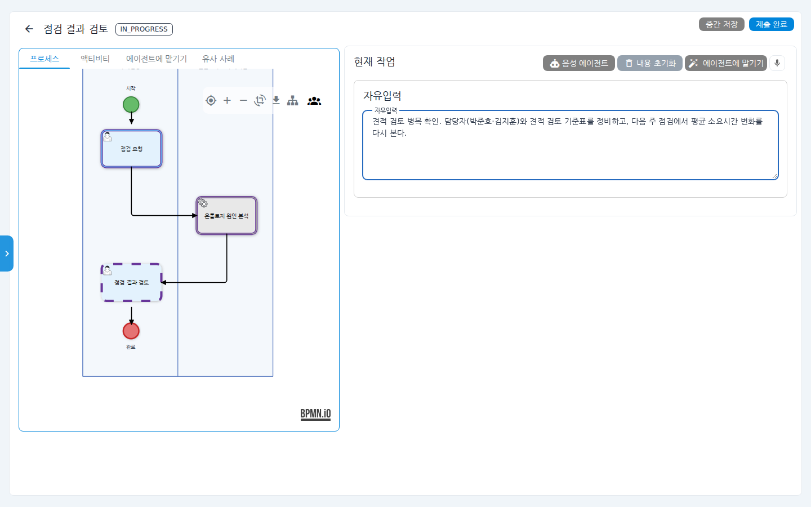

2. 인스턴스가 **COMPLETED** 가 됩니다. 사람(점검 요청) → 에이전트(원인 분석) → 사람(검토)이 모두 끝났습니다.

   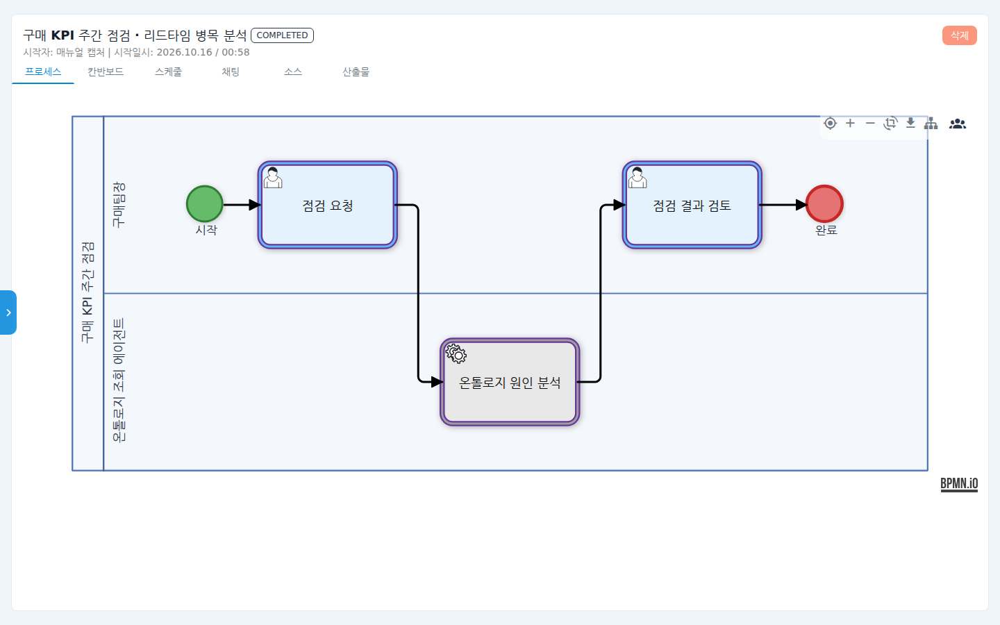

## ⑥ 온톨로지에 반영된 실행 보기

1. **전략 보드 → 온톨로지 익스플로러** 탭에서 오른쪽 위 **동기화**를 누릅니다(주기적으로도 자동 반영됩니다).
2. 검색창에 **구매 KPI 주간 점검**을 입력하고 Enter. 보라색 **코스**가 전략 → KPI(KPI 주간 점검 완료 건수) → 프로세스 →
   태스크 → 방금 끝난 인스턴스 → 워크아이템 → 담당자로 이어지고, 패널에 **실행 1 · 완료 1**이 보입니다.

   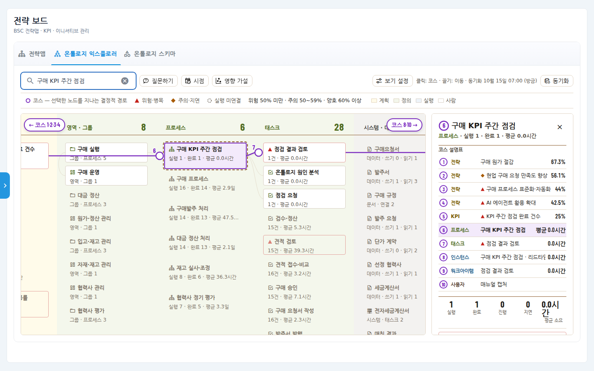

3. **온톨로지 원인 분석**을 검색하면 에이전트 단계의 코스가 **에이전트(온톨로지 조회 에이전트) → 스킬(온톨로지 질의)**까지
   이어집니다. 누가(어떤 에이전트가) 어떤 능력으로 이 일을 했는지가 지도에 남습니다.

   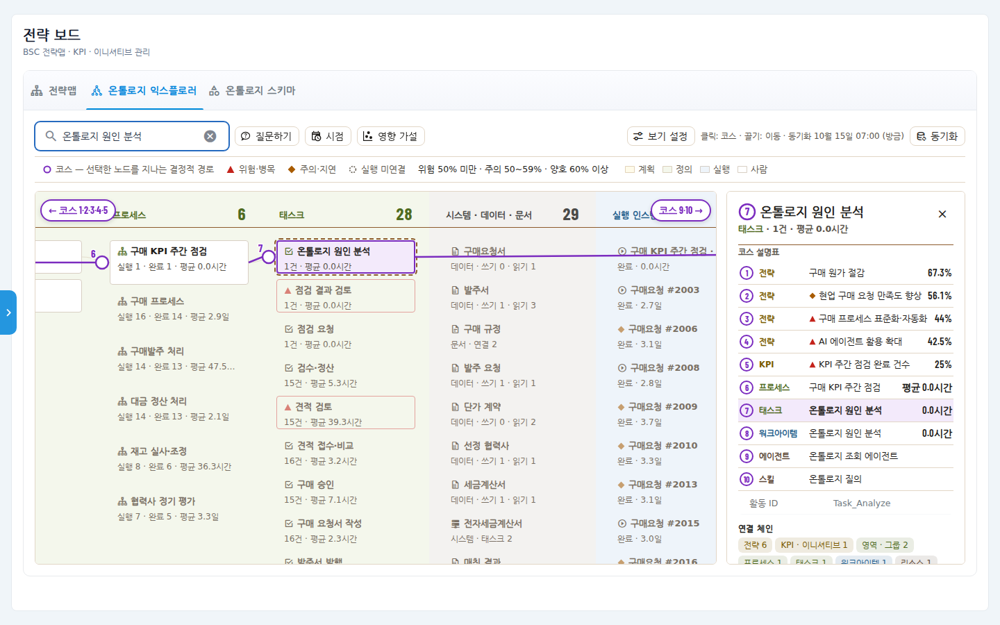

4. **KPI 주간 점검 완료 건수**를 검색하면 완료 1건이 실적으로 반영되어 **25% (1 / 4 건)**입니다. 상위 전략
   「AI 에이전트 활용 확대」의 달성률도 함께 바뀝니다.

   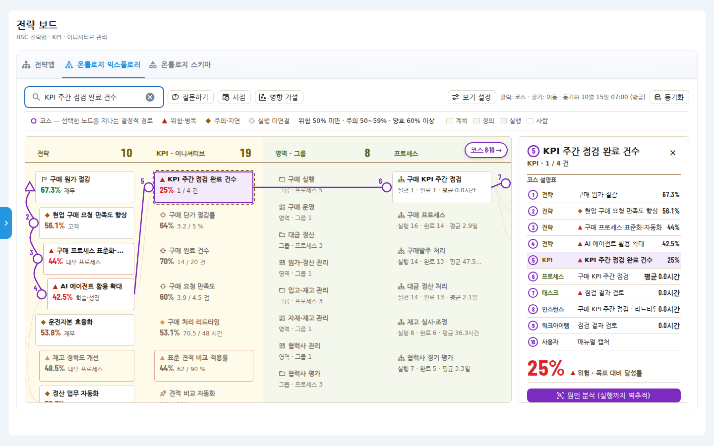

## ⑦ 온톨로지로 분석

1. 툴바 **질문하기**를 누르고 질문을 입력합니다 — 「구매 처리 리드타임이 왜 목표 미달이야?」 → **묻기**.

   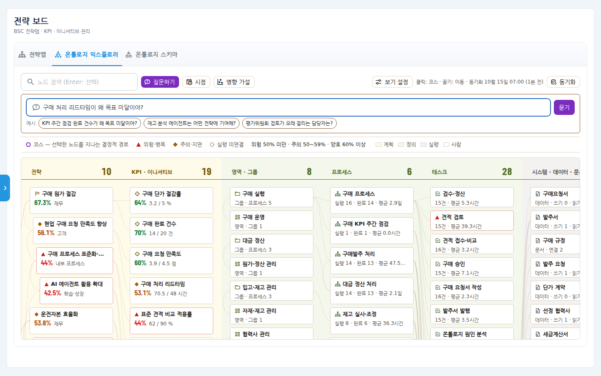

2. 몇 초 뒤 오른쪽에 **질문 답**이 나오고, 근거가 된 노드가 지도에 보라색 번호 코스로 그려집니다
   (KPI → 구매 프로세스 → 견적 검토 → 담당자). ④에서 에이전트가 업무 중에 찾은 것과 **같은 결론(견적 검토 병목)**입니다.

   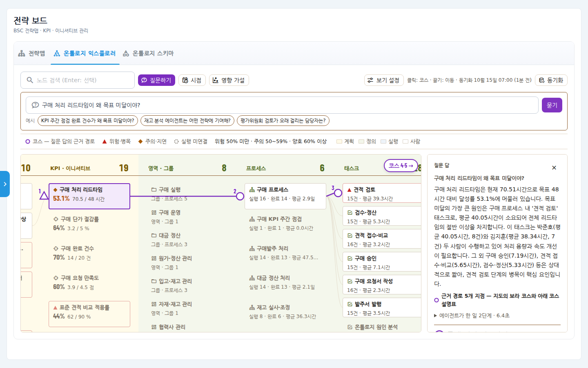

3. **에이전트가 한 일**을 펼치면 답을 만들려고 쓴 단계(① 이름 찾기 ② 원인 분석)가 보입니다 — 업무 중의 에이전트와 같은 도구입니다.

   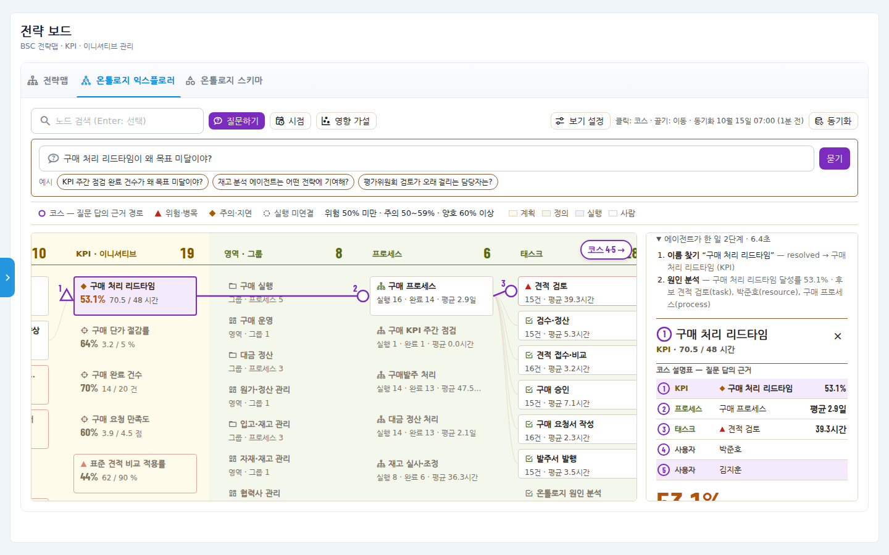

4. 검색창에서 **구매 처리 리드타임**을 고르고 패널의 **원인 분석 (실행까지 역추적)**을 누르면 **개선 후보**가 영향 점수순으로
   나오고(견적 검토 → 담당자 → 프로세스 …), 그 아래에 결과를 근거로 한 진단 문장이 붙습니다.

   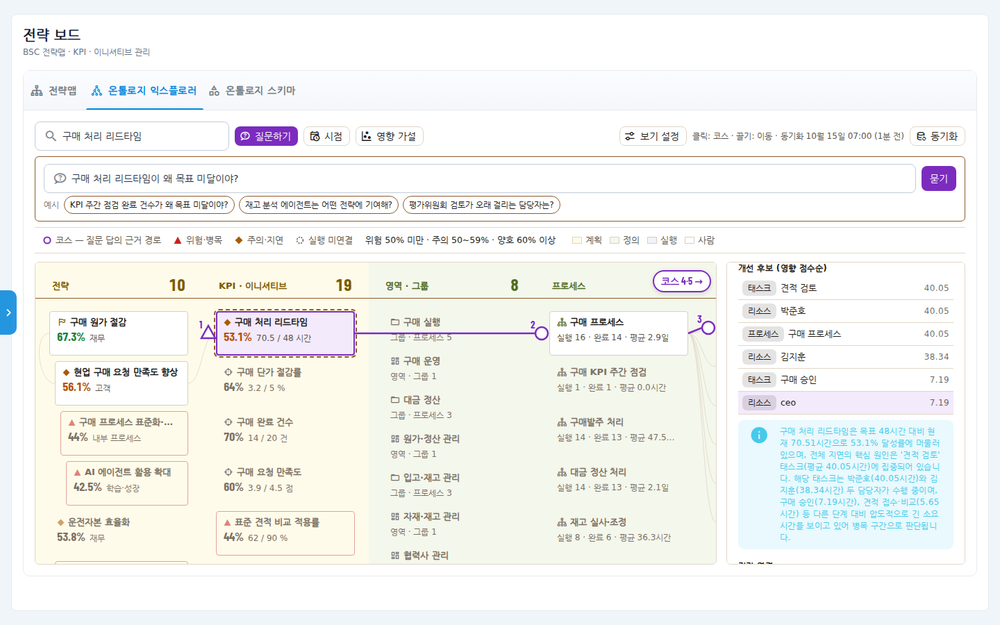

## 확인 포인트

- [ ] 순서도 저장 후 프로세스를 실행할 수 있다(정의에 3개 단계, 에이전트 단계는 담당 에이전트가 지정).
- [ ] 점검 요청을 제출하면 1분 안에 「온톨로지 원인 분석」이 완료되고, 「점검 결과 검토」가 구매팀장의 **진행 중**에 온다.
- [ ] 완료된 에이전트 업무를 열면 보고서가 보이고, KPI 현재값·목표·병목 태스크가 익스플로러의 값과 같다.
- [ ] 익스플로러에서 새 프로세스가 **실행 1 · 완료 1**, 에이전트 단계에 에이전트·스킬이 이어져 있다.
- [ ] 새 KPI 가 1 / 4 건(25%)이다.
- [ ] 질문하기와 원인 분석이 에이전트 보고와 같은 병목(견적 검토)을 가리킨다.

## 자주 묻는 질문 / 문제 해결

| 증상 | 원인 · 해결 |
|---|---|
| 순서도에 ▶실행 버튼이 없다 | 실행 엔진이 연결된 배포에서만 보입니다(관리자). 엔진이 없는 문서화 전용 배포에서는 프로세스를 정의·분석만 합니다. 이 가이드의 녹화 환경도 버튼이 숨겨진 구성이라, 인스턴스 시작만 실행 엔진의 시작 API 로 하고 나머지는 화면에서 진행했습니다. |
| 에이전트 단계가 계속 「제출됨」에 머문다 | 에이전트의 LLM 이 응답하지 못하는 경우입니다(키 만료·한도 초과 등). 단계는 실패한 채 넘어가지 않고 최대 3번 다시 시도합니다. 관리자에게 LLM 설정을 확인해 달라고 하세요. 에이전트에 도구(MCP)가 연결되지 않아도 진행되지 않습니다. |
| 에이전트 보고서 칸이 비어 있다 | 에이전트가 도구를 하나도 쓰지 못한 경우입니다. 에이전트의 도구 목록에 `strategy-ontology` 가 있는지, 그 MCP 서버가 켜져 있는지 확인합니다. |
| 익스플로러에 새 실행이 안 보인다 | **동기화**를 누르세요. 실행 기록은 주기적으로 반영되지만 바로 보려면 동기화가 필요합니다. |
| KPI 가 「미측정」이다 | 완료 건수 KPI 는 프로세스가 **완료**되어야 쌓입니다. 측정은 주기적으로 돌며, 익스플로러 동기화 후 반영됩니다. |
| 같은 과정을 처음부터 다시 해 보고 싶다 | 프로세스를 휴지통으로 보내고 KPI 를 삭제한 뒤 다시 만듭니다. (테스트 환경에서는 `scripts/demo/ontology-e2e/cleanup.py` 가 이 가이드로 만든 데이터를 한 번에 지웁니다.) |
