# 전략 보드 — 온톨로지 익스플로러 사용 매뉴얼

> 질문하기 · 영향 가설 · 시점 · 분석 대시보드 연결은 [온톨로지 익스플로러 — 질문하기·영향 가설·시점·대시보드 연결](ontology-graph-platform.md)을 보세요.

**온톨로지 익스플로러**는 회사의 전략, 그 전략을 재는 KPI, KPI를 만드는 프로세스, 실제 실행 결과, 일한 사람과 스킬을 **한 화면에 하나의 사슬로** 이어 보여 줍니다.
"이 KPI는 왜 목표에 못 미쳤나?", "이 사람의 업무는 어떤 전략에 기여하나?", "이 프로세스의 병목은 어디인가?"에 답할 때 씁니다.
같은 화면의 **온톨로지 스키마** 탭에서는 이 연결에 쓰이는 데이터 종류와 관계를 확인할 수 있습니다.

## 시나리오 개요

경영기획팀 김 매니저는 분기 점검에서 **"현업 구매 요청 만족도 향상"** 전략이 **주의**(달성률 56.1%) 상태인 것을 봤습니다.
이 전략은 KPI **"구매 처리 리드타임"**(목표 48시간, 현재 70.5시간)으로 측정합니다.
김 매니저는 이 KPI가 어느 프로세스에서 계산되는지, 그 실행 중 어느 단계가 오래 걸렸는지, 누가 맡았는지를 찾으려 합니다.

## 사전 조건

- 전략 보드에 접근할 수 있는 계정(검토자 이상)
- 전략맵에 전략 목표와 KPI가 등록되어 있을 것
- KPI가 프로세스에 연결되어 있어야 실행 결과까지 이어집니다(KPI 편집 화면의 "연결 프로세스"). 연결되지 않은 KPI에는 **실행 미연결** 표시가 붙습니다.
- 연결한 프로세스에 실행 기록이 있을 것. 그래프는 최근 180일 실행분을 보여 줍니다.

## 화면 읽는 법 — 지도처럼

익스플로러는 **지도**처럼 읽습니다. 전체 데이터는 조용한 **지형**으로 깔리고, 노드를 고르면 그 노드를 지나는 **결정적 경로**가 보라색 **코스**로 위에 그려집니다.

| 표시 | 의미 |
|---|---|
| 열 바탕색(지형) | 단계 묶음 — 옅은 노랑 = 계획(전략·KPI), 옅은 올리브 = 정의(프로세스·태스크), 옅은 파랑 = 실행(인스턴스·워크아이템), 흰색 = 사람(리소스·스킬) |
| 보라색 코스(△ 출발 · ○ 통제점 · ◎ 결승, 번호) | 고른 노드를 지나며 단계마다 **가장 나쁜** 노드 하나씩을 이은 경로. 예: 전략 → 가장 낮은 KPI → 프로세스 → 병목 태스크 → 가장 늦은 실행 → 그 업무 → 담당자 |
| ▲ 빨간 삼각형 | **위험**(달성률이 "주의" 기준 미만) 또는 **병목** 태스크 |
| ◆ 황토 마름모 | **주의**(달성률 "주의"~"양호" 기준 사이) 또는 **지연**(기한 초과) |
| ○ 점선 원 | **실행 미연결** — 프로세스가 연결되지 않은 KPI |
| 표시 없음 | **양호** |
| 큰 응축 숫자 | 달성률 — 위험은 빨강, 주의는 황토, 양호는 초록 |

달성률 기준값은 분석 대시보드의 **차트 기준값(KPI 달성 RAG)** 설정을 따르며, 범례 줄에 현재 기준(예: "위험 50% 미만 · 주의 50~59% · 양호 60% 이상")이 표시됩니다. 전략의 달성률은 하위 KPI를 **중요도로 가중 평균**한 값입니다.
코스에 포함되지 않은 노드는 상자 없이 회색 글자로 물러나고, 보라색은 코스·선택한 카드·원인 분석 버튼에만 쓰입니다.

## 단계별 따라 하기

### 1. 전략 보드 열기

왼쪽 메뉴에서 **분석 › 전략 보드**를 누릅니다.
테두리 박스 안에 **전략맵 · 온톨로지 익스플로러 · 온톨로지 스키마** 세 탭이 있습니다.
오른쪽 위에는 **전략목표 추가** 버튼과 **더보기** 메뉴가 있습니다. 더보기 메뉴에는 측정 갱신, 전략 정합성 검사, 전략맵 초기화가 들어 있습니다.

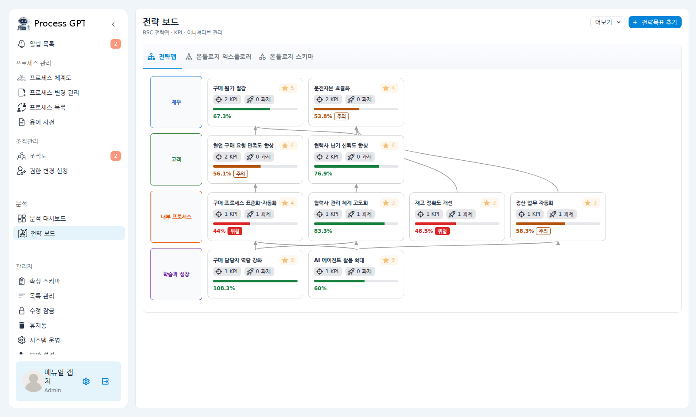

전략맵 카드마다 달성률과 상태 배지(위험·주의)가 표시됩니다.

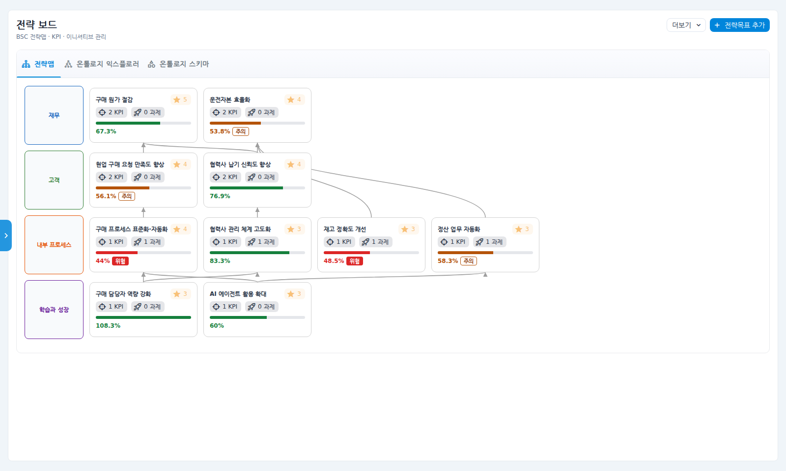

### 2. 전략맵에서 목표를 골라 익스플로러로 이동

① 살펴볼 전략 목표 카드(예: "현업 구매 요청 만족도 향상")를 누릅니다.
② 오른쪽에 상세 패널이 화면 높이만큼 열리고, 헤더는 왼쪽으로 좁혀집니다. 패널 오른쪽 위의 **연관관계 보기** 아이콘(연필 아이콘 왼쪽)을 누릅니다.

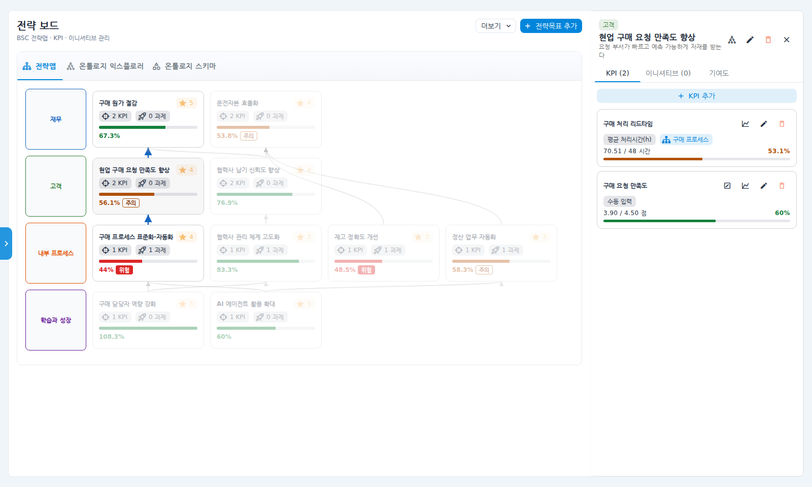

③ **온톨로지 익스플로러** 탭이 그 목표가 선택된 채로 열립니다. 연결된 노드는 진하게, 나머지는 흐리게 보입니다.

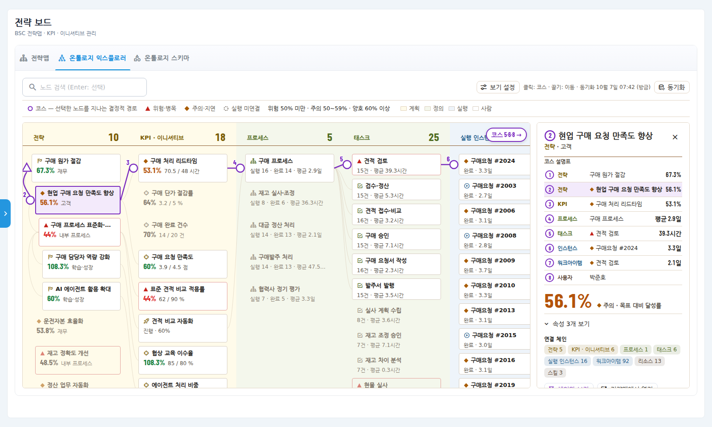

### 3. 전체 지형 보기

열은 왼쪽에서 오른쪽으로 **"무엇으로 실행되는가"** 순서입니다: 전략 → KPI·이니셔티브 → 프로세스 → 태스크 → 실행 인스턴스 → 워크아이템 → 리소스 → 스킬.
열 머리의 큰 숫자는 그 단계의 노드 수입니다. 워크아이템은 수백 건이라 기본으로 접혀 있고, 세로 띠("워크아이템 289 · 펼치기")를 누르면 펼쳐집니다.
노드를 고르기 전에는 이웃한 열 사이의 선만 아주 옅게 보입니다. **빈 곳이나 카드를 끌면 화면이 이동**합니다.

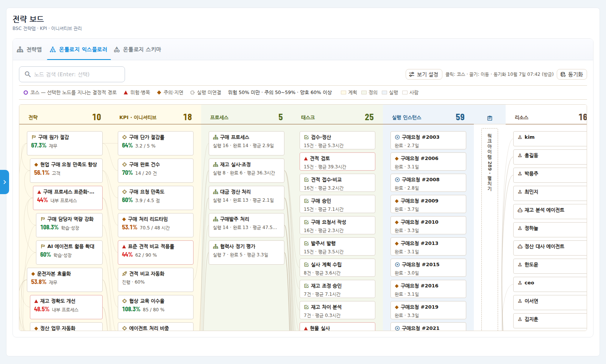

### 4. KPI를 눌러 코스 그리기 — 원인 역추적

① KPI 열에서 **구매 처리 리드타임**(◆ 주의, 53.1%)을 누릅니다.
② 코스가 그려집니다. 코스에 든 노드는 각 열의 맨 위로 올라와 **한 줄로 가로질러** 읽힙니다:
△1 구매 원가 절감 → 2 현업 구매 요청 만족도 향상 → **3 구매 처리 리드타임** → 4 구매 프로세스 → 5 ▲ 견적 검토(병목) → 6 구매요청 #2024 → …
화면 밖으로 이어지는 지점은 캔버스 가장자리에 **"코스 8 →"** 같은 표식으로 알려 주고, 누르면 그쪽으로 이동합니다.
③ 오른쪽 패널 맨 위의 **코스 설명표**가 각 지점의 단계·이름·값을 순서대로 보여 줍니다. 행을 누르면 그 지점으로 이동합니다.
④ 그 아래 큰 숫자로 달성률(53.1% · 주의)이 보입니다.

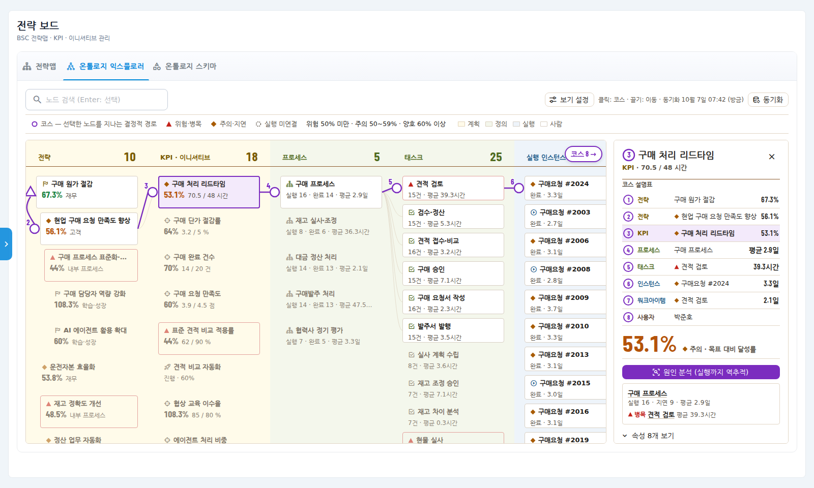

⑤ **원인 분석 (실행까지 역추적)**을 누르면 **개선 후보**가 영향 점수 순으로 나옵니다. 예시에서는 "견적 검토" 태스크와 그 담당자(박준호)가 맨 위입니다. 패널의 연결 프로세스 카드에서도 **병목 단계**(견적 검토, 평균 39.3시간)를 바로 볼 수 있습니다.

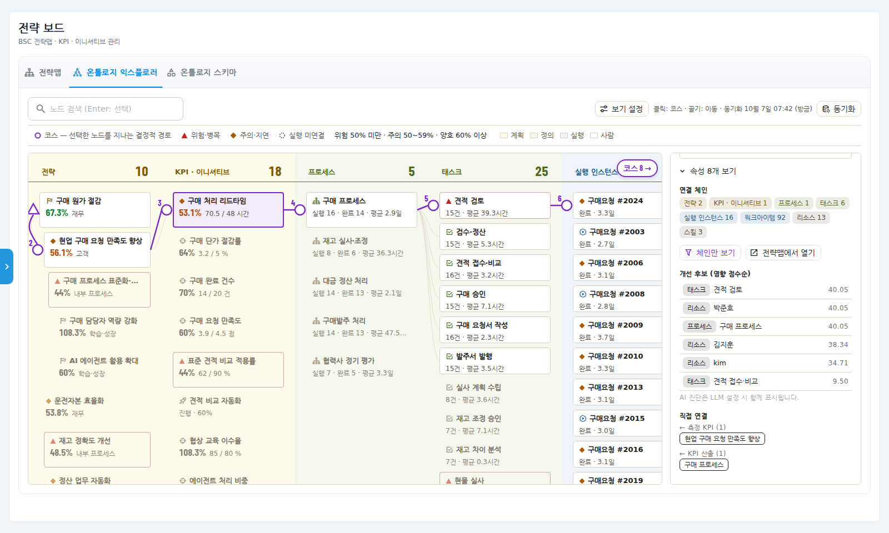

> AI 진단 문장은 시스템에 AI 모델이 설정된 경우에만 후보 목록 아래에 함께 표시됩니다.

**프로세스에 연결되지 않은 KPI**(예: 수동 입력하는 "구매 단가 절감률")를 고르면 코스가 KPI에서 끝나고, 패널에 안내가 나옵니다. **전략맵에서 프로세스 연결**로 측정 프로세스를 연결하면 실행까지 이어집니다.

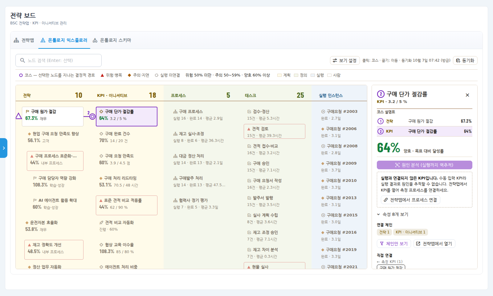

### 5. 프로세스의 실행 결과와 병목 확인

① 프로세스 열에서 **구매 프로세스**를 누릅니다. 이 프로세스를 지나는 코스가 그려집니다.
② 패널에 **실행 · 완료 · 진행 · 지연 · 평균 소요** 집계와 **▲ 병목 태스크**(견적 검토)가 표시되고, 병목 이름을 누르면 그 태스크로 이동합니다.

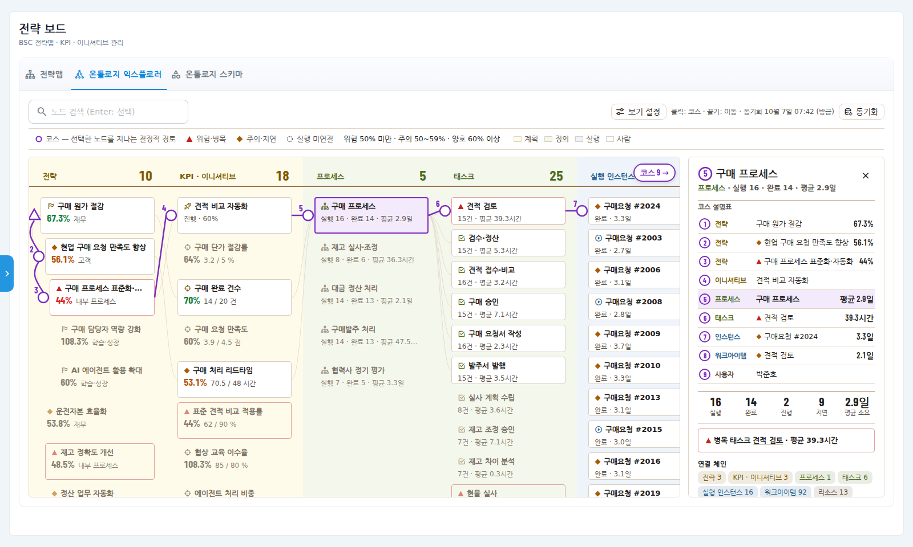

### 6. 보기 설정 — 단계·체인·밀도 조절

툴바의 **보기 설정**을 누르면 다음을 한곳에서 조절합니다.

- **단계**: 열별 표시/숨김 체크, 열 접기/펼치기
- **선택 체인만 보기**: 고른 노드와 관계없는 노드를 숨깁니다(노드를 고른 뒤에 켤 수 있습니다)
- **전략과 연결 안 된 노드 포함**: 전략에 아직 이어지지 않은 프로세스·실행·사람까지 모두 표시
- **촘촘히 보기**: 카드 폭을 줄여 한 화면에 더 많은 열을 보여 줍니다

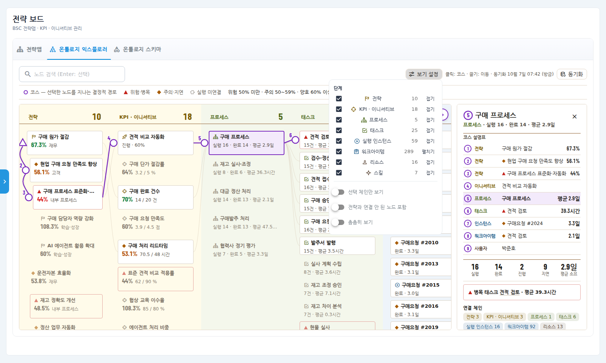

노드를 고른 뒤 **선택 체인만 보기**를 켜면, 그 노드와 관계없는 노드를 숨겨 연결된 사슬만 남깁니다.

### 7. 검색

**노드 검색**에 이름을 입력하면 일치하는 카드에 점선 테두리가 생기고, **Enter**를 누르면 첫 결과가 선택되며 그 위치로 이동합니다. 접힌 열의 노드를 찾을 때는 먼저 그 열을 펼칩니다.
아래 예시는 워크아이템 열을 펼친 뒤 "정산 검토"를 찾은 화면입니다. 대금 정산 처리의 병목 단계(▲)이며, 코스는 운전자본 효율화 → 정산 업무 자동화 → 정산 대사 RPA → 대금 정산 처리 → 정산 검토 → 최민지로 이어집니다.

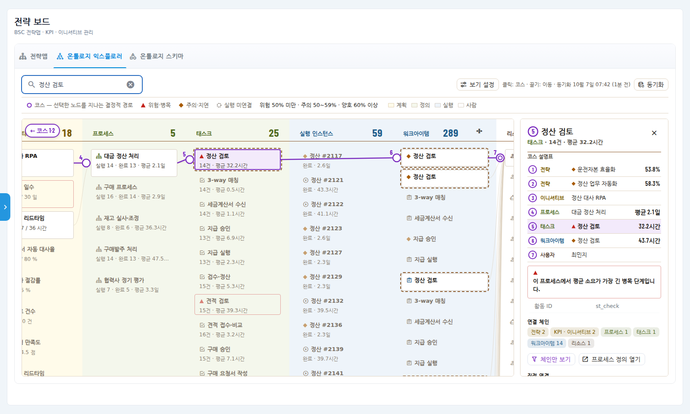

**동기화** 버튼은 프로세스 정의·조직도·실행 기록 같은 원천 데이터를 즉시 다시 읽어 반영합니다(평소에는 1분마다 자동 반영). 마지막 동기화 시각은 툴바의 동기화 버튼 왼쪽에 "10월 7일 07:39 (1분 전)"처럼 표시됩니다. 좁은 화면에서는 범례가 **기호표** 버튼 뒤로 접힙니다.

### 8. 원래 화면으로 이동

| 선택한 노드 | 버튼 | 이동 위치 |
|---|---|---|
| 전략 · KPI · 이니셔티브 | 전략맵에서 열기 | 전략맵 탭에서 해당 목표의 상세 패널 |
| 프로세스 · 태스크 | 프로세스 정의 열기 | 프로세스 정의 화면 |
| 실행 인스턴스 | 인스턴스 열기 | 실행 화면 |
| 워크아이템 | 워크아이템 열기 | 업무 화면 |
| 사람 · 에이전트 · 팀 | 조직도 열기 | 조직도 |

카드는 키보드로도 다룰 수 있습니다. **Tab**으로 이동하고 **Enter** 또는 **Space**로 선택합니다.

### 9. 온톨로지 스키마 확인

① **온톨로지 스키마** 탭을 누릅니다.
② 위쪽 그림은 데이터 종류(노드 타입)를 **전략 · 프로세스 · 실행 · 리소스 · 스킬** 묶음으로 보여 주고, 화살표로 관계를 표시합니다. 숫자는 현재 회사의 데이터 개수입니다.
③ 아래 표에는 타입별 설명, 고유 식별 기준(업무키), 주요 속성, 원천 데이터가 있습니다.

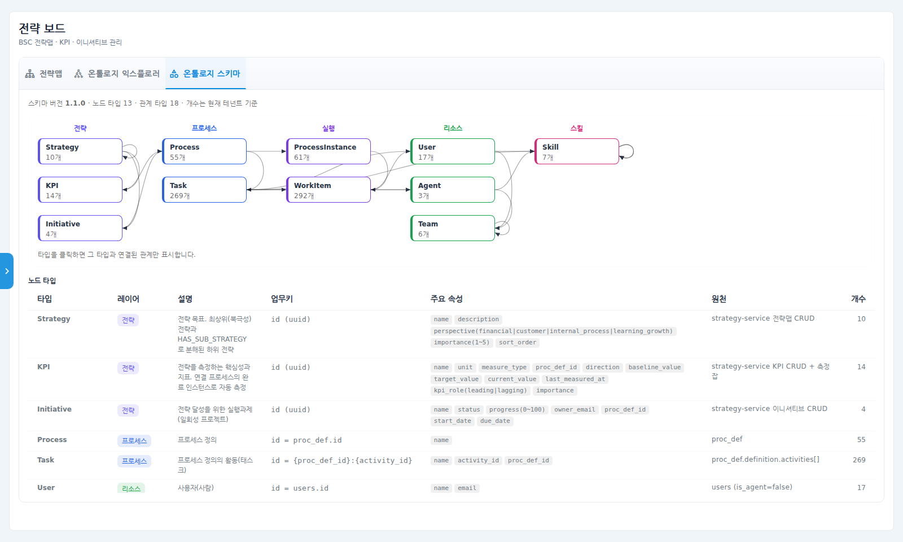

④ 상자 하나(예: ProcessInstance)를 누르면 그 타입과 직접 연결된 관계만 남고 관계 이름이 표시됩니다. 오른쪽 위 칩의 ✕로 해제합니다.

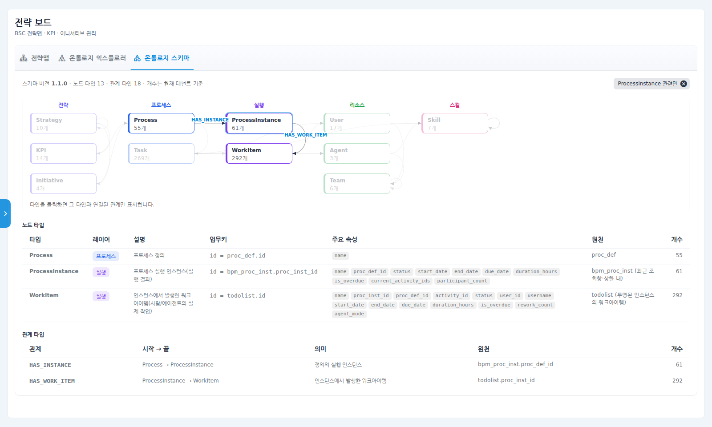

## 확인 포인트

- 전략맵과 익스플로러에서 같은 목표의 달성률과 상태(위험·주의)가 **같은지** 확인합니다.
- 연결된 KPI를 눌렀을 때 코스가 프로세스·병목 태스크·실행까지 이어지고 코스 설명표에 값이 채워지면, 전략과 실행이 제대로 이어진 것입니다.
- 프로세스 상세의 실행/완료 수가 실제 실행 목록 건수와 같은지 확인합니다(최근 180일 기준).

## 자주 묻는 질문 / 문제 해결

**"위험"·"주의" 기준을 바꾸고 싶습니다.**
분석 대시보드의 **차트 기준값** 설정(관리자)에서 KPI 달성 기준을 바꾸면 전략 보드에도 함께 적용됩니다.

**익스플로러에 "전략맵이 아직 없습니다"가 나옵니다.**
전략맵 탭에서 목표와 KPI를 먼저 등록하세요. 전략 없이 프로세스·실행만 보려면 **프로세스·실행만 보기**를 누릅니다.

**KPI에서 사슬이 끊깁니다.**
그 KPI에 연결된 프로세스가 없는 경우입니다. 패널의 **전략맵에서 프로세스 연결**로 이동해 연결하거나, 더보기 메뉴의 **전략 정합성 검사**로 연결할 프로세스를 찾으세요.

**방금 끝난 실행이 보이지 않습니다.**
자동 반영은 1분 주기입니다. 바로 보려면 **동기화**를 누르세요.

**빨간 오류 상자가 나옵니다.**
전략 데이터 서비스에 연결하지 못한 경우입니다. 잠시 후 **다시 시도**를 누르고, 계속되면 관리자에게 문의하세요.
