# 온톨로지 익스플로러 — 질문하기 · 영향 가설 · 시점 · 대시보드 연결

전략 보드의 **온톨로지 익스플로러**는 전략 → KPI → 프로세스 → 태스크 → 실행 → 담당자 → 스킬을 한 지도에 보여 줍니다
(기본 사용법은 [온톨로지 익스플로러 매뉴얼](ontology-explorer.md)). 이 문서는 그 위에 더해진 네 가지 기능을 다룹니다.

| 기능 | 답하는 질문 |
|---|---|
| **질문하기** | "구매 리드타임이 왜 목표 미달이야?" — 말로 물으면 답과 **근거 경로**를 지도에 그린다 |
| **영향 가설** | "수동으로 입력하는 KPI 는 어떤 업무가 움직이나?" — 실행 데이터가 후보를 내고 사람이 승인한다 |
| **시점** | "8월 중순에는 어땠나?" — 과거 어느 주의 KPI 값과 실행 상태로 지도를 다시 그린다 |
| **대시보드 연결** | 지도에서 고른 프로세스의 도메인으로 분석 대시보드를 열고, 대시보드의 도메인을 지도에서 본다 |

툴바 왼쪽 검색창 옆에 세 버튼이 새로 생겼습니다.

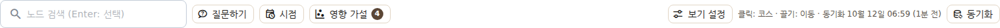

## 시나리오 개요

구매팀장은 주간 회의 전에 전략 보드를 엽니다. 구매 처리 리드타임 KPI 가 목표에 못 미친다는 보고를 받았는데, 이유를
설명해야 합니다. 그는 익스플로러에서 **질문**을 던져 원인과 그 근거 경로를 지도에서 확인하고, 수동으로 입력해 온
납기 준수율 KPI 가 실제로 어느 업무와 함께 움직이는지 **영향 가설**을 검토해 승인합니다. 지난달과 비교하려고
**시점**을 8월로 돌려 보고, 문제 프로세스를 **분석 대시보드**에서 같은 도메인으로 이어서 봅니다.

## 사전 조건

- 전략 보드를 볼 수 있는 계정(검토자 이상). 영향 가설 승인·거절도 같은 권한입니다.
- 전략맵에 KPI 가 있고, 그 KPI 와 이어진 프로세스가 실행된 이력이 있어야 지도가 채워집니다.
- **질문하기**는 서버에 LLM 이 설정되어 있어야 합니다(없으면 "LLM 이 설정되지 않았습니다" 안내).
- **영향 가설**은 KPI 측정 이력이 8주 이상 쌓여야 후보가 나옵니다.
- **대시보드 연결**은 프로세스에 업무 도메인(프로세스 체계도의 도메인)이 지정되어 있어야 하고, 도메인 필터가 있는
  분석 대시보드 화면에서 동작합니다.

## 1. 질문하기 — 답과 근거 경로

1. 분석 → **전략 보드** → **온톨로지 익스플로러** 탭에서 툴바의 **질문하기**를 누릅니다.
2. 질문 입력줄이 열립니다. 직접 입력하거나 **예시** 칩을 누릅니다.

   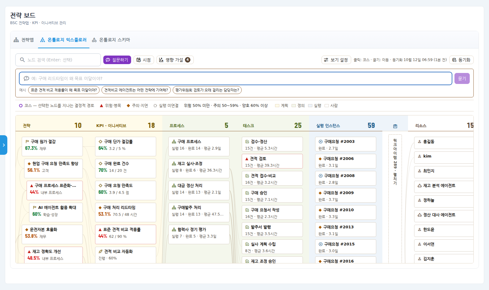

3. **묻기**를 누르면 몇 초 뒤 오른쪽 패널 맨 위에 **질문 답**이 나오고, 답의 근거가 된 노드들이
   **보라색 번호 코스**로 지도에 그려집니다(KPI → 프로세스 → 병목 태스크 → 담당자). 패널 아래 **코스 설명표**가
   지점마다 값을 보여 줍니다 — 표의 행을 누르면 지도가 그 지점으로 이동합니다.

   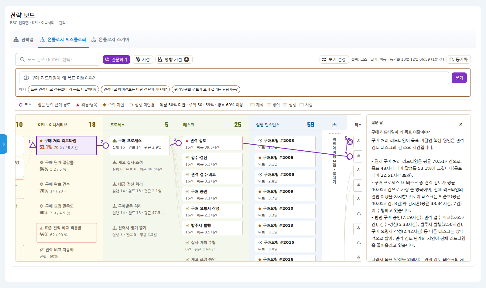

4. **에이전트가 한 일**을 펼치면 답을 만들려고 실제로 무엇을 찾았는지 단계별로 보입니다(이름 찾기 → 원인 분석 …).
   답의 숫자는 이 단계들의 결과에만 근거합니다.

   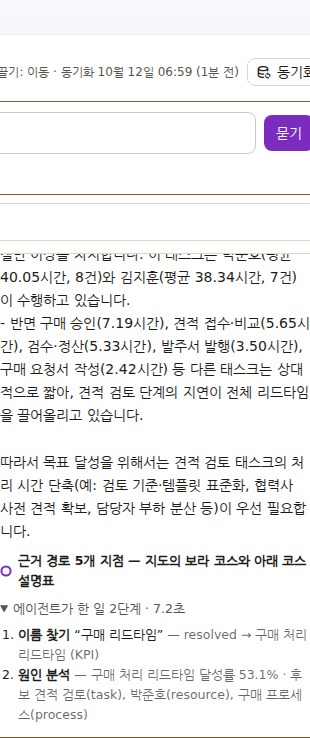

5. 지도에 없는 대상을 물으면 **억지로 답하지 않습니다.** "근거로 확인된 노드가 없어 지도에 경로를 그리지 않았습니다"가
   나오고 코스가 그려지지 않습니다.

   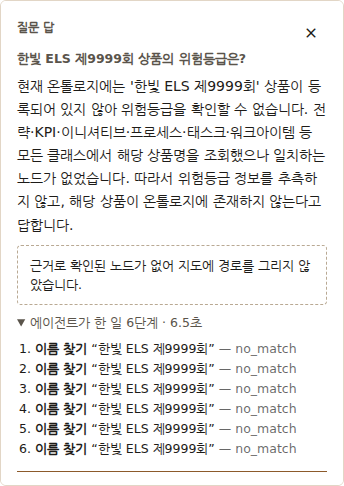

6. 패널의 × 를 누르거나 코스 밖의 노드를 고르면 평소 지도(선택한 노드의 결정적 코스)로 돌아갑니다.

## 2. 영향 가설 — 통계가 제안하고 사람이 정한다

수동으로 입력하는 KPI(납기 준수율, 구매 요청 만족도 …)는 어떤 업무가 그 값을 움직이는지 지도에 이어져 있지 않아
원인을 추적할 수 없습니다. 영향 가설은 프로세스의 **주간 실행 지표**(완료 건수·평균 소요시간·지연 비율)와 **KPI 의
주간 값**을 0~2주 시차를 두고 비교해, 함께 움직이는 쌍을 **후보**로 제안합니다.

1. 툴바의 **영향 가설**을 누릅니다. 버튼의 숫자는 검토를 기다리는 후보 수입니다.
2. 후보마다 "어느 프로세스의 어떤 지표가 → 몇 주 뒤 KPI 와 → 같은/반대 방향으로" 움직였는지, 상관계수(r), 비교한
   주 수, 유의확률(p)이 보입니다.

   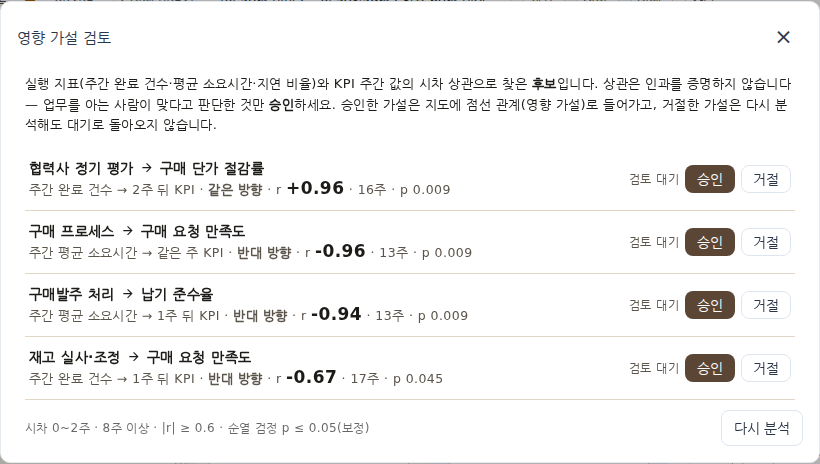

3. 업무를 아는 사람으로서 **말이 되는 것만 승인**합니다. 예를 들어 "구매발주 처리의 평균 소요시간이 길어지면 1주 뒤
   납기 준수율이 떨어진다"(r −0.94)는 승인, "재고 실사 완료 건수가 늘면 구매 요청 만족도가 떨어진다"(r −0.67)는
   우연으로 보고 **거절**합니다.

   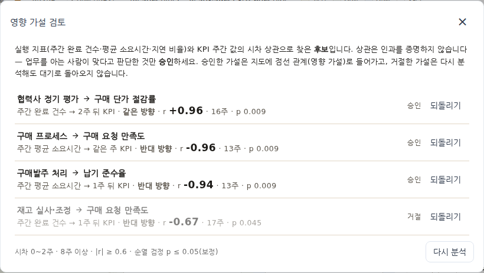

4. 승인한 가설은 지도에 **점선 관계(영향 가설)** 로 들어갑니다. 이제 수동 KPI 도 실행과 이어집니다 — 납기 준수율을
   고르면 코스가 구매발주 처리 → 병목 태스크(발주 승인) → 담당자로 이어지고 **원인 분석**도 동작합니다.

   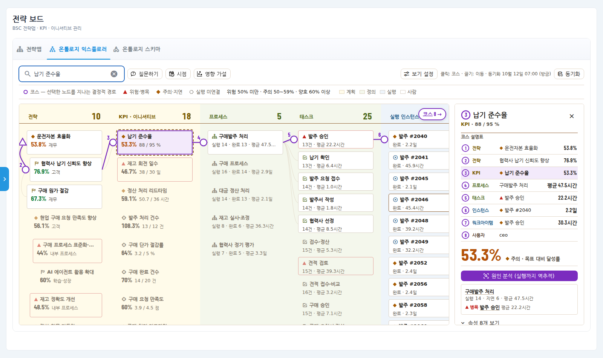

5. 거절한 가설은 **다시 분석해도 대기로 돌아오지 않습니다.** 판정을 바꾸려면 **되돌리기**를 누릅니다.
   **다시 분석**은 최신 데이터로 수치만 갱신합니다.

### 관계의 출처

상세 패널 아래 **직접 연결**의 관계마다 그것이 어디서 왔는지 표시됩니다.

| 표시 | 뜻 |
|---|---|
| 선언 | 사람이 전략맵·KPI·이니셔티브 화면에서 만든 관계 |
| 측정 정의 | KPI 에 측정 프로세스를 지정해 생긴 관계(그 프로세스의 실행이 KPI 값을 만든다) |
| 동기화 | 프로세스 정의·실행·조직도·스킬에서 자동으로 가져온 관계 |
| 통계 가설 승인 | 위의 영향 가설을 사람이 승인해 생긴 관계 — r 과 시차가 함께 보인다 |

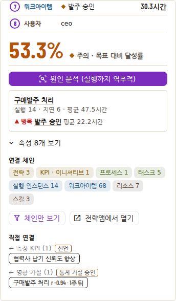

## 3. 시점 — 과거 어느 주의 지도

1. 툴바의 **시점**을 누르면 슬라이더가 열립니다(가장 이른 실행일 ~ 오늘, 1주 단위).
2. 손잡이를 왼쪽으로 끌거나, 손잡이를 누른 뒤 키보드 ← → 로 주를 옮깁니다. 버튼에 "2026-08-12 시점"처럼 표시되고
   지도가 그 날짜 기준으로 다시 그려집니다.
   - **KPI 값**은 그날까지의 마지막 측정값(측정이 없던 KPI 는 "-").
   - **실행**은 그날까지 시작된 것만 — 그 뒤에 시작한 건수는 안내줄에 표시됩니다. 그날 아직 끝나지 않은 실행은
     진행 중으로 보입니다.
   - 그날 이후에 승인된 영향 가설 관계는 보이지 않습니다.
   - 전략·KPI 정의(이름·목표값)는 현재 것을 씁니다.

   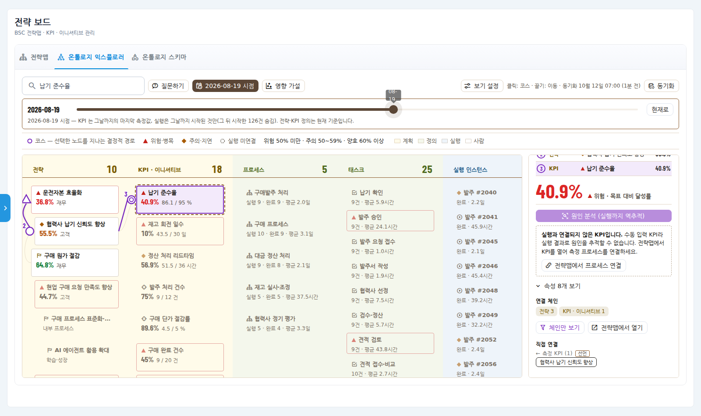

3. **현재로**를 누르면 오늘 지도로 돌아갑니다.

## 4. 분석 대시보드와 이어 보기

1. 지도에서 **프로세스**를 고르고 패널의 **분석 대시보드에서 보기**를 누릅니다.

   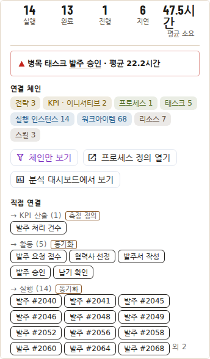

2. 분석 대시보드가 그 프로세스의 **도메인**으로 걸러진 채 열립니다. 맨 위 안내줄에 "온톨로지 익스플로러에서 온 필터
   — 도메인 구매관리"가 보입니다(시점을 과거로 둔 상태였다면 기간도 함께). **필터 해제**로 전체로 돌아갑니다.

   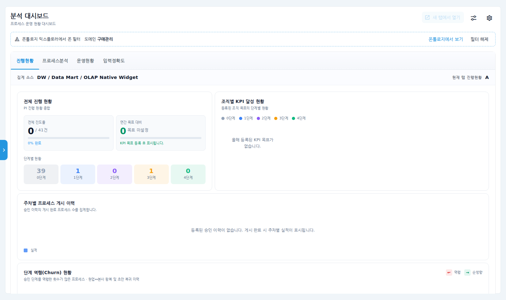

3. 안내줄의 **온톨로지에서 보기**를 누르면 반대로, 지도가 그 도메인의 프로세스와 그 체인만 보여 줍니다.
   지도 위 점선 안내줄의 **필터 해제**로 전체 지도로 돌아갑니다.

   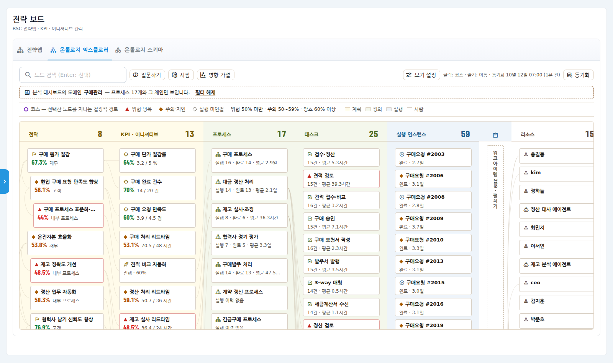

## 확인 포인트

- 질문의 답에 나온 숫자가 코스 설명표·카드의 숫자와 같다(예: 구매 처리 리드타임 53.1%, 견적 검토 평균 40.05시간).
- 없는 이름을 물으면 코스가 그려지지 않고 "근거 없음"이 나온다.
- 영향 가설을 승인하면 해당 KPI 를 골랐을 때 연결 프로세스와 **원인 분석**이 나오고, 직접 연결에 "통계 가설 승인"과
  r·시차가 보인다. 거절한 가설은 **다시 분석** 뒤에도 거절로 남는다.
- 시점을 과거로 옮기면 실행 인스턴스 수가 줄고 KPI 값이 그 주의 값으로 바뀐다. **현재로**를 누르면 원래 값으로.
- 프로세스 → 대시보드 → 온톨로지로 오가면 같은 도메인이 양쪽에 걸려 있다.

## 관리자: 에이전트가 온톨로지에 묻게 하기 (MCP)

Process GPT 의 에이전트도 같은 온톨로지를 도구로 읽을 수 있습니다(읽기 전용). 에이전트가 업무를 처리하다가
"이 KPI 의 병목은?"을 물으면, 이름을 키로 바꾸고(모르면 모른다고 답함) 체인·원인 분석을 조회합니다.

1. **계정 설정 → MCP 서버**에서 새 서버를 추가하고 아래 내용을 붙여 넣습니다(테넌트·토큰은 운영 값으로).

   ```json
   {
     "mcpServers": {
       "strategy-ontology": {
         "transport": "streamable_http",
         "url": "http://<전략 서비스 주소>:8014/mcp",
         "headers": { "X-Tenant-Id": "<테넌트>", "Authorization": "Bearer <토큰>" }
       }
     }
   }
   ```

2. 에이전트 설정의 도구 목록에서 `strategy-ontology` 를 고릅니다.
3. 쓸 수 있는 도구: 온톨로지 구조 읽기, 이름 → 노드 찾기, 노드 조회, 체인 추적, KPI 원인 분석, 종류별 목록.
   쓰기 도구는 없습니다.

> `transport` 는 꼭 `"streamable_http"` 로 적습니다. 다른 표기를 쓰면 에이전트 실행 시 연결되지 않을 수 있습니다.

## 운영자: 그래프 저장소(ontological-db)

온톨로지 그래프는 플랫폼과 **같은 데이터베이스(셀프호스트 Supabase)** 안에 있습니다. 로컬에서 처음 준비할 때:

```bash
./supabase/ontological/install.sh                       # DB 이미지에 확장 설치(데이터 유지, 첫 빌드 약 5분)
cd ../process-gpt-strategy
python -m scripts.migrate_age_to_ontological            # 이전 저장소(AGE)와 수 비교
python -m scripts.migrate_age_to_ontological --apply --tenant <테넌트>   # 이관(여러 번 실행해도 같다)
```

`start-all.sh` 는 기본으로 이 저장소를 씁니다(`STRATEGY_GRAPH_STORE=age` 로 이전 방식). Supabase 클라우드(관리형)에는
이 확장을 설치할 수 없습니다 — 셀프호스트 환경에서 씁니다.

## 자주 묻는 질문

- **질문 답이 매번 조금씩 다르다** — 문장은 달라질 수 있지만 숫자와 근거 경로는 도구 결과에서 오므로 같습니다.
- **영향 가설이 하나도 없다** — KPI 측정 이력이 8주 미만이거나, 함께 움직이는 쌍이 기준(|r| ≥ 0.6, p ≤ 0.05)을
  넘지 못한 것입니다. 측정 프로세스가 지정된 KPI(측정 정의)는 이미 이어져 있어 후보에서 빠집니다.
- **상관이 높으면 원인이 확실한가?** — 아닙니다. 역방향이거나 공통 원인일 수 있어 사람이 판정합니다. 지도에서도
  "영향 가설"로 표시해 측정 정의와 구분합니다.
- **분석 대시보드에서 보기 버튼이 없다** — 프로세스에 도메인이 지정되지 않았거나, 도메인 필터가 있는 대시보드를 쓰지
  않는 환경입니다.
