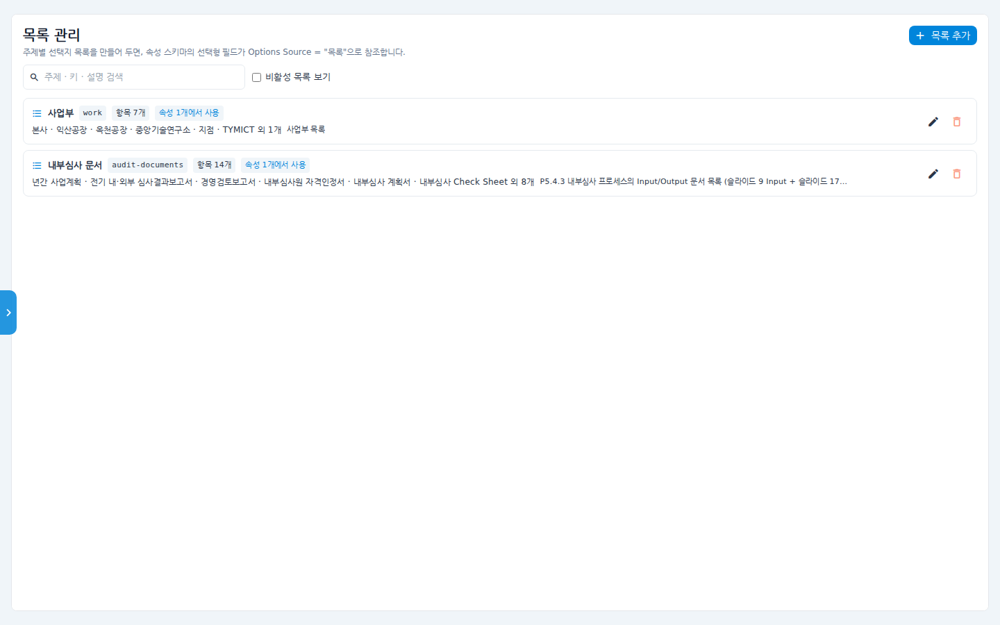
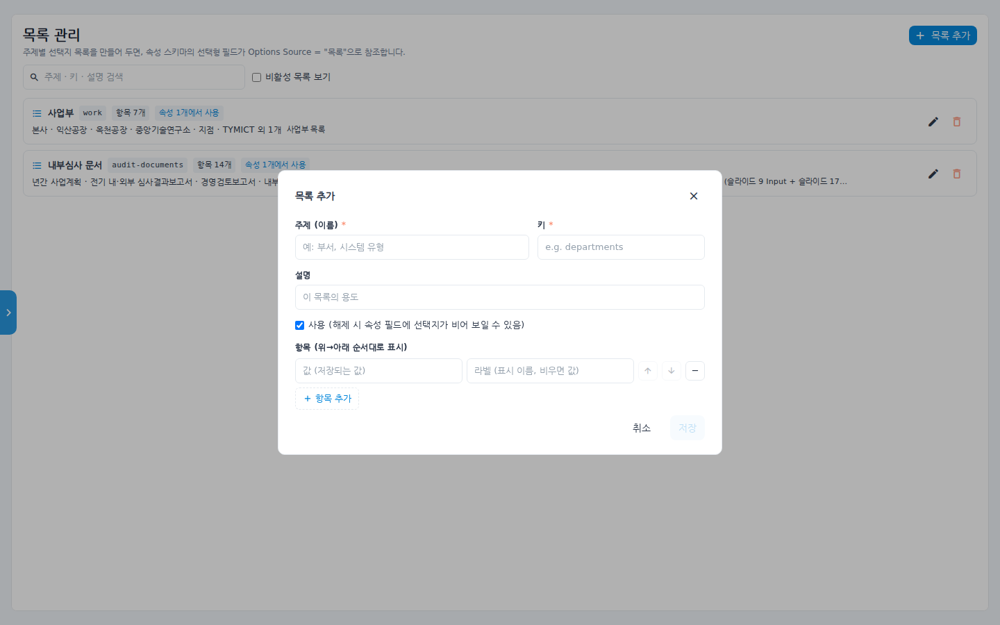
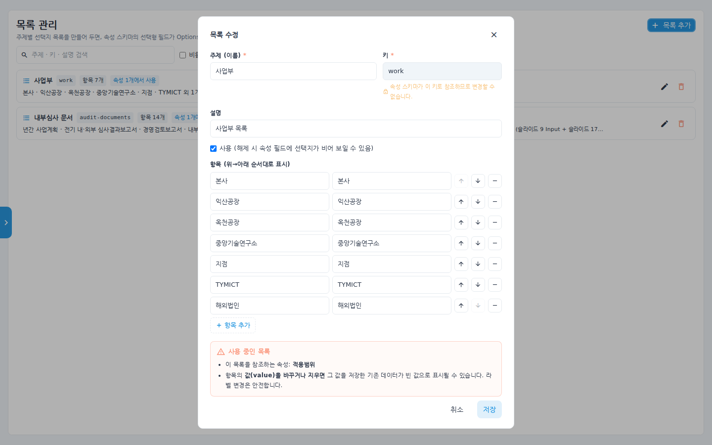

# 목록 관리 사용 매뉴얼 (선택지 목록)

속성 스키마의 **선택형 필드가 참조하는 선택지 목록**을 주제별로 관리하는
관리자 화면입니다. 예를 들어 "사업부" 목록을 한 번 만들어 두면, 프로세스·Task
속성의 선택 필드(Options Source = "목록")가 이 목록을 공용으로 참조합니다.
선택지를 고칠 일이 생겨도 목록 한 곳만 바꾸면 모든 속성에 반영됩니다.

## 시나리오 개요

관리자인 여러분은 Task 속성에 "적용 사업부" 선택 필드를 추가하려고 합니다.
선택지(본사, 익산공장, 옥천공장 …)는 다른 속성에서도 재사용할 예정이라
목록 관리에 "사업부" 목록으로 등록해 두고, 속성 스키마에서 이 목록을
참조하게 하려고 합니다.

## 사전 조건

- 관리자(Admin) 권한. 좌측 **관리자** 섹션에 **목록 관리** 메뉴가 보여야 합니다.
- 만든 목록을 실제 화면에 노출하려면 **속성 스키마**(관리자 > 속성 스키마)에서
  선택형 필드의 Options Source를 "목록"으로 지정해야 합니다.

## 단계별 따라 하기

### 1. 목록 관리 열기

1. 좌측 메뉴 **관리자 > 목록 관리**를 클릭합니다.

   

   - 등록된 목록이 카드로 나열됩니다. 카드에는 주제 이름, 키, 항목 수,
     **속성 N개에서 사용** 배지, 항목 미리보기가 표시됩니다.
   - 상단에서 주제·키·설명 검색과 **비활성 목록 보기** 토글을 쓸 수 있습니다.

### 2. 목록 추가

2. 우상단 **+ 목록 추가**를 누릅니다.

   

3. 입력 항목:
   - **주제(이름)** * — 사람이 읽는 이름 (예: 사업부)
   - **키** * — 속성 스키마가 참조하는 영문 키 (예: `departments`)
   - **설명** — 이 목록의 용도
   - **사용** 체크 — 해제하면 이 목록을 쓰는 속성 필드의 선택지가 비어 보입니다
   - **항목** — `값(저장되는 값)`과 `라벨(표시 이름, 비우면 값)` 을 행 단위로
     입력합니다. ↑↓ 버튼으로 순서를 바꾸고, − 로 삭제, **+ 항목 추가**로
     행을 늘립니다. 화면에는 위→아래 순서대로 표시됩니다.

4. **저장**을 누르면 목록 카드가 추가됩니다.

### 3. 목록 수정 시 주의

5. 카드의 연필 아이콘을 누르면 수정 다이얼로그가 열립니다.

   

   - 이미 속성 스키마가 참조 중인 목록은 **키를 바꿀 수 없습니다**
     (잠금 안내가 표시됩니다).
   - 하단 **사용 중인 목록** 경고를 확인하세요 — **항목의 값(value)을 바꾸거나
     지우면 그 값을 저장한 기존 데이터가 빈 값으로 표시될 수 있습니다.
     라벨 변경은 안전합니다.**

6. 카드의 휴지통 아이콘으로 삭제할 수 있습니다. 참조 중인 속성이 있으면
   "해당 속성의 선택지가 빈 목록이 됩니다" 경고가 뜹니다.

### 4. 속성 스키마에서 연결

7. **관리자 > 속성 스키마**에서 선택형 필드를 만들 때 Options Source를
   **목록**으로 두고 방금 만든 목록(키)을 고르면, 순서도 속성 패널의 해당
   필드에 이 목록의 항목들이 선택지로 나타납니다.

## 확인 포인트

- 목록 카드에 **속성 N개에서 사용** 배지가 붙으면 연결이 정상입니다.
- 순서도에서 해당 속성 필드를 열면 목록 항목이 입력한 순서대로 보입니다.
- 항목 라벨을 바꾼 뒤 화면을 새로고침하면 선택지 표시가 바로 바뀝니다.

## 자주 묻는 질문

- **선택지가 비어 보여요** — 목록의 **사용** 체크가 해제됐거나 목록이 삭제된
  경우입니다. 비활성 목록 보기 토글로 숨은 목록을 확인하세요.
- **값과 라벨을 왜 나누나요?** — 값은 데이터로 저장되는 식별자, 라벨은 화면
  표시용입니다. 라벨은 자유롭게 바꿔도 되지만 값을 바꾸면 기존 데이터와
  연결이 끊어집니다.
