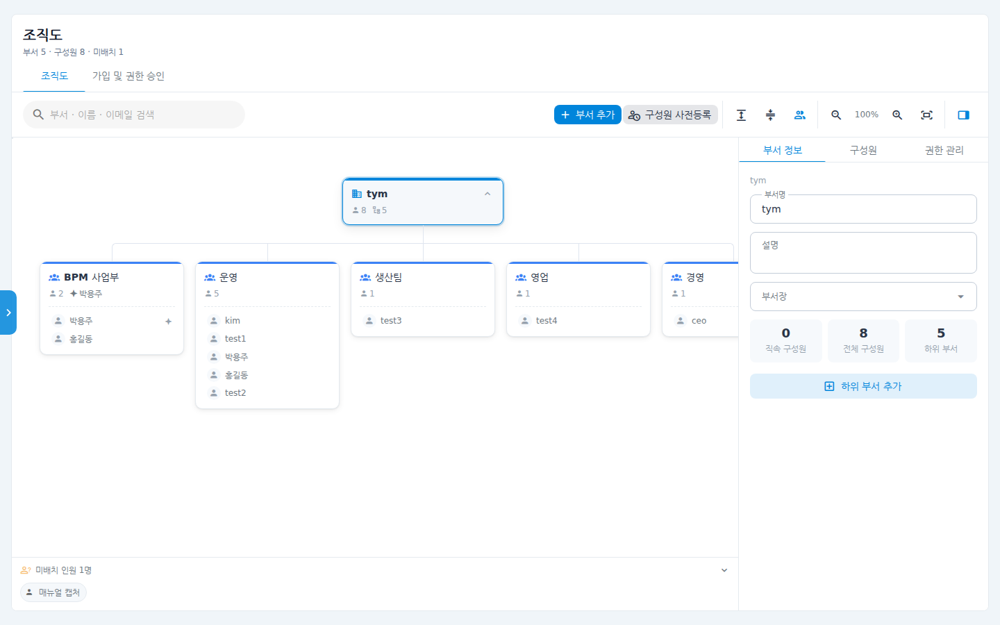
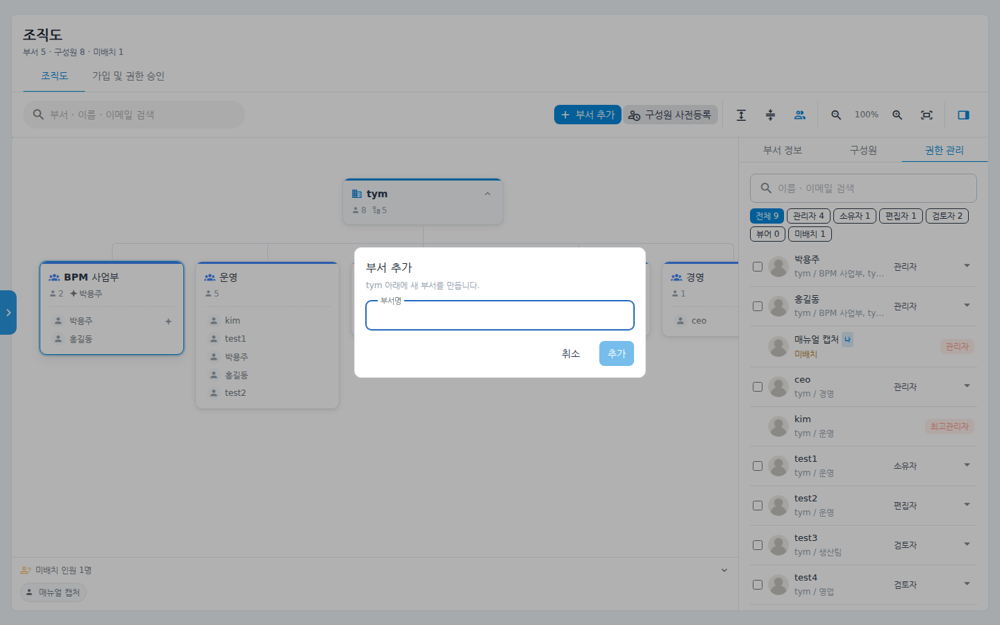
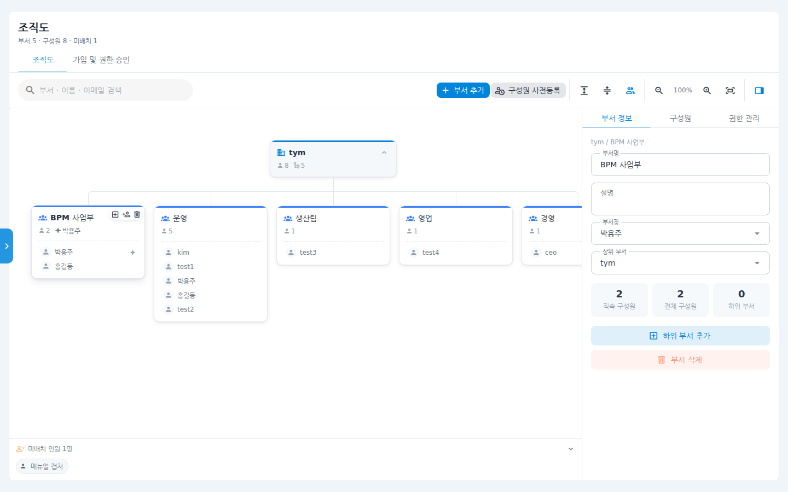
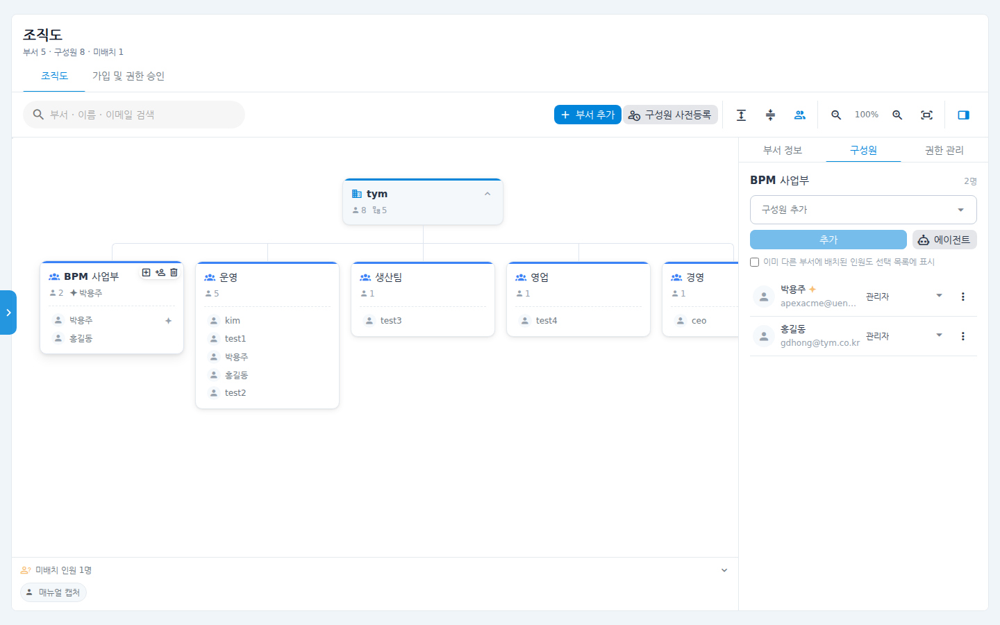
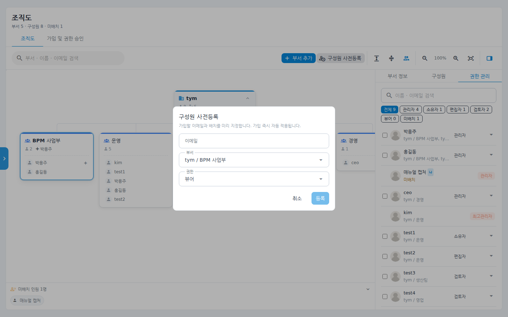
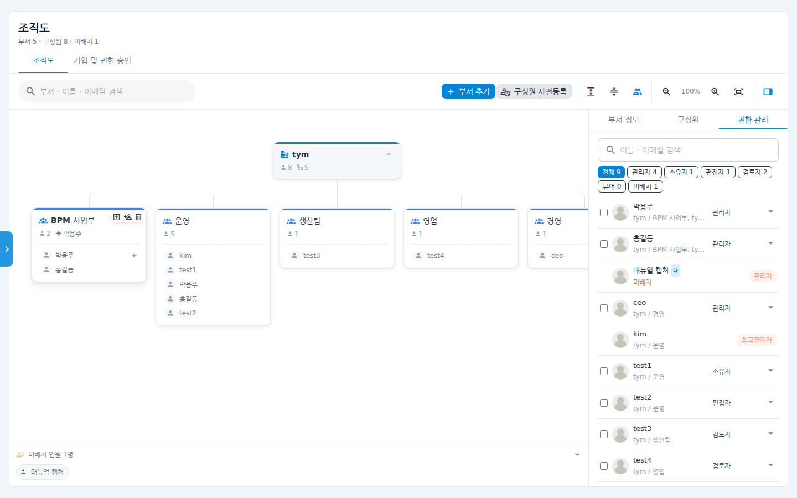
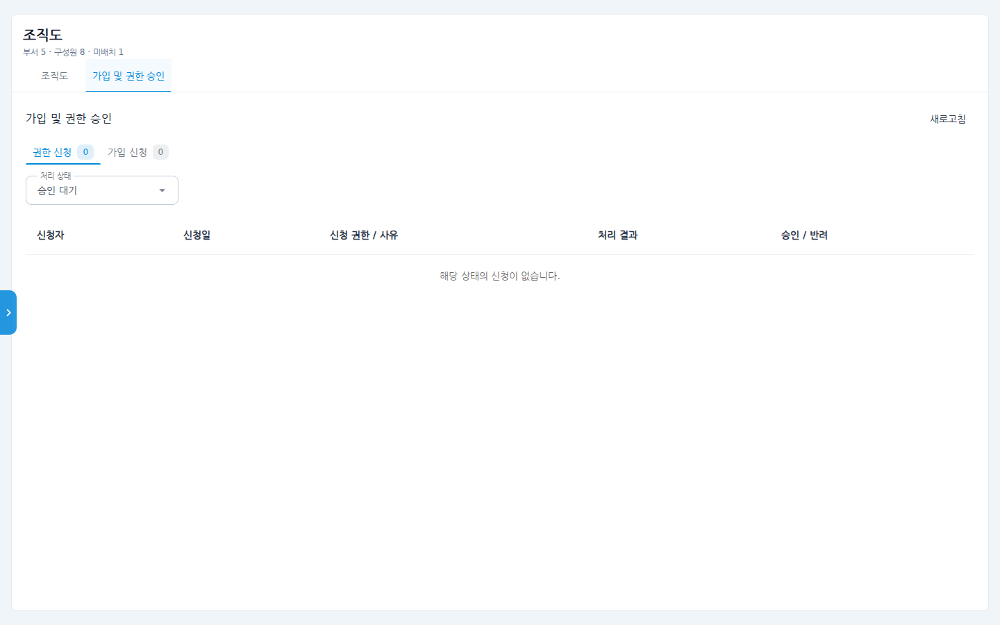

# 조직도 사용 매뉴얼

회사의 부서 구조와 구성원 배치를 트리 형태로 관리하는 화면입니다.
부서를 만들고, 구성원을 드래그로 배치하고, 부서장·권한까지 한 화면에서 지정합니다.
가입 승인 대기자 처리(**가입 및 권한 승인** 탭)도 이 화면에서 함께 합니다.
(승인 탭의 자세한 사용법은 "가입 및 권한 승인 매뉴얼" 참고)

## 시나리오 개요

관리자인 여러분 회사에 새 팀 "품질혁신팀"이 생겼습니다. 조직도에 부서를 추가하고,
기존 구성원을 새 부서로 옮기고, 아직 가입하지 않은 신입사원은 이메일로 미리
등록해 두어 가입하는 즉시 자동으로 배치되게 하려고 합니다.

## 사전 조건

- **부서 편집**: 소유자(Owner) 이상 또는 관리자(Admin) 권한.
- **권한 관리 탭**: 관리자(Admin) 이상. 권한이 없으면 화면이 읽기 전용으로 열립니다.
- 좌측 메뉴 **조직관리 > 조직도**로 진입합니다. 처리할 가입 신청이 있으면
  메뉴 옆에 빨간 숫자 배지가 표시됩니다.

## 단계별 따라 하기

### 1. 화면 구성 확인

1. 좌측 메뉴에서 **조직도**를 클릭합니다.

   

   - 상단에 **부서 N · 구성원 N · 미배치 N** 요약이 보입니다.
   - 툴바: 검색창, **부서 추가**, **구성원 사전등록**, 펼치기/접기,
     구성원 표시 토글, 확대/축소, 화면에 맞추기, 우측 패널 열기/닫기.
   - 가운데 캔버스에 부서 트리가, 하단에 **미배치 인원** 목록이 표시됩니다.
   - 변경은 자동 저장되며 상단에 "방금 저장됨" 표시가 나타납니다.

### 2. 부서 추가

2. 툴바의 **+ 부서 추가**를 누르면 최상위 아래 새 부서를 만드는 다이얼로그가
   열립니다. 부서명을 입력하고 **추가**를 누릅니다.

   

3. 특정 부서 아래에 만들려면 부서 카드를 선택한 뒤 우측 패널의
   **하위 부서 추가** 버튼을 사용합니다. (부서 카드 위에 마우스를 올리면
   나타나는 아이콘으로도 가능합니다.)

### 3. 부서 정보 편집

4. 부서 카드를 클릭하면 우측 패널의 **부서 정보** 탭이 열립니다.
   부서명·설명·부서장·상위 부서를 바로 수정할 수 있고, 직속/전체 구성원 수와
   하위 부서 수 통계가 표시됩니다. 맨 아래 **부서 삭제** 버튼도 여기 있습니다
   (하위 부서·배치가 함께 제거되며, 계정은 삭제되지 않고 미배치로 남습니다).

   

### 4. 구성원 배치

5. 우측 패널의 **구성원** 탭에서는 이름·이메일 검색으로 구성원을 이 부서에
   추가하고, 각 구성원의 역할 변경·이동·제거·부서장 지정을 할 수 있습니다.

   

6. 드래그로도 배치할 수 있습니다 —
   - 화면 하단 **미배치 인원** 칩을 부서 카드 위로 끌어다 놓으면 그 부서에
     배치됩니다.
   - 이미 배치된 구성원을 다른 부서 카드로 끌면 부서 이동이 됩니다.

### 5. 구성원 사전등록 (가입 전 미리 배치)

7. 툴바의 **구성원 사전등록**을 누르고, 가입 예정자의 **이메일·부서·권한**을
   입력해 **등록**합니다. 그 이메일로 회원가입이 완료되는 즉시 지정한 부서와
   권한이 자동 적용됩니다.

   

### 6. 권한 관리 탭 (관리자 전용)

8. 우측 패널의 **권한 관리** 탭에서는 조직 전체 사용자를 역할별 칩
   (관리자/소유자/편집자/검토자/뷰어/미배치)으로 걸러 보고, 사용자별 역할을
   바꿀 수 있습니다. 여러 명을 체크한 뒤 **역할 일괄 적용**도 가능합니다.

   

### 7. 가입 및 권한 승인 탭

9. 상단의 **가입 및 권한 승인** 탭(대기 건수 칩 표시)에서는 회원가입 승인과
   권한 변경 신청을 처리합니다.

   

## 확인 포인트

- 부서를 추가/이동하면 상단 요약의 부서 수가 바로 갱신되고 "방금 저장됨"이
  표시됩니다.
- 미배치 인원을 부서로 끌어 놓으면 하단 미배치 수가 줄어듭니다.
- 사전등록한 이메일로 가입하면, 승인 후 조직도에 자동으로 해당 부서 소속으로
  나타납니다.

## 자주 묻는 질문

- **편집이 안 돼요** — 헤더에 "읽기 전용"이 보이면 소유자/관리자 권한이 없는
  것입니다. "권한만 편집 가능"이면 부서 구조는 못 바꾸고 권한 탭만 쓸 수 있습니다.
- **부서를 삭제하면 구성원 계정도 삭제되나요?** — 아니요. 배치만 해제되어
  미배치 인원으로 남습니다.
