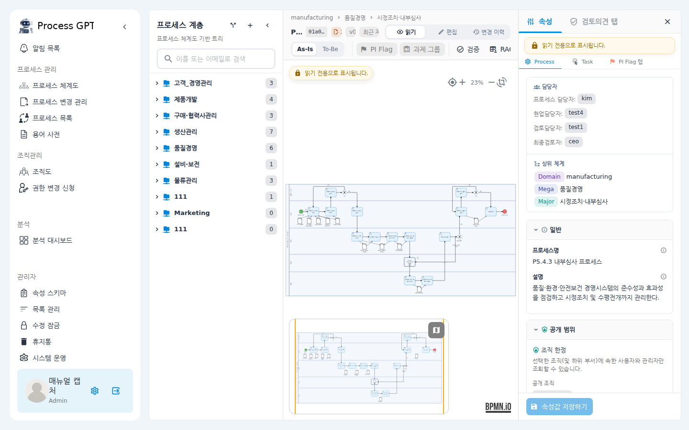
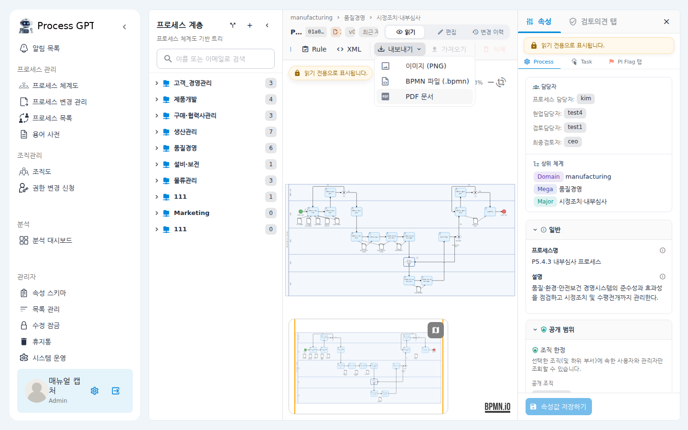
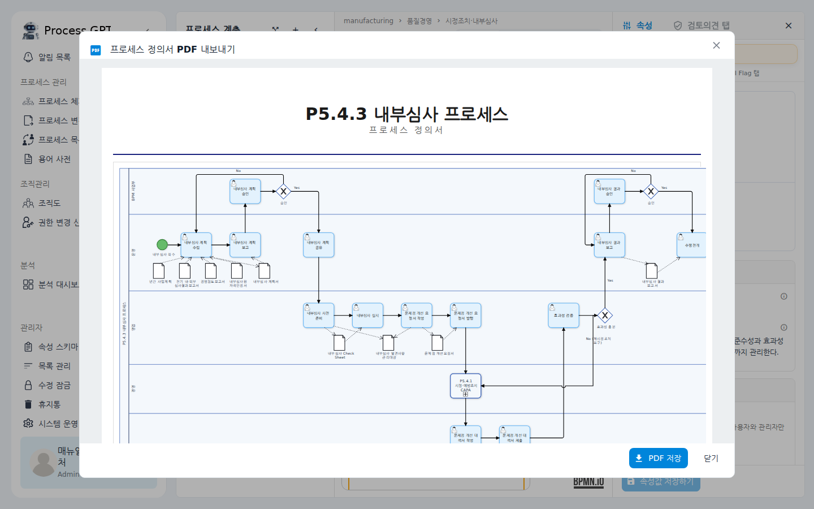
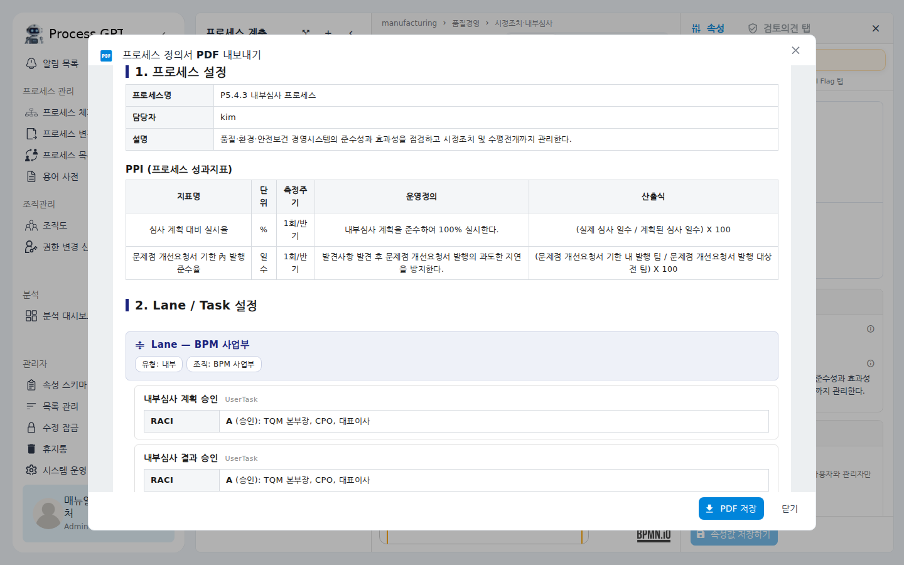
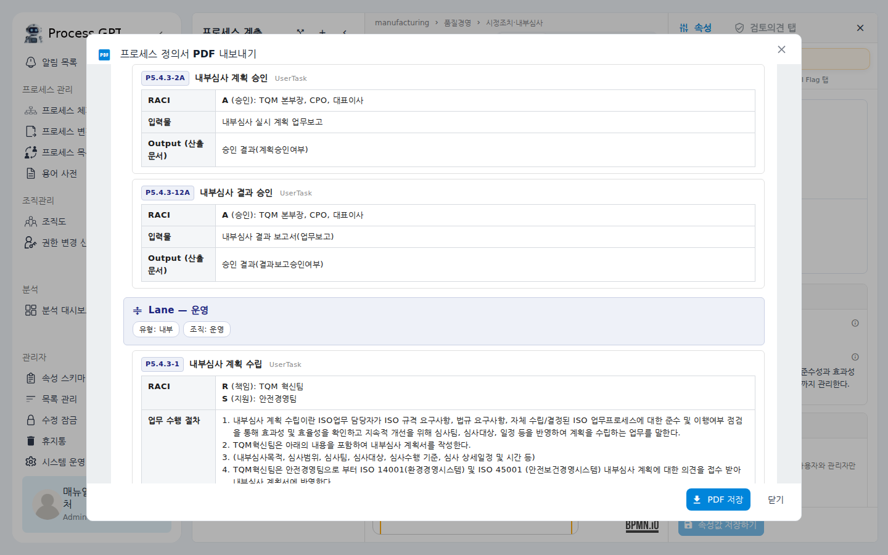
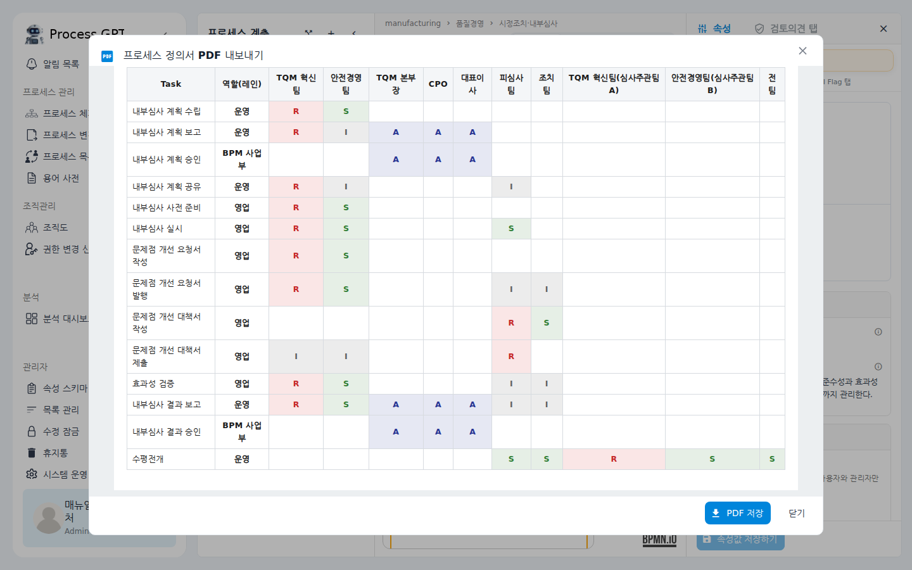

# 프로세스 순서도 내보내기 (이미지 · BPMN · PDF)

프로세스 순서도 화면에서 작성한 다이어그램과 설정 내용을 파일로 내보내는 기능입니다.
빠르게 공유할 때는 **이미지(PNG)**, 다른 BPMN 도구나 다른 시스템으로 옮길 때는
**BPMN 파일(.bpmn)**, 프로세스 규정·업무 문서로 배포할 때는 **PDF 정의서**를 선택하면 됩니다.
PDF에는 다이어그램뿐 아니라 프로세스 설정, 각 Lane과 Task에 입력한 설정(RACI, 업무 수행 절차 등),
통합 RACI 매트릭스까지 한 문서로 정리되어 담깁니다.

## 시나리오 개요

품질팀의 프로세스 담당자가 "내부심사 프로세스"의 작성을 마쳤습니다. 이제 이 프로세스를

- 감사 대응용 **규정 문서(PDF)** 로 배포하고,
- 백업 및 외부 도구 검토용으로 **BPMN 파일**을 보관하려고 합니다.

아래 단계를 따라 하면 두 가지 모두 몇 번의 클릭으로 끝납니다.

## 사전 조건

- 로그인한 계정이 해당 프로세스를 **조회할 수 있는 권한**을 갖고 있어야 합니다.
  (읽기 전용 계정도 내보내기는 가능합니다.)
- 내보낼 프로세스가 프로세스 체계도에 등록되어 있어야 합니다.

## 단계별 따라 하기

### 1. 프로세스 순서도 화면 열기

왼쪽 메뉴에서 **프로세스 체계도**를 클릭한 뒤, 가운데 트리에서 내보낼 프로세스를
선택합니다. 오른쪽에 순서도(다이어그램)와 속성 패널이 열립니다.

### 2. 툴바에서 "내보내기" 메뉴 열기

순서도 위쪽 툴바에서 **내보내기** 버튼을 클릭합니다. 세 가지 형식이 나타납니다.

| 항목 | 결과 |
|---|---|
| **이미지 (PNG)** | 현재 다이어그램이 `<프로세스명>.png`로 바로 다운로드됩니다. |
| **BPMN 파일 (.bpmn)** | 다이어그램이 표준 BPMN 2.0 XML(`<프로세스명>.bpmn`)로 다운로드됩니다. |
| **PDF 문서** | 미리보기 창이 열리고, 확인 후 PDF로 저장할 수 있습니다. |

> **BPMN 파일 활용**: 내려받은 `.bpmn` 파일은 같은 툴바의 **가져오기** 버튼으로
> 다시 불러올 수 있고, 다른 BPMN 편집 도구에서도 열 수 있습니다.

### 3. PDF 문서 미리보기 확인

**PDF 문서**를 선택하면 문서 미리보기 창이 열립니다. 맨 위에는 표지(프로세스명)와
전체 순서도 이미지가 표시됩니다. 다이어그램이 크면 자동으로 여러 페이지로 나뉩니다.

### 4. 프로세스 설정 · Lane/Task 설정 확인

아래로 스크롤하면 문서 본문이 이어집니다.

**1. 프로세스 설정** — 프로세스명, 담당자, 설명, 시스템, 관련자료, PPI(성과지표) 등
프로세스 수준에서 입력한 값이 표로 정리됩니다.

**2. Lane / Task 설정** — Lane(역할)별로 담당 조직·유형이 표시되고, 그 아래에
소속 Task들이 Task 코드와 함께 순서대로 나열됩니다. 각 Task에는 속성 패널에서
입력해 둔 항목이 모두 표시됩니다: 설명, RACI, 업무 수행 절차, 입력물/산출물,
데이터 객체 입출력, 폼 연결, 시스템, 관련자료, API 연동, 연관 과제, FTE, OPEX,
PPI, Future Status, 메일 발송 설정(메일 Task), 연결 프로세스(하위 프로세스 Task),
그리고 관리자가 속성 스키마에서 추가한 사용자 정의 필드까지 포함됩니다.
값을 입력하지 않은 항목은 표시되지 않습니다.

### 5. 통합 RACI 매트릭스 확인 후 저장

문서 마지막에는 전체 Task × 조직의 **통합 RACI 매트릭스**가 색상 구분과 함께 담깁니다
(R=책임 · A=승인 · S=지원 · C=자문 · I=통보).

내용을 확인했으면 오른쪽 아래 **PDF 저장** 버튼을 클릭합니다. 진행률 표시 후
`<프로세스명>.pdf` 파일이 다운로드됩니다.

## 확인 포인트

- **PNG/BPMN/PDF 파일이 브라우저 다운로드 폴더에 저장되었는지** 확인합니다.
  파일명은 프로세스명과 같습니다.
- **BPMN 파일 검증**: 툴바의 **가져오기** 버튼으로 방금 받은 `.bpmn` 파일을
  다시 올려 보세요. 같은 다이어그램이 오류 없이 그려지면 정상입니다.
- **PDF 내용 검증**: 순서도 화면에서 입력했던 RACI·업무 수행 절차·설명이
  PDF의 해당 Task 항목에 그대로 보이면 정상입니다. 값을 입력하지 않은 항목은
  표시되지 않는 것이 정상 동작입니다.

## 자주 묻는 질문

**Q. 내보내기 버튼이 비활성화되어 있어요.**
프로세스가 선택되지 않은 상태입니다. 트리에서 프로세스를 먼저 선택하세요.

**Q. PDF에 어떤 항목이 나오나요? 특정 항목을 빼고 싶어요.**
사용자가 입력한 값이 있는 항목만 나옵니다. 관리자가 속성 스키마(속성 노출 설정)에서
숨긴 항목은 화면과 동일하게 PDF에서도 제외됩니다.

**Q. 통합 RACI가 "입력된 RACI가 없습니다"로 나와요.**
어떤 Task에도 RACI가 입력되지 않은 경우입니다. Task를 선택해 속성 패널에서
RACI를 입력한 뒤 다시 내보내면 매트릭스가 채워집니다.

**Q. 다이어그램이 세로로 긴 프로세스인데 잘려 보여요.**
다이어그램 방향(가로/세로)에 맞춰 페이지 방향이 자동으로 정해지고, 한 페이지를
넘는 부분은 다음 페이지로 나뉩니다. 미리보기에서 페이지 구성을 먼저 확인하세요.
