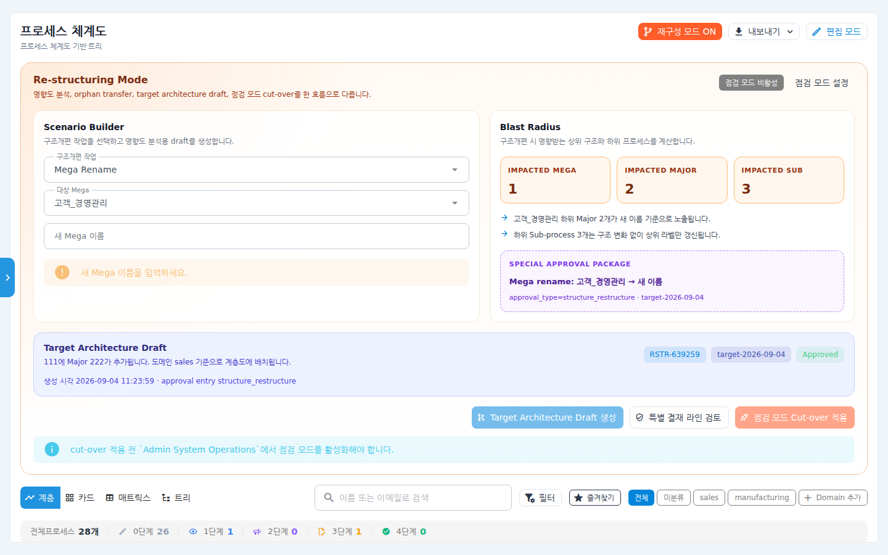
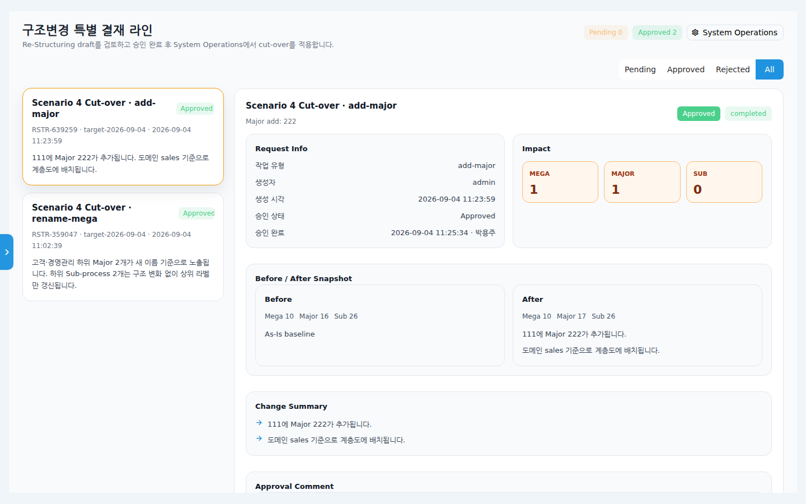
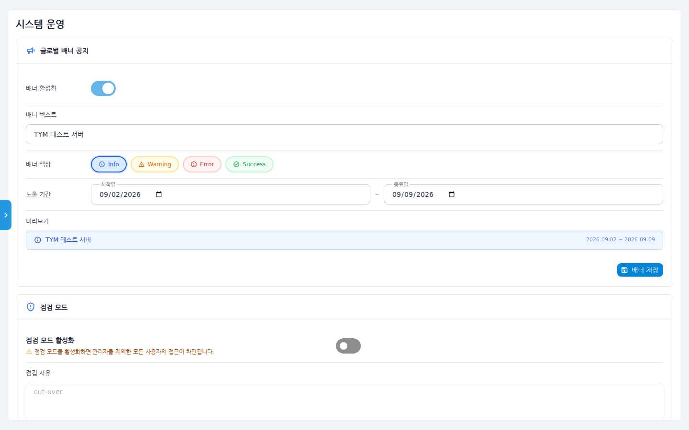

# 프로세스 구조 재구성 사용 매뉴얼 (관리자 심화)

프로세스 체계도의 **계층 구조 자체를 개편**하는 3단계 흐름을 설명합니다.

1. **재구성 모드**에서 개편 시나리오를 만들고 영향도를 확인 (프로세스 체계도)
2. **구조변경 특별 결재 라인**에서 개편안(draft) 승인
3. **점검 모드를 켠 상태에서 Cut-over 적용** (시스템 운영)

일반 편집 모드와 달리 메가/메이저 이동·이름 변경처럼 여러 프로세스에 파급되는
작업을 안전하게 반영하기 위한 절차입니다.

## 시나리오 개요

조직 개편으로 "고객_경영관리" 메가 프로세스의 이름을 바꿔야 합니다. 하위
메이저·서브 프로세스 표기가 모두 영향을 받으므로, 관리자인 여러분은 영향
범위를 확인하고 결재를 받은 뒤 점검 시간에 일괄 반영하려고 합니다.

## 사전 조건

- 관리자(Admin) 권한 — 재구성 모드 버튼은 관리자에게만 보입니다.
- Cut-over 실행 전에 **시스템 운영 화면에서 점검 모드를 활성화**해야 합니다.
  (점검 모드 사용법은 통합 매뉴얼의 "시스템 운영" 장 참고)

## 단계별 따라 하기

### 1. 재구성 모드에서 시나리오 만들기

1. **프로세스 체계도** 화면 우상단의 **재구성 모드**를 켭니다. 화면 위쪽에
   Re-structuring Mode 스튜디오가 펼쳐집니다.

   

2. 왼쪽 **Scenario Builder**에서 개편 작업을 고릅니다 — 메가 이름 변경
   (Mega Rename), 메이저 이동/추가 등. 대상과 새 값을 입력합니다.

3. 오른쪽 **Blast Radius**에서 이 작업이 영향을 주는 메가/메이저/서브 개수와
   요약을 확인합니다. 아래 SPECIAL APPROVAL PACKAGE에 결재로 넘어갈 내용이
   미리 표시됩니다.

4. **Target Architecture Draft 생성**을 눌러 개편안(초안)을 만듭니다.
   생성된 draft는 스튜디오 하단에 번호(RSTR-…)·버전·상태와 함께 표시됩니다.

5. **특별 결재 라인 검토** 버튼으로 개편안을 결재로 넘깁니다.

### 2. 구조변경 특별 결재 라인에서 승인

6. 결재자는 **구조변경 특별 결재 라인** 화면(`/review-board/restructure`,
   재구성 스튜디오나 시스템 운영 화면의 버튼으로 진입)에서 개편안을
   검토합니다.

   

   - Pending / Approved / Rejected / All 토글로 목록을 거릅니다.
   - 상세에는 Request Info(작업 유형·생성자·승인 상태), Impact(영향 개수),
     **Before / After Snapshot**, Change Summary가 표시됩니다.
   - 하단에서 승인 또는 반려를 처리합니다.

### 3. 점검 모드 켜고 Cut-over 적용

7. 반영 시각이 되면 **관리자 > 시스템 운영**에서 **점검 모드**를 활성화합니다
   (관리자를 제외한 사용자의 접근이 차단됩니다).

   

8. 다시 프로세스 체계도의 재구성 스튜디오로 돌아와
   **점검 모드 Cut-over 적용** 버튼을 누릅니다. 이 버튼은
   **개편안이 승인(Approved)되고 점검 모드가 켜져 있을 때만** 활성화됩니다.

9. 적용이 끝나면 점검 모드를 해제해 정상 운영으로 돌립니다.

## 확인 포인트

- 적용 후 프로세스 체계도에 개편된 구조(새 이름/새 배치)가 반영되어야 합니다.
- **관리자 > 감사 로그 > 관리자 감사 로그** 탭의 **구조개편 반영 이력** 카드에
  실행자·버전·반영 내용이 기록됩니다.
- 결재 화면에서 해당 draft의 상태가 Approved · completed로 표시됩니다.

## 자주 묻는 질문

- **Cut-over 버튼이 비활성이에요** — (1) 개편안이 아직 승인되지 않았거나
  (2) 점검 모드가 꺼져 있는 경우입니다. 두 조건을 모두 확인하세요.
- **일반 편집 모드로 하면 안 되나요?** — 프로세스 하나의 내용 수정은 편집
  모드로 충분합니다. 재구성 모드는 계층 구조 개편(이동·개명·추가)처럼 여러
  프로세스에 파급되는 변경을 결재·이력과 함께 반영하기 위한 절차입니다.
