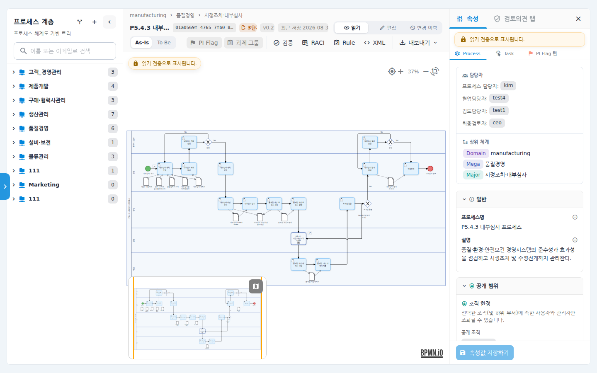
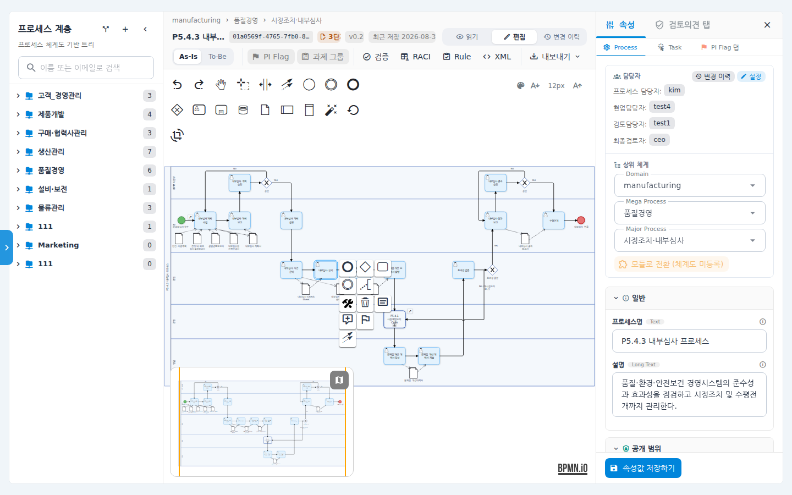
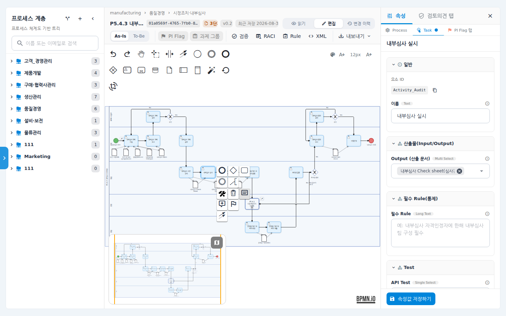
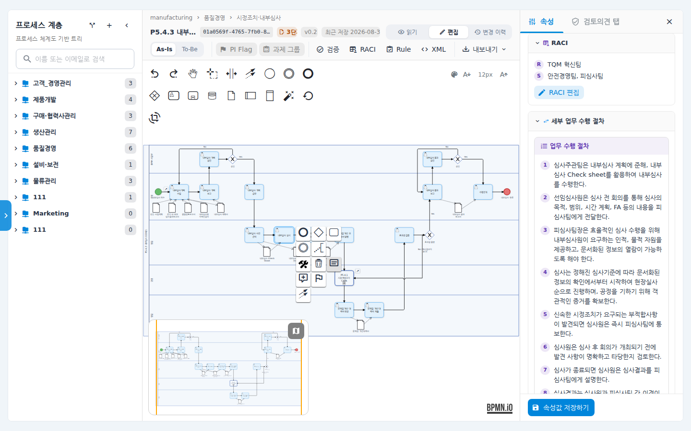
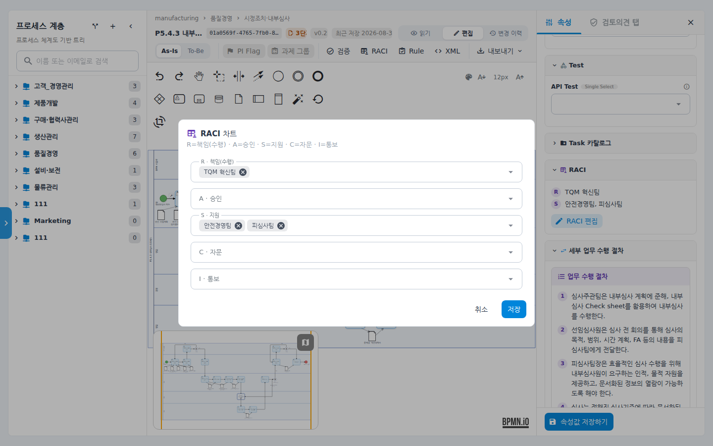
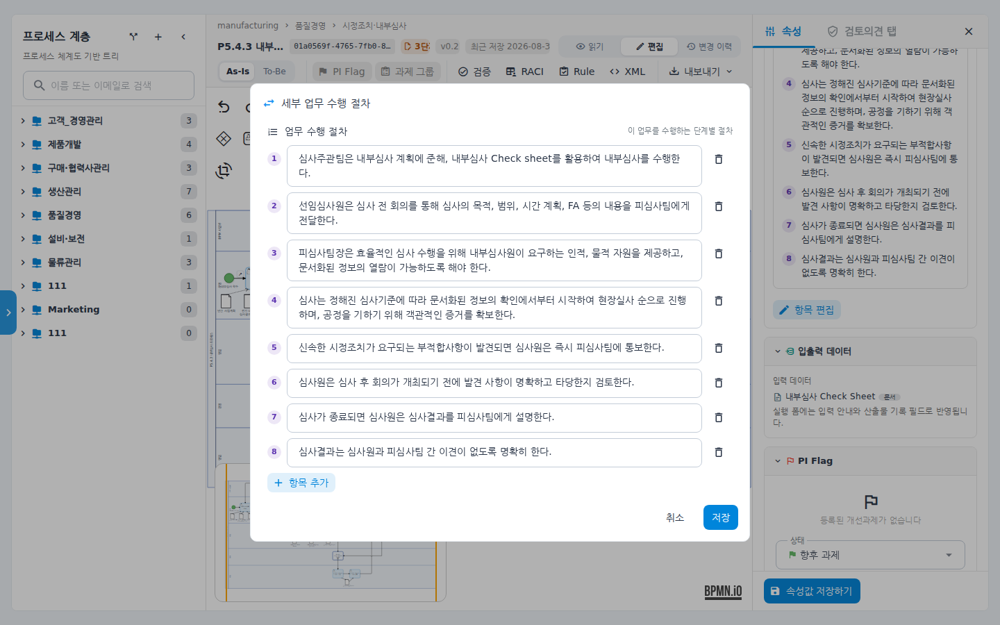
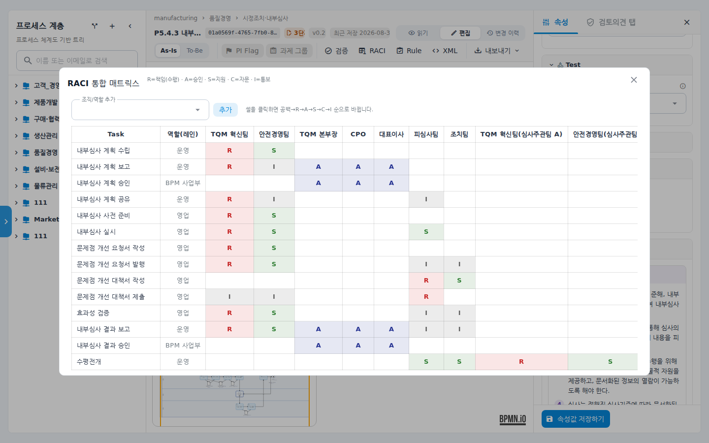

# 순서도 Task 상세 설정 — RACI와 세부 업무 수행 절차

프로세스 순서도에서 각 업무(Task)마다 **누가 어떤 역할로 참여하는지(RACI)** 와
**그 업무를 어떤 순서로 수행하는지(세부 업무 수행 절차)** 를 기록하는 기능입니다.
여기에 입력한 내용은 우측 속성 패널과 RACI 통합 매트릭스에 표시되고,
프로세스 PDF 정의서에도 그대로 실립니다.

## 시나리오 개요

품질팀 담당자가 "P5.4.3 내부심사 프로세스"의 규정서를 시스템으로 옮기고 있습니다.
규정서에는 업무마다 담당 조직표(R/A/S/C/I)와 수행 절차가 정리되어 있는데,
이를 순서도의 각 Task에 입력해 두면 문서를 따로 관리하지 않아도
순서도 하나로 담당과 절차까지 확인할 수 있습니다.

## 사전 조건

- 해당 프로세스의 **편집 권한**이 있어야 합니다. 읽기 모드에서는 등록된 내용만 보이고
  편집 버튼이 나타나지 않습니다.
- 프로세스 체계도에 순서도가 등록된 프로세스가 있어야 합니다.

## 단계별 따라 하기

### 1. 순서도 열고 편집 모드로 전환

1. 좌측 메뉴에서 **프로세스 체계도**를 클릭하고, 설정할 프로세스를 선택해
   순서도 화면을 엽니다.

2. 상단 도구줄을 확인합니다. **검증 · RACI · Rule · XML · 내보내기** 버튼이
   보입니다. 처음에는 **읽기** 모드입니다.

   

3. 오른쪽 위 **편집** 버튼을 눌러 편집 모드로 전환합니다.
   (편집은 한 번에 한 사람만 가능합니다.)

### 2. Task 선택하고 속성 패널 열기

4. 캔버스에서 설정할 Task(예: "내부심사 실시")를 클릭합니다. Task 주변에
   동그란 아이콘 모음(컨텍스트 메뉴)이 나타납니다.

   

5. 컨텍스트 메뉴에서 **속성 패널 열기**(문서 모양 아이콘)를 클릭합니다.
   우측 패널이 **Task 탭**으로 바뀌면서 선택한 Task의 속성이 표시됩니다.

   

### 3. RACI 입력

6. 패널을 아래로 내리면 **RACI** 섹션이 있습니다. 현재 지정된 역할 요약이 보이고,
   그 아래 **RACI 편집** 버튼이 있습니다.

   

7. **RACI 편집**을 누르면 5개 역할 입력창이 있는 다이얼로그가 열립니다.

   

   - **R · 책임(수행)** — 실제로 업무를 수행하는 조직/역할
   - **A · 승인** — 결과를 승인하는 조직/역할
   - **S · 지원** — 수행을 지원하는 조직/역할
   - **C · 자문** — 의견을 구하는 조직/역할
   - **I · 통보** — 결과를 공유받는 조직/역할

   각 칸에 조직 이름을 입력하고 Enter를 치면 칩으로 추가됩니다(여러 개 가능).
   입력창을 열면 이 Task가 놓인 **레인(Lane) 이름과 다른 Task에서 이미 쓴
   조직명이 제안 목록**으로 떠서 골라 넣을 수 있습니다. R을 비워 두면 레인
   이름이 자동으로 채워집니다(저장 전이므로 수정·삭제 가능).

8. **저장**을 눌러야 순서도에 반영됩니다. 다섯 칸을 모두 비우고 저장하면
   RACI가 등록되지 않은 상태로 돌아갑니다.

### 4. 세부 업무 수행 절차 입력

9. RACI 섹션 아래 **세부 업무 수행 절차** 섹션이 있습니다. 이미 등록된 절차는
   번호 목록의 문서형 카드로 보입니다. **항목 편집**(등록된 항목이 없으면
   **항목 추가**) 버튼을 누릅니다.

10. 다이얼로그에서 단계별 절차를 한 줄씩 입력합니다. 한 단계 안에서 줄바꿈도
    가능하고, **항목 추가**로 단계를 늘리고 휴지통 아이콘으로 삭제합니다.

    

11. **저장**을 누르면 패널의 절차 카드에 번호 순서대로 표시됩니다.

### 5. RACI 통합 매트릭스로 전체 확인

12. 상단 도구줄의 **RACI** 버튼을 누르면 프로세스 전체 Task × 조직의
    **RACI 통합 매트릭스**가 열립니다.

    

    - 각 행은 Task, 각 열은 조직/역할입니다. **역할(레인)** 열에서 Task가 속한
      레인도 함께 확인합니다.
    - **셀을 클릭하면 공백 → R → A → S → C → I 순으로 바뀝니다.** 매트릭스에서
      바로 지정을 고치고 싶을 때 사용합니다(편집 모드에서만).
    - 위쪽 **조직/역할 추가** 입력창과 **추가** 버튼으로 새 조직 열을 만들 수
      있고, 값이 하나도 없는 열은 ✕로 제거합니다.

## 확인 포인트

- Task를 다시 선택하면 패널 RACI 섹션에 지정한 역할 요약(R/A/S/C/I별 조직)이
  보여야 합니다.
- RACI 통합 매트릭스에서 해당 Task 행에 지정한 값이 표시되어야 합니다.
- **내보내기 > PDF 정의서**로 내보내면 Task별 RACI와 업무 수행 절차,
  통합 RACI 매트릭스가 문서에 포함됩니다. (자세한 내용은 프로세스 내보내기
  매뉴얼 참고)

## 자주 묻는 질문

- **RACI 섹션이 안 보여요** — RACI는 Task 계열 요소에만 표시됩니다. 이벤트·게이트웨이
  선택 시에는 나타나지 않습니다. 관리자가 속성 스키마에서 RACI 항목을 숨긴 경우에도
  보이지 않으니 관리자에게 확인하세요.
- **저장했는데 다른 사람 화면에 안 보여요** — 순서도 자체를 저장(상단 저장 버튼)해야
  다른 사용자에게도 반영됩니다.
