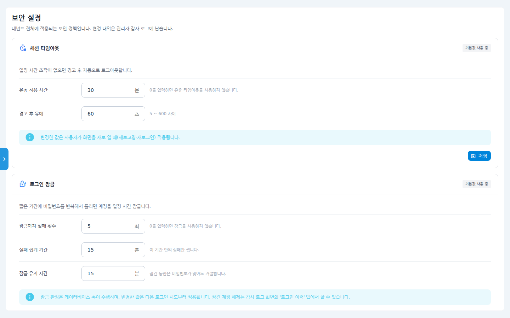
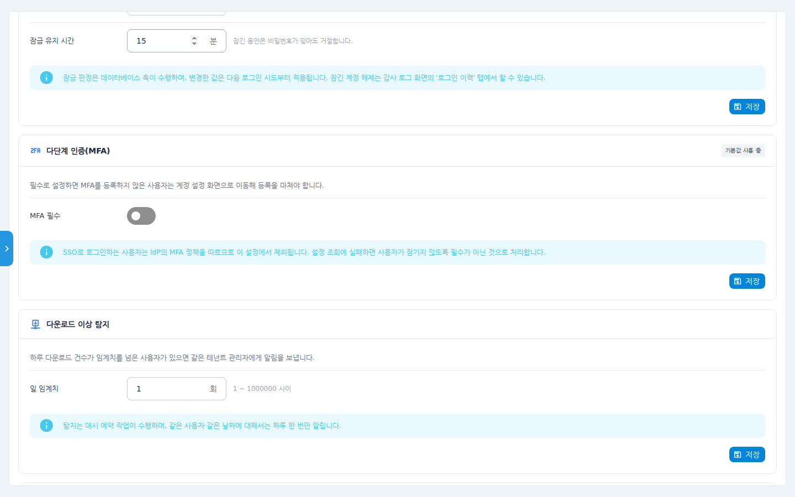
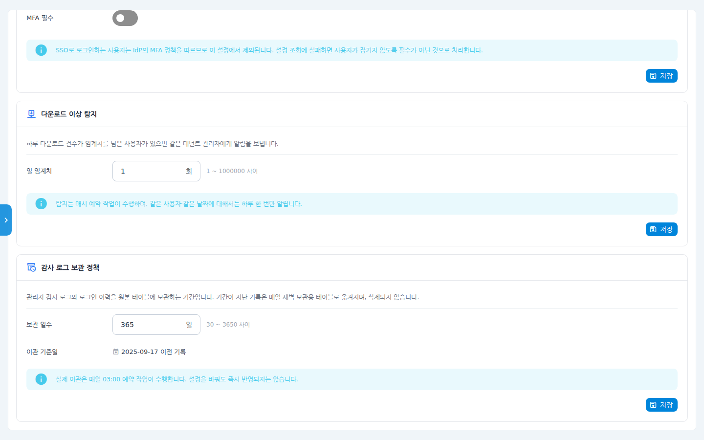

# 보안 설정 사용 매뉴얼

테넌트(조직) 전체에 적용되는 보안 정책을 관리자 한 화면에서 조정합니다.
세션 타임아웃, 로그인 잠금, 다단계 인증(MFA), 다운로드 이상 탐지,
감사 로그 보관 정책 — 5개 섹션으로 구성되며, 변경 내역은 모두
**관리자 감사 로그**에 남습니다.

## 시나리오 개요

보안 점검 결과에 따라 관리자인 여러분은 (1) 30분 무조작 시 자동 로그아웃,
(2) 비밀번호 5회 연속 실패 시 15분 잠금을 조직 전체에 적용하려고 합니다.

## 사전 조건

- 관리자(Admin) 권한. 좌측 **관리자 > 보안 설정** 메뉴로 진입합니다.
- 각 섹션은 **개별 저장** 버튼을 갖습니다. 섹션마다 저장을 눌러야 반영됩니다.

## 단계별 따라 하기

### 1. 세션 타임아웃

1. 좌측 메뉴 **관리자 > 보안 설정**을 클릭합니다. 첫 섹션이
   **세션 타임아웃**입니다.

   

   - **유휴 허용 시간(분)** — 이 시간 동안 조작이 없으면 경고 후 자동
     로그아웃됩니다. 0을 입력하면 유휴 타임아웃을 쓰지 않습니다.
   - **경고 후 유예(초)** — 경고 표시 후 로그아웃까지의 유예(5~600초).
   - 변경 값은 사용자가 화면을 새로 열 때(새로고침·재로그인)부터 적용됩니다.

2. 값을 입력하고 섹션 우하단 **저장**을 누릅니다. 섹션 우상단의
   **기본값 사용 중** 배지는 커스텀 값 저장 후 사라집니다.

### 2. 로그인 잠금

3. **로그인 잠금** 섹션에서 반복 실패 시 계정 잠금 정책을 정합니다.
   - **잠금까지 실패 횟수** — 0이면 잠금 기능을 쓰지 않습니다.
   - **실패 집계 기간(분)** — 이 기간 안의 실패만 셉니다.
   - **잠금 유지 시간(분)** — 잠긴 동안은 비밀번호가 맞아도 거절됩니다.
   - 변경 값은 다음 로그인 시도부터 반영됩니다. 잠긴 계정 해제는
     **감사 로그 > 로그인 이력** 탭의 잠금 계정 영역에서 합니다.

### 3. 다단계 인증(MFA)

4. **다단계 인증(MFA)** 섹션의 **MFA 필수** 토글을 켜면, MFA를 등록하지 않은
   사용자는 로그인 후 계정 설정 화면으로 이동해 등록을 마쳐야 합니다.

   

   - SSO로 로그인하는 사용자는 소속 IdP의 MFA 정책을 따르므로 이 설정에서
     제외됩니다.

### 4. 다운로드 이상 탐지

5. **다운로드 이상 탐지** 섹션에서 **일 임계치(회)** 를 설정합니다. 하루
   다운로드 건수가 임계치를 넘는 사용자가 있으면 같은 테넌트의 관리자에게
   알림이 갑니다. 탐지는 매시 예약 작업이 수행하며, 같은 사용자·같은 날짜는
   하루 한 번만 알립니다.

### 5. 감사 로그 보관 정책

6. **감사 로그 보관 정책** 섹션에서 관리자 감사 로그·로그인 이력의
   **보관 일수**(30~3650일)를 정합니다.

   

   - 기간이 지난 기록은 매일 새벽(03:00) 보관용 테이블로 옮겨질 뿐
     **삭제되지 않습니다.**
   - **이관 기준일**로 현재 설정 기준 어느 날짜 이전 기록이 이관되는지
     확인할 수 있습니다.

## 확인 포인트

- 각 섹션 저장 후 **기본값 사용 중** 배지가 사라졌는지 확인합니다.
- **관리자 > 감사 로그 > 관리자 감사 로그** 탭에 방금 변경한 설정 이력이
  남았는지 확인합니다.
- 세션 타임아웃은 본인 계정으로 새로고침 후 설정 시간 동안 조작하지 않으면
  경고 → 자동 로그아웃되는지로 검증할 수 있습니다.

## 자주 묻는 질문

- **잠긴 계정을 바로 풀어주고 싶어요** — 감사 로그 화면의 **로그인 이력** 탭
  상단 "잠금 계정" 영역에서 해제할 수 있습니다.
- **설정을 기본값으로 되돌리려면?** — 각 항목을 기본값(플레이스홀더에 표시)과
  같게 입력하고 저장하면 됩니다.
