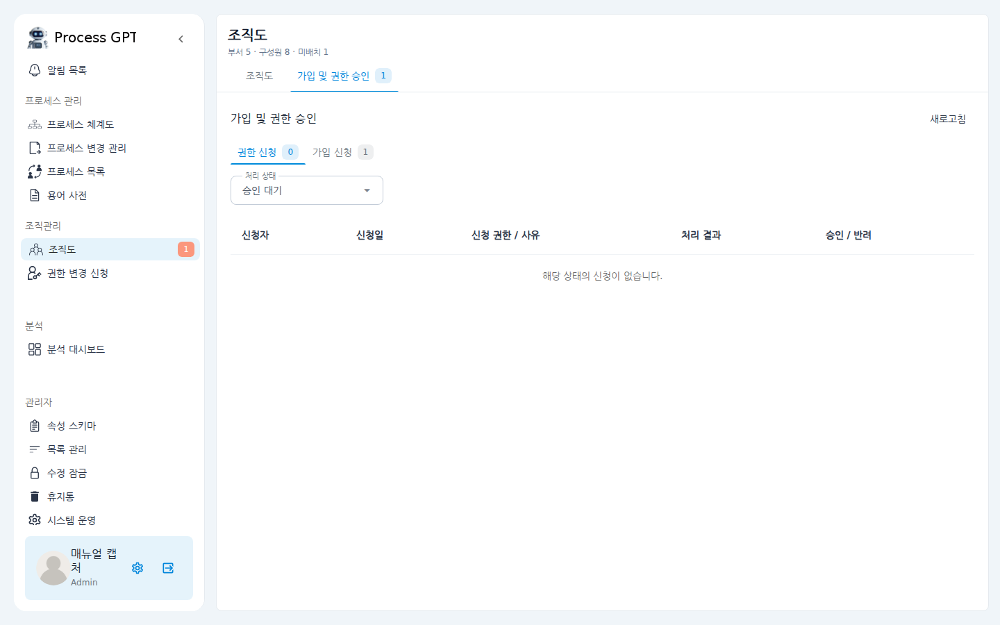
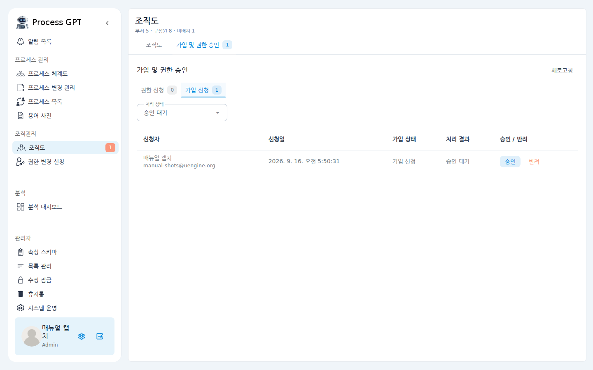

# 가입 및 권한 승인 매뉴얼

새 구성원이 회원가입하면 바로 활동할 수 있는 것이 아니라 **관리자의 승인**을 거칩니다.
이 문서는 관리자가 가입 신청과 권한 변경 신청을 확인하고 승인·반려하는 방법을 설명합니다.

## 시나리오 개요

신입사원 한 명이 우리 조직 워크스페이스에 회원가입을 마쳤습니다. 아직 승인 전이라
로그인해도 업무 화면을 쓸 수 없는 상태입니다. 관리자인 여러분이 신청 내역을 확인하고
승인해서, 신입사원이 바로 일을 시작할 수 있게 하려고 합니다.

## 사전 조건

- 관리자(Admin) 계정으로 로그인되어 있어야 합니다.
- 좌측 메뉴에 **조직관리 > 조직도**가 보여야 합니다. 보이지 않으면 관리자 권한이 없는 것입니다.

## 단계별 따라 하기

1. 좌측 메뉴에서 **조직도**를 클릭합니다. 처리할 신청이 있으면 메뉴 오른쪽에
   빨간 숫자 배지가 표시됩니다.

2. 화면 상단의 **가입 및 권한 승인** 탭을 클릭합니다. 탭 이름 옆 숫자가
   대기 중인 신청 건수입니다.

   

3. 신청 종류에 따라 하위 탭을 선택합니다.
   - **권한 신청** — 기존 구성원이 요청한 권한 변경 건
   - **가입 신청** — 새로 회원가입한 사람의 승인 대기 건

4. **가입 신청** 탭을 열면 신청자 이름·이메일, 신청일, 처리 상태가 표로 나타납니다.
   기본 필터는 "승인 대기"이며, 상단의 **처리 상태** 드롭다운으로 이미 처리한 건도
   조회할 수 있습니다.

   

5. 신청자를 확인한 뒤 행 오른쪽의 **승인** 또는 **반려** 버튼을 클릭합니다.
   - **승인** — 신청자가 즉시 조직 구성원이 되어 로그인 후 업무 화면을 사용할 수 있습니다.
   - **반려** — 신청이 거절되며, 신청자는 다시 가입 신청해야 합니다.

## 확인 포인트

- 승인 직후 목록에서 해당 건이 사라집니다(기본 필터가 "승인 대기"이므로).
  **처리 상태** 드롭다운을 "승인 완료"로 바꾸면 방금 처리한 건이 보입니다.
- 좌측 **조직도** 메뉴의 빨간 배지 숫자가 줄어듭니다.
- 승인된 구성원은 **조직도** 탭의 미배치 목록에 나타나며, 부서로 배치할 수 있습니다.

## 자주 묻는 질문

- **승인했는데 신청자가 여전히 로그인이 안 된다고 합니다.**
  신청자에게 로그아웃 후 다시 로그인하도록 안내하세요. 승인 상태는 로그인 시점에 반영됩니다.
- **권한 신청 탭은 언제 쓰나요?**
  기존 구성원이 좌측 메뉴 **권한 변경 신청**에서 요청한 건이 이 탭으로 들어옵니다.
  처리 방법은 가입 신청과 동일합니다(승인/반려 버튼).
