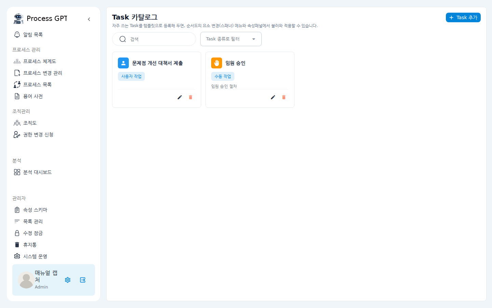
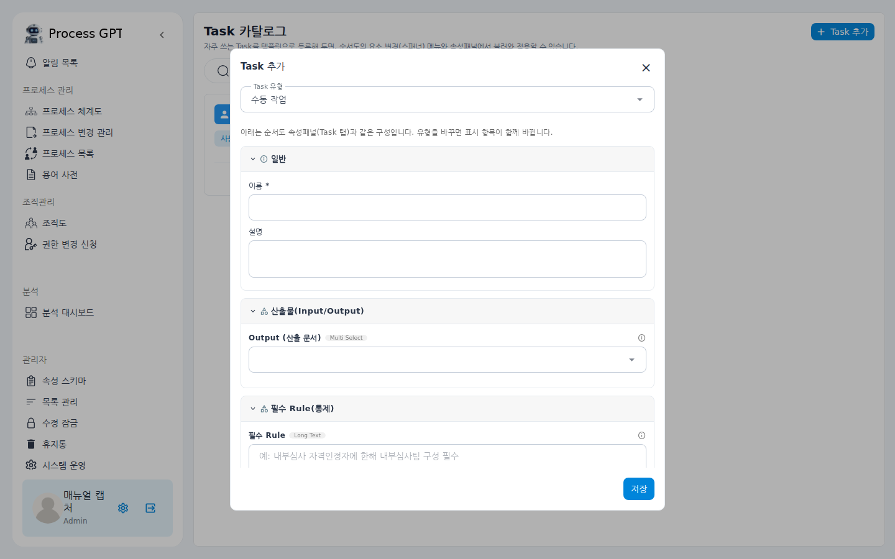
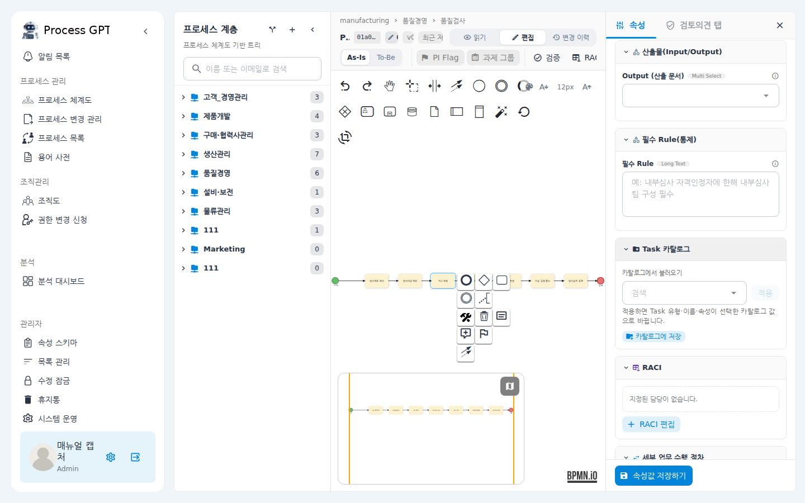
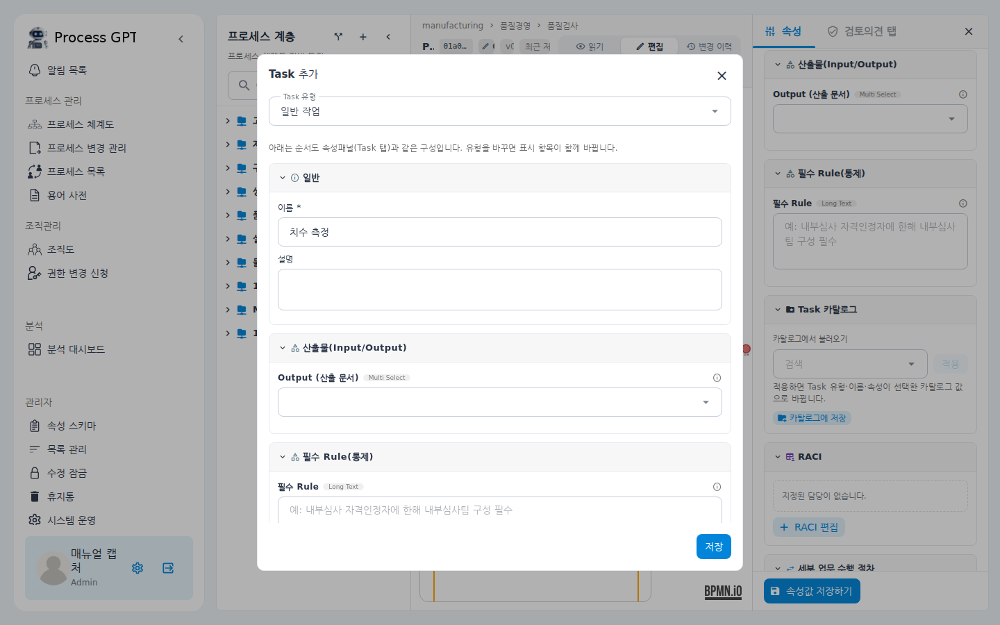
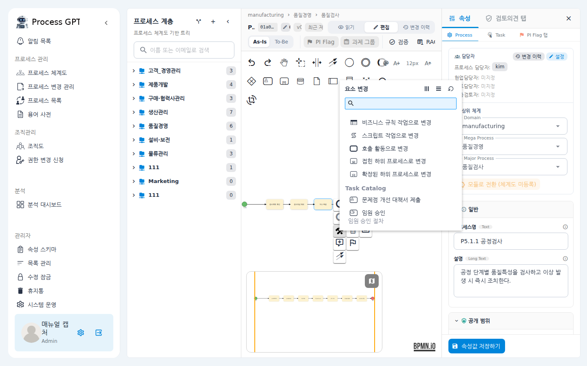
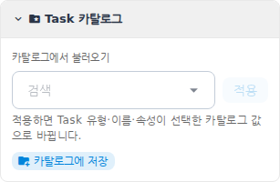

# Task 카탈로그 사용 매뉴얼

자주 쓰는 업무(Task)를 **카탈로그**에 템플릿처럼 등록해 두고, 프로세스 순서도를 그릴 때
꺼내 쓰는 기능입니다. 이름·업무 유형·설명은 물론 RACI, 세부 절차, 관련자료 링크 같은
속성까지 함께 저장되므로, 여러 프로세스에서 반복되는 업무를 매번 새로 입력할 필요가 없습니다.

## 시나리오 개요

품질팀에서는 "임원 승인", "문제점 개선 대책서 제출" 같은 업무가 여러 프로세스에
반복해서 등장합니다. 관리자인 여러분이 이 업무들을 카탈로그에 한 번 등록해 두면,
프로세스를 그리는 누구나 순서도에서 두어 번의 클릭으로 같은 이름·같은 속성의
업무를 배치할 수 있습니다.

## 사전 조건

- **카탈로그 등록·관리(방법 1)**: 관리자(Admin) 권한. 좌측 메뉴에 **관리자** 섹션이
  보여야 합니다.
- **프로세스 화면에서 등록·사용(방법 2, 3)**: 프로세스 편집 권한. 읽기 모드에서는
  등록·적용 버튼이 나타나지 않습니다.

---

## 방법 1 — 카탈로그 페이지에서 직접 등록하기

1. 좌측 메뉴의 **관리자** 섹션에서 **카탈로그**를 클릭합니다.
   (항목이 많으면 메뉴를 아래로 스크롤해야 보일 수 있습니다.)

2. 카탈로그 페이지가 열립니다. 등록된 업무가 카드로 나열되고, 상단에서 이름·설명 검색과
   Task 종류 필터를 쓸 수 있습니다.

   

3. 우측 상단의 **Task 추가** 버튼을 클릭합니다.

4. 등록 창이 열립니다. 맨 위에서 **Task 유형**을 고르면, 그 아래에 순서도의
   속성 입력 화면과 똑같은 구성(일반 / 산출물 / 필수 Rule / RACI / 세부 절차 /
   관련자료 링크 등)이 나타납니다. **이름**은 필수이고, 나머지는 필요한 만큼 입력합니다.

   

5. **저장**을 클릭하면 목록에 새 카드가 나타납니다.
   카드의 연필 아이콘으로 수정, 휴지통 아이콘으로 삭제할 수 있습니다.

---

## 방법 2 — 프로세스를 그리다가 등록하기

순서도를 그리던 중 "이 업무는 다른 프로세스에서도 계속 쓰겠다" 싶으면,
화면을 옮기지 않고 그 자리에서 바로 등록할 수 있습니다.

1. **프로세스 체계도**에서 프로세스를 열고 **편집** 모드로 전환합니다.

2. 등록할 업무 요소를 클릭한 뒤, 요소 옆에 뜨는 아이콘 묶음에서
   **속성 패널 열기**(문서 모양) 아이콘을 클릭합니다.
   우측 속성 패널이 해당 업무의 속성 화면(Task 탭)으로 바뀝니다.

3. 패널에서 **Task 카탈로그** 섹션을 펼칩니다(기본은 접혀 있습니다).

   

4. **카탈로그에 저장** 버튼을 클릭합니다. 방법 1과 같은 등록 창이 열리는데,
   현재 요소의 이름·유형·속성이 미리 채워져 있습니다.

   

5. 필요한 값을 보완하고 **저장**을 클릭합니다. "카탈로그에 등록되었습니다" 알림이
   표시되고, 등록 직후부터 아래 방법 3의 목록에 바로 나타납니다.

---

## 방법 3 — 등록된 업무를 순서도에 적용하기

### 3-1. 요소 변경 메뉴에서 적용

1. 순서도에 업무 요소를 하나 배치(또는 기존 요소를 선택)합니다.
2. 요소를 클릭하고 아이콘 묶음에서 **스패너(변경)** 아이콘을 클릭합니다.
3. "요소 변경" 메뉴를 아래로 스크롤하면 **Task Catalog** 그룹이 나타납니다.
   등록해 둔 업무가 유형 아이콘·이름·설명과 함께 나열되고, 항목이 많으면
   메뉴 상단 검색창으로 좁힐 수 있습니다.

   

4. 원하는 항목을 클릭하면 한 번에 적용됩니다 — 요소의 **유형**이 카탈로그에 등록된
   유형으로 바뀌고, **이름**과 **속성**(설명·RACI·세부 절차·관련자료 링크 등)이
   함께 채워집니다. 기존에 입력해 둔 속성 중 카탈로그에 없는 값은 그대로 유지됩니다.

### 3-2. 속성 패널에서 불러오기

1. 업무 요소의 속성 패널(방법 2의 1~3단계)에서 **Task 카탈로그** 섹션을 펼칩니다.
2. **카탈로그에서 불러오기** 목록에서 항목을 검색·선택하고 **적용**을 클릭합니다.

   

3. 적용 결과는 3-1과 동일하며, 적용 직후 패널의 입력값이 카탈로그 값으로 갱신됩니다.
   적용된 요소는 섹션 제목 오른쪽에 적용한 카탈로그 항목의 이름 칩이 표시됩니다.

---

## 확인 포인트

- 방법 1·2로 등록한 업무가 카탈로그 페이지의 카드 목록에 보입니다.
- 방법 3으로 적용한 요소의 속성 패널을 열면, 카탈로그에 등록해 둔
  설명·RACI·세부 절차가 그대로 들어와 있습니다.
- 적용 후 요소의 속성을 수정해도 카탈로그 원본은 바뀌지 않습니다(복사 방식).
  반대로 카탈로그 항목을 삭제해도 이미 적용된 요소는 영향을 받지 않습니다.

## 자주 묻는 질문

- **요소 변경 메뉴에 Task Catalog 그룹이 안 보여요.**
  카탈로그에 등록된 업무가 하나도 없으면 그룹 자체가 표시되지 않습니다.
  또한 메뉴가 길면 아래로 스크롤해야 보입니다. 업무·호출 활동·하위 프로세스
  요소에서만 나타나며, 이벤트·게이트웨이에서는 나타나지 않습니다.
- **수정한 내용을 카탈로그에도 반영하고 싶어요.**
  요소에서 **카탈로그에 저장**으로 다시 등록하거나(새 항목으로 추가됨),
  카탈로그 페이지에서 해당 항목을 직접 수정하세요.
- **같은 이름으로 저장하면 기존 항목이 덮어써지나요?**
  아니요, 새 항목이 추가됩니다. 기존 항목을 고치려면 카탈로그 페이지의
  연필 아이콘을 사용하세요.
