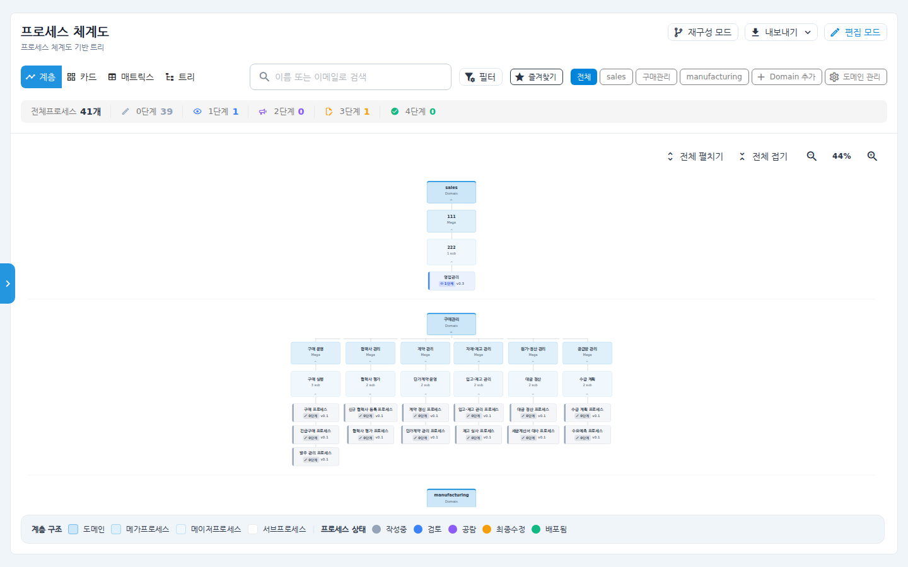
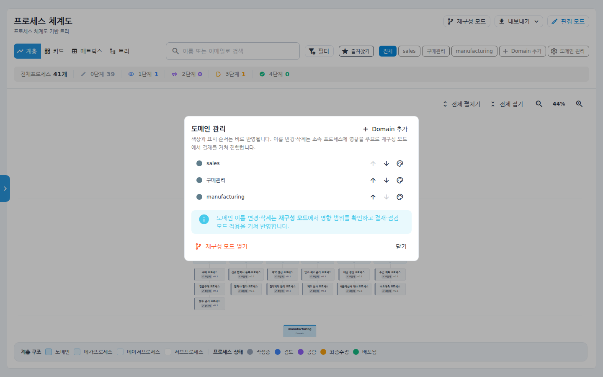
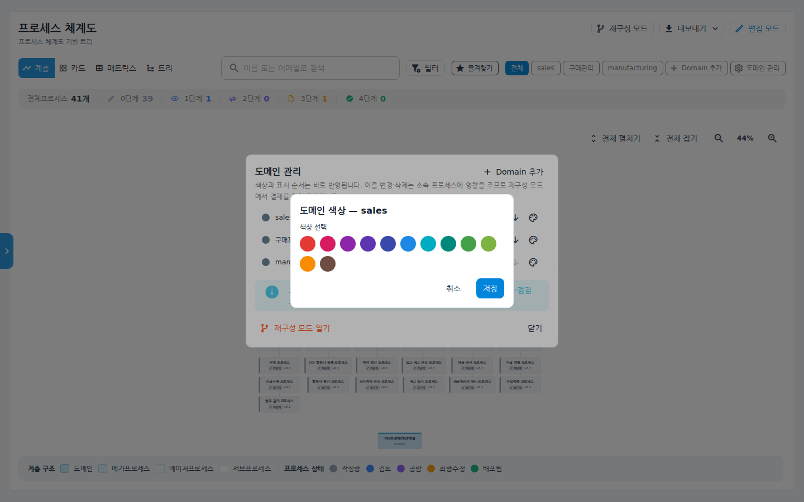
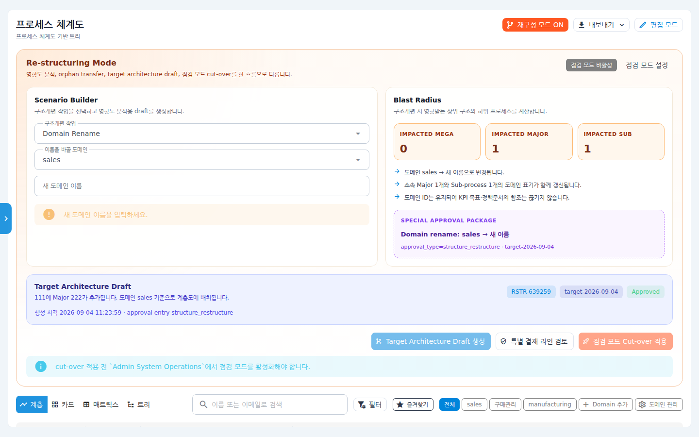
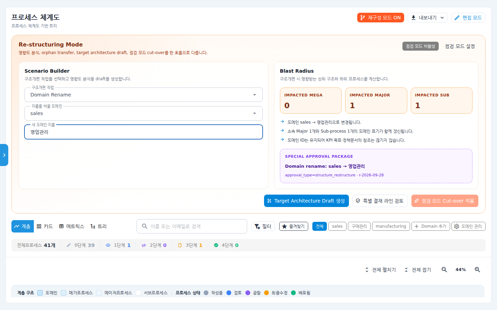
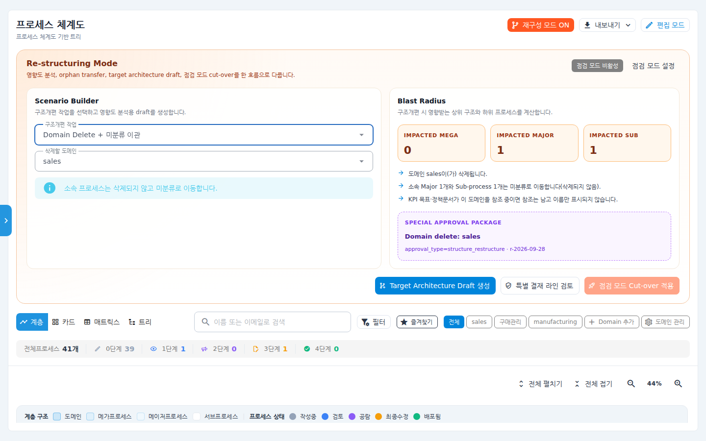
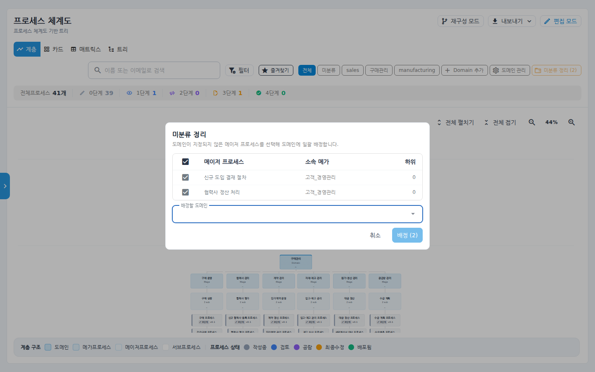
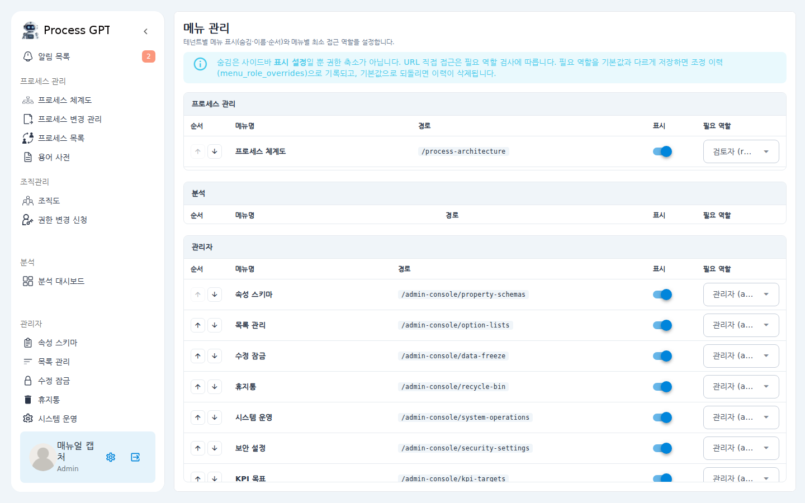
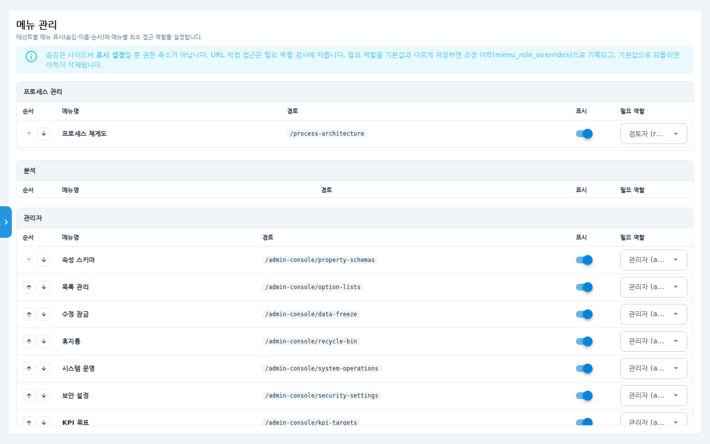
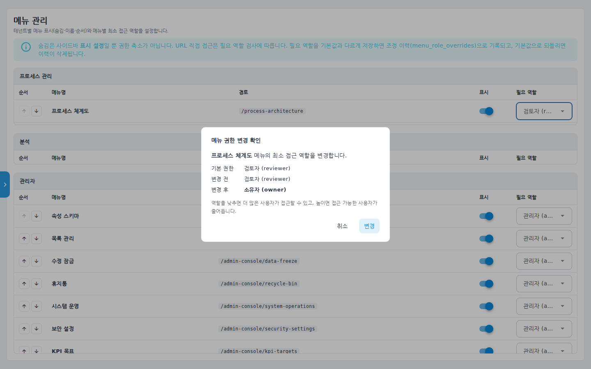

# 관리자 사용자화 가이드 — 도메인 관리 · 미분류 정리 · 메뉴 관리

우리 회사의 업무 환경에 맞춰 시스템을 조정하는 관리자 기능 3가지를 소개합니다.
프로세스 체계도의 **도메인**(최상위 업무 분류)을 정리하고,
아직 분류되지 않은 프로세스를 **미분류에서 꺼내 도메인에 일괄 배정**하며,
좌측 사이드바의 **메뉴 구성(표시 여부·이름·순서·접근 역할)**을 테넌트별로 설정할 수 있습니다.

도메인 작업은 성격에 따라 두 곳으로 나뉩니다.

| 하려는 일 | 어디서 | 반영 시점 |
|---|---|---|
| 도메인 추가, 색상 변경, 표시 순서 변경 | 프로세스 체계도 > **도메인 관리** | 즉시 |
| 도메인 **이름 변경**, **삭제** | 프로세스 체계도 > **재구성 모드** | 영향 범위 확인 → 결재 승인 → 점검 모드 적용 |

이름 변경과 삭제는 그 도메인에 속한 프로세스 전체에 영향을 주기 때문에, 곧바로 반영하지 않고
영향 범위를 먼저 보여주고 결재를 거치는 재구성 모드에서 처리합니다.

## 시나리오 개요

새로 시스템을 도입한 회사의 관리자 김담당 님은 기본 상태 그대로인 화면을 회사에 맞게 정리하려 합니다.

1. 초기 세팅 때 영문으로 들어간 도메인 이름(`sales`)을 `영업관리`로 바꾸고, 더 이상 쓰지 않는 도메인은 삭제한다.
2. 도메인 없이 등록되어 "미분류"에 쌓여 있는 프로세스들을 올바른 도메인으로 한 번에 옮긴다.
3. 회사에서 쓰지 않는 메뉴는 사이드바에서 숨기고, 메뉴 이름을 사내 용어로 바꾸고, 일부 메뉴의 접근 역할을 조정한다.

## 사전 조건

- **관리자(admin) 역할** 계정으로 로그인해야 합니다. 도메인 관리·미분류 정리·메뉴 관리는 관리자에게만 보입니다.
- 도메인 관리와 미분류 정리는 **프로세스 체계도** 화면에서, 메뉴 관리는 **관리자 콘솔**에서 사용합니다.

---

## 1. 도메인 관리 — 추가·색상·표시 순서

### 1-1. 화면 위치

사이드바에서 **프로세스 관리 > 프로세스 체계도**를 엽니다.
화면 상단의 도메인 필터 칩 오른쪽 끝에 관리자 전용 버튼이 보입니다.

- **Domain 추가** — 새 도메인을 만듭니다.
- **도메인 관리** (톱니 아이콘) — 색상과 표시 순서를 바꾸고, 이름 변경·삭제를 위해 재구성 모드로 이동합니다.
- **미분류 정리** — 도메인이 지정되지 않은 프로세스가 있을 때만 나타나며, 괄호 안에 건수가 표시됩니다.

### 1-2. 도메인 관리 다이얼로그

**도메인 관리** 버튼을 누르면 현재 도메인 목록이 나타납니다.

- 각 줄 오른쪽의 **↑ / ↓** 버튼으로 표시 순서를 바꿉니다. 순서는 즉시 저장되며, 상단 필터 칩과 계층·트리 화면의 도메인 순서에 그대로 반영됩니다.
- **팔레트** 아이콘으로 도메인 색상을 바꿉니다.
- 이름 변경과 삭제는 아래 안내의 **재구성 모드 열기** 버튼으로 이동해 진행합니다.

> **미분류는 목록에 없습니다.** 미분류는 "아직 도메인이 지정되지 않은 상태"를 가리키는 시스템 항목이라
> 도메인으로 다루지 않습니다. 따라서 이름을 바꾸거나 삭제할 수 없고, 도메인 필터 칩에도 나타나지 않습니다.
> 미분류에 있는 프로세스를 정리하려면 아래 **2. 미분류 정리**를 사용하세요.

### 1-3. 색상 변경

팔레트 아이콘을 누르면 색상 선택 창이 열립니다. 색을 고른 뒤 **저장**을 누릅니다.

색상은 화면 표시에만 영향을 주므로 결재 없이 바로 반영됩니다.

### 1-4. 이름 변경 — 재구성 모드

도메인 관리 다이얼로그 아래의 **재구성 모드 열기**를 누르면, 화면 위쪽에 재구성 스튜디오가 펼쳐지고
구조개편 작업이 **Domain Rename**으로 선택된 상태로 열립니다.

1. **이름을 바꿀 도메인**을 고릅니다.
2. **새 도메인 이름**을 입력합니다.
3. 오른쪽 **Blast Radius**에서 영향 범위를 확인합니다.

영향 범위에는 이름이 바뀌면서 함께 갱신되는 메이저 프로세스 수와 하위 프로세스 수가 표시됩니다.
**도메인 ID는 그대로 유지**되므로 KPI 목표·사내 정책문서가 걸어 둔 연결은 끊기지 않습니다.

4. **Target Architecture Draft 생성** → **특별 결재 라인 검토**에서 승인 → 점검 모드를 켠 뒤
   **점검 모드 Cut-over 적용**을 누르면 실제 체계도에 반영됩니다.

### 1-5. 도메인 삭제 — 재구성 모드

구조개편 작업에서 **Domain Delete + 미분류 이관**을 선택합니다.

- 소속 프로세스는 **삭제되지 않고 미분류로 이동**합니다. 영향 범위에서 몇 건이 이동하는지 미리 확인할 수 있습니다.
- KPI 목표·정책문서가 이 도메인을 참조하고 있었다면 참조 자체는 남고 도메인 이름만 표시되지 않습니다.
- 이름 변경과 마찬가지로 draft 생성 → 결재 승인 → 점검 모드 적용 순서를 거칩니다.

---

## 2. 미분류 정리 — 분류되지 않은 프로세스 일괄 배정

### 2-1. 미분류 정리 다이얼로그

도메인이 지정되지 않은 메이저 프로세스가 있으면 상단에 **미분류 정리 (N)** 버튼이 나타납니다.
버튼을 누르면 미분류 프로세스 목록이 열립니다.

1. 배정할 프로세스를 체크합니다. 맨 위 체크박스로 전체 선택도 됩니다.
2. **배정할 도메인**을 선택합니다.
3. **배정 (N)** 버튼을 누르면 선택한 프로세스가 한 번에 해당 도메인으로 이동합니다.

배정이 끝나 미분류가 0건이 되면 버튼 자체가 사라집니다.

### 2-2. 반대로 미분류로 되돌리기

프로세스를 다시 미분류로 보내야 할 때는:

1. 체계도 상단의 **편집 모드**를 켭니다.
2. 트리/계층 화면에서 해당 메이저 프로세스에 마우스를 올려 **연필** 아이콘을 누릅니다.
3. 편집 창의 **도메인** 선택 상자 오른쪽 **× (지우기)** 버튼으로 선택을 해제하고 저장합니다.
   ("선택을 해제하면 미분류로 이동합니다"라는 안내가 함께 표시됩니다.)

---

## 3. 메뉴 관리 — 사이드바 메뉴 표시·이름·순서·접근 역할 설정

### 3-1. 화면 위치

사이드바 아래쪽 **관리자** 섹션에서 **메뉴 관리**를 누르거나, 주소창에 `/admin-console/menu-settings`를 입력합니다.

### 3-2. 화면 구성

메뉴가 섹션(프로세스 관리 / 분석 / 관리자 등)별로 표 형태로 나열됩니다.

| 열 | 설명 |
|---|---|
| 순서 | ↑ / ↓ 버튼으로 같은 섹션 안에서 메뉴 표시 순서를 바꿉니다. |
| 메뉴명 | 메뉴 이름 위에 마우스를 올리면 연필 아이콘이 나타나며, 회사 용어로 이름을 바꿀 수 있습니다. 비워서 저장하면 기본 이름으로 돌아갑니다. |
| 경로 | 해당 메뉴의 화면 주소입니다. |
| 표시 | 스위치를 끄면 사이드바에서 그 메뉴가 숨겨집니다. |
| 필요 역할 | 이 메뉴에 접근할 수 있는 최소 역할을 선택합니다. |

> **숨김은 표시 설정일 뿐 권한 축소가 아닙니다.** 숨긴 메뉴도 주소를 직접 입력하면 필요 역할 검사에 따라 접근할 수 있습니다. 접근 자체를 막으려면 "필요 역할"을 조정하세요.
> 또한 **메뉴 관리 화면 자신은 숨길 수 없습니다** — 설정 화면으로 돌아올 길이 막히는 것을 방지하기 위해서입니다.

### 3-3. 표시 여부·이름·순서 바꾸기

1. 숨기고 싶은 메뉴의 **표시** 스위치를 끕니다.
2. 이름을 바꾸려면 메뉴명 옆 연필 아이콘을 눌러 새 이름을 입력합니다.
3. 순서를 바꾸려면 ↑ / ↓ 버튼을 누릅니다.

변경 내용은 저장 즉시 반영되며, 사이드바를 새로고침하면(페이지 이동 또는 브라우저 새로고침) 숨김·이름·순서가 적용된 메뉴가 보입니다. 이 설정은 **우리 테넌트에만** 적용되고 다른 회사에는 영향을 주지 않습니다.

### 3-4. 메뉴별 필요 역할 조정

**필요 역할** 드롭다운에서 새 역할을 고르면 확인 창이 열립니다.

- **기본 권한**(시스템 기본값), **변경 전**, **변경 후**를 나란히 보여줍니다.
- **변경**을 누르면 저장되고, **취소**를 누르면 원래 값으로 돌아갑니다.
- 역할을 낮추면 더 많은 사용자가 접근할 수 있고, 높이면 접근 가능한 사용자가 줄어듭니다.
- 기본값과 다른 역할로 저장하면 조정 이력이 남고, 다시 기본값으로 되돌리면 이력이 삭제됩니다.

---

## 확인 포인트

작업이 제대로 됐는지 스스로 확인하는 방법입니다.

- **도메인 이름 변경 후**: 점검 모드 적용까지 마친 뒤 체계도 상단 필터 칩에 새 이름이 보이고, 그 칩을 눌렀을 때 기존 프로세스들이 그대로 필터링되면 성공입니다.
- **도메인 삭제 후**: 삭제한 도메인 칩이 사라지고, 소속이던 프로세스가 계층 화면의 "미분류" 아래에 보이면 성공입니다. 화면을 새로고침해도 삭제한 도메인이 다시 나타나지 않아야 합니다.
- **색상·순서 변경 후**: 저장 즉시 도메인 칩과 계층 화면의 색·순서가 바뀌면 성공입니다.
- **미분류 배정 후**: 상단 "미분류 정리" 버튼의 숫자가 줄었고(0이 되면 버튼이 사라짐), 배정한 도메인 칩으로 필터하면 해당 프로세스가 보이면 성공입니다.
- **메뉴 숨김 후**: 페이지를 새로고침했을 때 사이드바에서 해당 메뉴가 보이지 않으면 성공입니다.
- **필요 역할 변경 후**: 해당 역할 미만의 계정으로 로그인하면 그 메뉴가 사이드바에 보이지 않거나 접근이 차단되면 성공입니다.
- 도메인 수정·삭제, 미분류 배정, 메뉴 설정 변경은 모두 **관리자 콘솔 > 감사 로그**에 기록되므로 언제 누가 바꿨는지 확인할 수 있습니다.

## 자주 묻는 질문

**Q. 도메인 목록에 "미분류"가 없습니다.**
정상입니다. 미분류는 도메인이 아니라 "아직 도메인이 지정되지 않은 상태"를 뜻하는 시스템 항목이라 도메인 목록·필터 칩에서 다루지 않습니다. 미분류에 있는 프로세스는 계층·트리 화면의 미분류 묶음에서 확인하고, **미분류 정리**로 도메인에 배정하면 됩니다.

**Q. 도메인 이름을 바로 바꾸고 싶은데 왜 결재를 거쳐야 하나요?**
도메인 이름을 바꾸면 그 도메인에 속한 모든 프로세스의 분류 표기가 함께 바뀌기 때문입니다. 재구성 모드는 바꾸기 전에 몇 건이 영향을 받는지 보여주고, 승인과 점검 시간대를 거쳐 반영해 운영 중 혼선을 막습니다. 색상과 표시 순서처럼 화면 표시만 바뀌는 항목은 결재 없이 즉시 반영됩니다.

**Q. 도메인 관리 버튼이 안 보입니다.**
관리자 역할이 아니거나, 관리자 승인이 완료되지 않은 계정입니다. 관리자에게 역할을 확인해 달라고 요청하세요.

**Q. 메뉴를 숨겼는데 다른 직원 화면에는 아직 보입니다.**
메뉴 설정은 화면을 새로 불러올 때 적용됩니다. 해당 직원이 브라우저를 새로고침하면 반영됩니다.

**Q. 도메인을 삭제하면 그 안의 프로세스도 삭제되나요?**
아니요. 프로세스는 삭제되지 않고 미분류로 이동합니다. 삭제 확인 창에서 이동할 프로세스 수를 미리 보여줍니다.
