# 우리 회사 용어·분류·운영 기준으로 바꾸기 (관리자 설정 가이드)

프로세스 관리 시스템은 처음 설치하면 제품 기본 용어(도메인/메가/메이저/서브, 0~4단계, 설계·구축·감시·제어 분류)와
기본 운영 기준(공람 30일, 휴지통 30일 보관, 연간 근무시간 2,080시간 등)으로 동작합니다.
이 가이드는 관리자가 **관리자 콘솔의 세 화면**(메뉴 관리 · 용어·분류 설정 · 운영 정책)에서
이 값들을 회사 체계에 맞게 바꾸는 방법을 설명합니다. 바꾼 값은 즉시 모든 사용자 화면에 반영되고,
비워 두면 언제든 제품 기본값으로 돌아갑니다.

## 시나리오 개요

제조업체의 프로세스 관리자 김 팀장은 도입 직후 두 가지 불편을 겪었습니다.

- 체계도에 "도메인"이라고 적혀 있는데 사내에서는 "사업 영역"이라고 부르고, 0단계 프로세스를 "기획"이라고 부릅니다.
- 카드 보기의 열이 통신사 용어(설계·구축·감시·제어)라 "고객관리·재고관리·품질관리" 프로세스가 모두 "제어" 열로 몰립니다.
- 자주 쓰는 병합 요청 화면이 사이드바에 없어 매번 주소를 직접 칩니다.
- 공람 기간을 30일이 아니라 21일로 운영하고 싶습니다.

아래 순서대로 따라 하면 네 가지를 모두 관리자 화면에서 해결할 수 있습니다.

## 사전 조건

- **관리자(admin)** 역할로 로그인해야 합니다. 관리자 콘솔 메뉴는 관리자에게만 보입니다.
- 사이드바 왼쪽 아래 **관리자** 구역에 `메뉴 관리`, `용어·분류 설정`, `운영 정책` 세 메뉴가 보이는지 확인합니다.

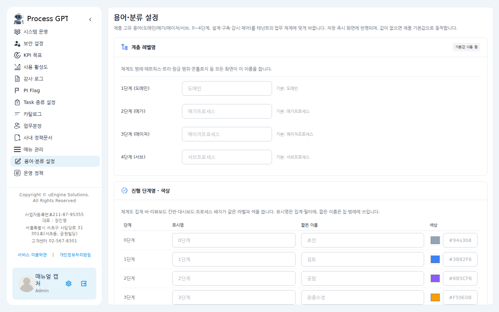

---

## 1. 사이드바에 원하는 화면 추가하기 (메뉴 관리)

병합 요청함처럼 기본 메뉴에 없는 화면이나 회사 위키 같은 외부 주소를 사이드바에 올립니다.

1. 사이드바 **관리자 → 메뉴 관리**를 클릭합니다.
2. 화면을 아래로 내리면 **사용자 정의 메뉴** 표가 있습니다. 오른쪽 위 **메뉴 추가** 버튼을 누릅니다.

   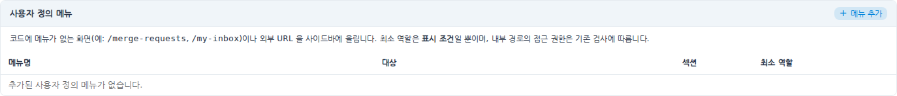

3. 메뉴명에 `병합 요청함`, 대상에 `/merge-requests`를 입력합니다.
   - 내부 화면은 `/`로 시작하는 경로를, 외부 사이트는 `https://`로 시작하는 주소를 넣습니다. 외부 주소는 새 탭으로 열립니다.
   - **섹션**은 사이드바의 어느 구역(프로세스 관리 / 조직관리 / 분석 / 관리자)에 표시할지입니다.
   - **사이드바 표시 최소 역할**은 "누구에게 보일지"만 정합니다. 화면을 열 수 있는 권한 자체는 바뀌지 않습니다.

   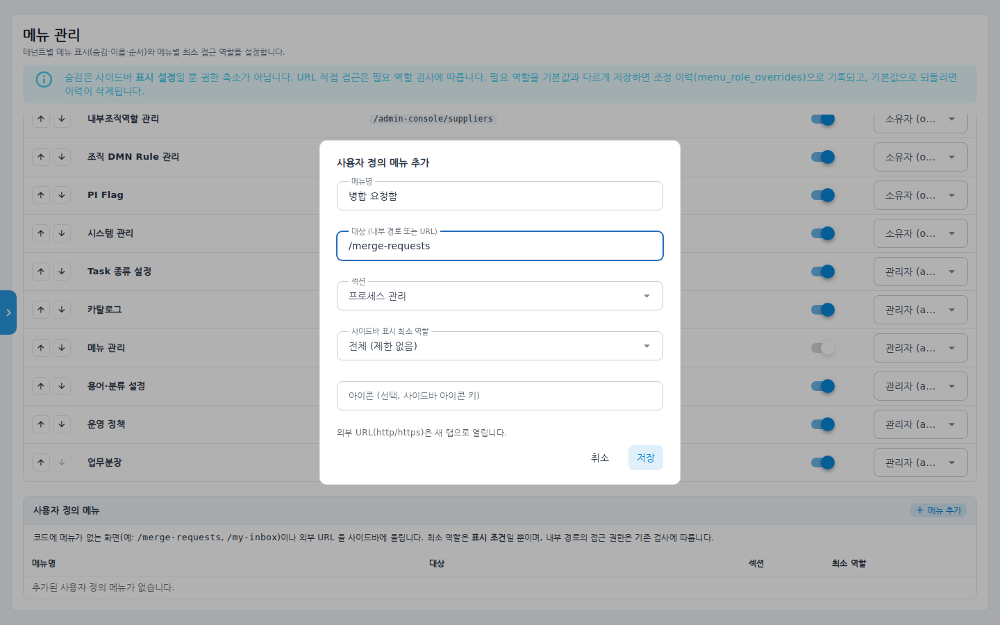

4. **저장**을 누르면 표에 항목이 추가되고, 사이드바 해당 구역에 바로 나타납니다.

   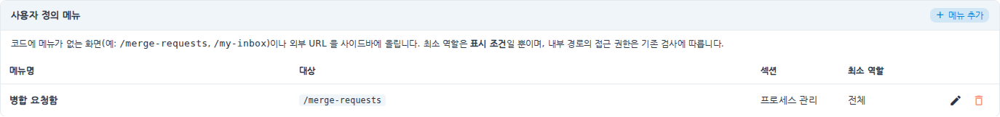

- 연필 아이콘으로 수정, 휴지통 아이콘으로 삭제합니다.
- 기존 메뉴의 숨김·이름·순서·필요 역할 조정은 같은 화면 위쪽 표에서 하던 대로 합니다.

---

## 2. 용어 바꾸기 (용어·분류 설정)

사이드바 **관리자 → 용어·분류 설정**을 엽니다. 네 개의 카드(계층 레벨명 / 진행 단계명·색상 / 프로세스 분류축 / 역할 표시 라벨)가 있습니다.
각 입력칸의 회색 글씨가 **제품 기본값**이고, 비워 두면 기본값이 쓰입니다.

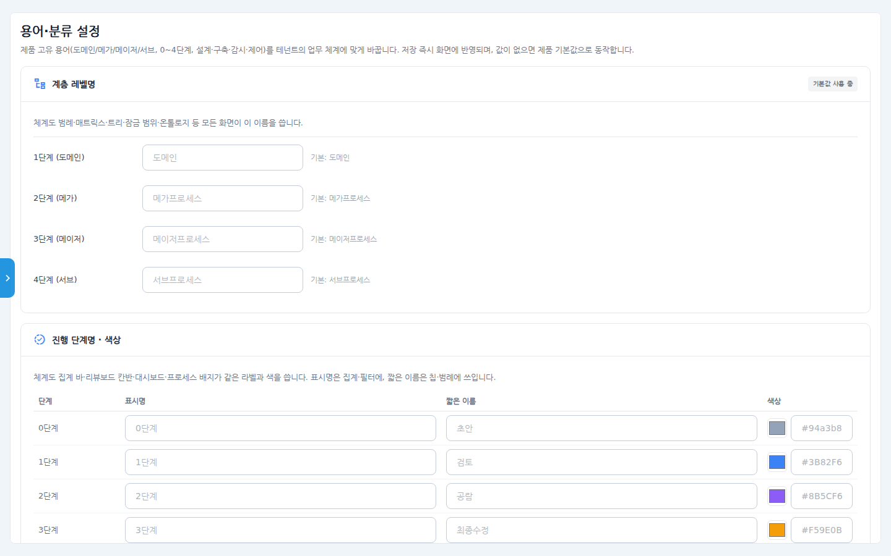

### 2-1. 계층 레벨명

1. **1단계 (도메인)** 칸에 `사업 영역`을 입력합니다. 필요하면 메가·메이저·서브도 바꿉니다.
2. 아래 **진행 단계명·색상** 카드까지 내려가 **용어 저장**을 누릅니다(두 카드는 한 버튼으로 함께 저장됩니다).

### 2-2. 진행 단계명 · 색상

1. **0단계** 행의 표시명에 `기획`, 짧은 이름에 `기획중`을 입력합니다.
   - **표시명**은 체계도 상단 집계 바·리뷰보드 열 제목·필터에, **짧은 이름**은 칩·범례·배지에 쓰입니다.
   - 색상 칸의 색 상자를 클릭하면 색을 고를 수 있습니다. 바꾼 색은 체계도·대시보드·배지에 모두 적용됩니다.
2. **용어 저장**을 누르면 버튼 왼쪽에 "저장했습니다."가 표시됩니다.

   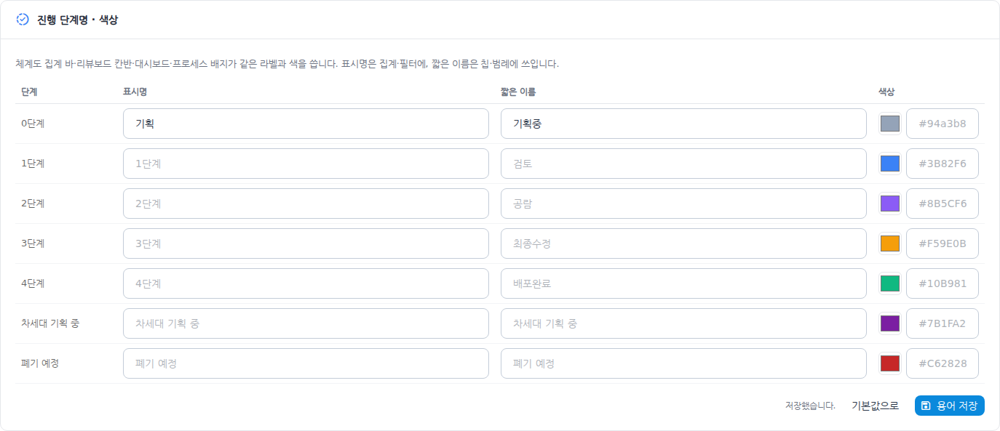

3. 프로세스 체계도로 이동해 확인합니다. 집계 바에 **기획 39**, 아래 범례에 **사업 영역**과 **기획중**이 보이면 적용된 것입니다.

   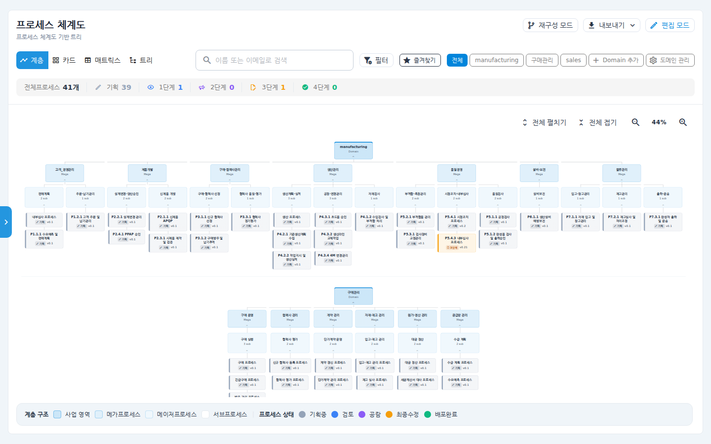

### 2-3. 프로세스 분류축 (카드 보기 열)

체계도 **카드** 보기의 열을 회사 분류 체계로 바꿉니다.

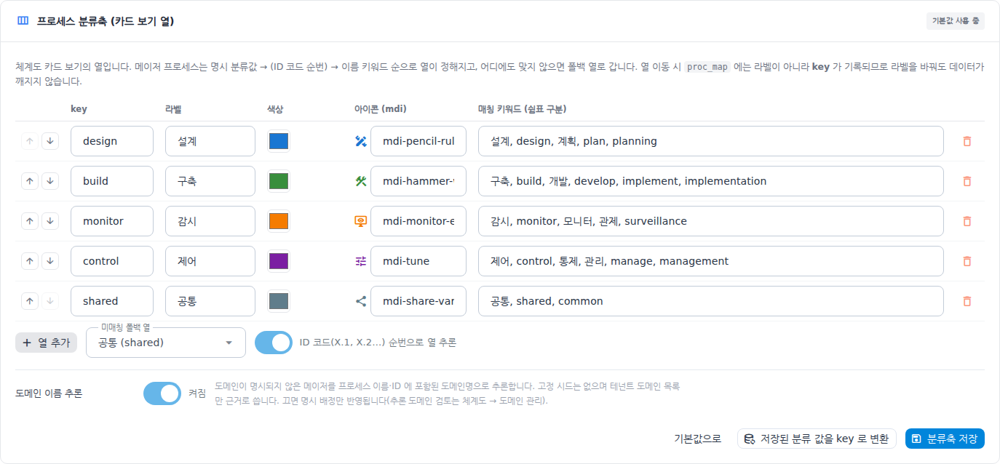

1. 표의 각 행이 열 하나입니다. **라벨**(열 제목), **색상**, **아이콘**, **매칭 키워드**를 수정합니다.
   - 메이저 프로세스는 ① 직접 지정된 분류값 → ② ID 코드 순번(`X.1`이면 1번째 열) → ③ 이름에 포함된 키워드 순으로 열이 정해집니다.
   - **key**는 저장에 쓰이는 영문 식별자입니다. 비워 두면 라벨에서 자동으로 만들어집니다. 라벨을 나중에 바꿔도 key는 그대로라 데이터가 깨지지 않습니다.
2. 열을 더 만들려면 **열 추가**, 없애려면 행 끝의 휴지통, 순서는 화살표로 바꿉니다.
3. **미매칭 폴백 열**: 어느 열에도 맞지 않는 프로세스가 갈 열입니다. 업종에 따라 "공통" 대신 "기타" 같은 열을 만들어 지정하세요.
4. ID 코드로 열을 추론하지 않으려면 **ID 코드 순번으로 열 추론** 스위치를 끕니다.
5. **분류축 저장**을 누릅니다.

> **저장된 분류 값을 key로 변환** 버튼은 예전에 라벨("설계")로 저장된 분류 값을 현재 key("design")로 한 번에 바꿉니다.
> 읽을 때는 라벨과 key를 모두 인식하므로 필수는 아니지만, 라벨을 바꾸기 전에 한 번 실행해 두면 안전합니다.

카드 보기에서 열 제목 옆 연필 아이콘으로 이름을 바꿔도 같은 설정에 저장되어 모든 사용자에게 반영됩니다.

### 2-4. 도메인 이름 추론

같은 카드 아래 **도메인 이름 추론** 스위치가 있습니다.

- 켜짐(기본): 도메인이 지정되지 않은 메이저 프로세스를 이름·ID에 들어 있는 도메인명으로 추측합니다. 추측 근거는 **우리 회사가 등록한 도메인 목록**뿐입니다.
- 꺼짐: 직접 지정한 도메인만 인정합니다. 추측이 자주 틀리는 업종이라면 끄는 것을 권합니다.

잘못 추측되어 저장된 도메인을 정리하려면 **프로세스 체계도 → 도메인 관리**를 엽니다.
직접 배정된 프로세스가 하나도 없는 도메인은 **추론 도메인 검토** 목록에 나타나며, **고정**(추측을 직접 배정으로 확정) 또는 **제거**(도메인 삭제, 소속 프로세스는 미분류로 이동)를 선택합니다.
모든 도메인에 직접 배정된 프로세스가 있으면 이 목록은 표시되지 않습니다.

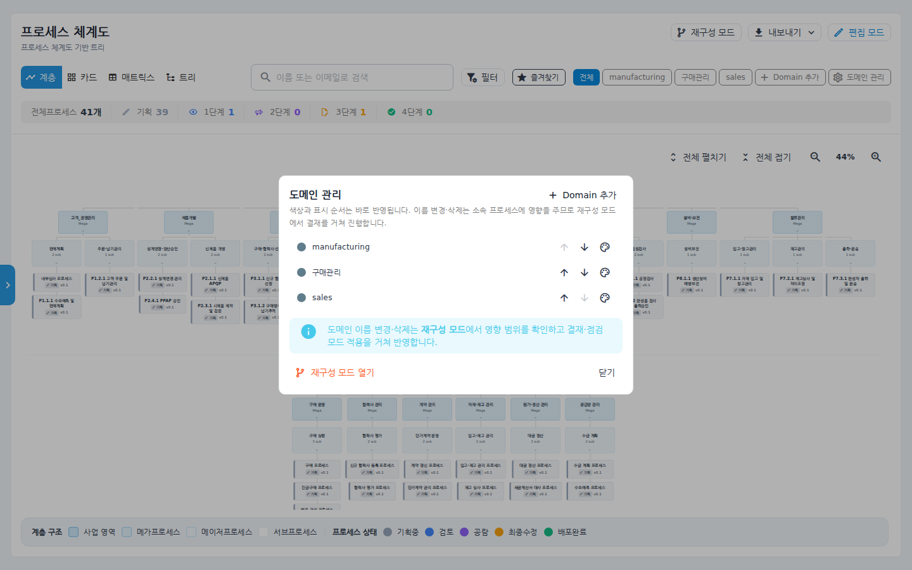

### 2-5. 역할 표시 라벨

조직도·권한 신청·메뉴 관리 등에 표시되는 5개 역할의 이름과 설명을 바꿉니다. 역할의 권한 자체는 바뀌지 않습니다.

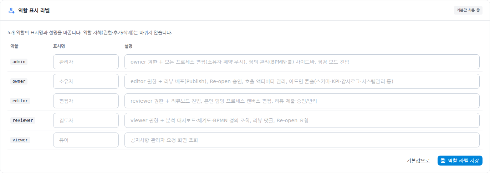

1. 예: `admin` 행의 표시명에 `운영자`를 입력합니다.
2. **역할 라벨 저장**을 누릅니다.

---

## 3. 운영 기준 바꾸기 (운영 정책)

사이드바 **관리자 → 운영 정책**을 엽니다. 보안 설정과 같은 모양의 세 카드가 있습니다.

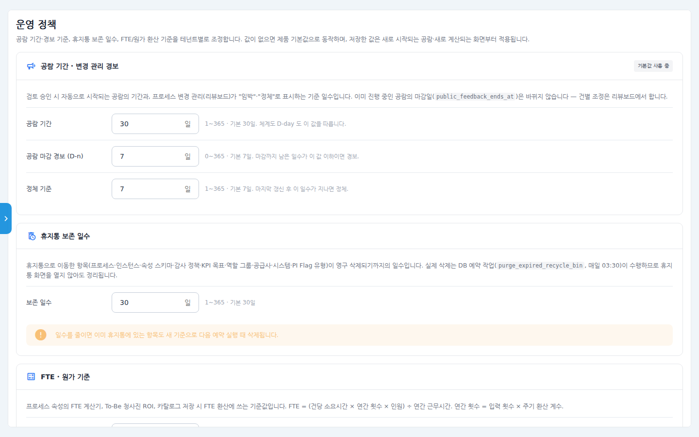

| 카드 | 항목 | 기본값 | 어디에 쓰이나 |
|------|------|--------|---------------|
| 공람 기간 · 변경 관리 경보 | 공람 기간 | 30일 | 검토 승인 시 시작되는 공람의 마감일, 체계도 D-day |
| | 공람 마감 경보 (D-n) | 7일 | 리뷰보드·내 수신함의 "임박" 표시 |
| | 정체 기준 | 7일 | 마지막 갱신 후 이 일수가 지나면 "정체" 표시 |
| 휴지통 보존 일수 | 보존 일수 | 30일 | 휴지통 항목의 "남은 일수", 자동 영구 삭제 시점 |
| FTE · 원가 기준 | 연간 근무시간 | 2,080시간 | FTE 계산기, To-Be ROI, 카탈로그 FTE 환산 |
| | 주기 환산 계수 | 12 / 52 / 260 | 월간·주간·일간 횟수 → 연간 횟수 |
| | 연간 인건비 단가 · 통화 | 80,000,000 KRW | To-Be 청사진 ROI 초기값 |

1. **공람 기간**을 `21`로 바꿉니다.
2. 필요하면 아래 카드의 값도 수정합니다.

   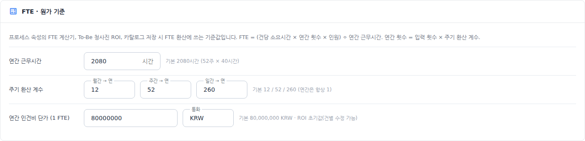

3. 맨 아래 **저장**을 누릅니다. "저장했습니다."가 표시됩니다.

   

주의할 점:

- 이미 진행 중인 공람의 마감일은 바뀌지 않습니다. 건별 조정은 리뷰보드에서 합니다.
- 휴지통 보존 일수를 줄이면 이미 휴지통에 있는 항목도 새 기준으로 다음 자동 정리 때 삭제됩니다.
- 휴지통 정리는 매일 새벽 서버가 자동으로 수행하므로 휴지통 화면을 열지 않아도 됩니다. 휴지통 제목 옆에 현재 보존 일수가 표시됩니다.

   

---

## 확인 포인트

- **메뉴**: 사이드바에 추가한 메뉴가 지정한 구역에 보이고, 클릭하면 해당 화면(외부 주소는 새 탭)이 열린다.
- **용어**: 프로세스 체계도 상단 집계 바와 하단 범례, 리뷰보드 열 제목, 프로세스 배지에 바꾼 이름과 색이 보인다. 새로고침 후에도 유지된다.
- **분류축**: 카드 보기의 열 제목·색·순서가 바뀌었고, 카드를 다른 열로 끌어 놓아도 새로고침 후 그 열에 남아 있다.
- **운영 정책**: 새로 승인된 공람의 D-day가 바꾼 기간으로 계산되고, 휴지통의 "남은 일수"가 보존 일수 기준으로 표시된다.
- **감사 로그**: 관리자 콘솔 → 감사 로그에 `terminology_update`, `process_classification_update`, `role_labels_update`, `operation_policy_update`, `menu_settings_update` 기록이 남는다.

## 자주 묻는 질문

**Q. 기본값으로 되돌리려면?**
각 카드의 **기본값으로** 버튼을 누른 뒤 저장합니다. 입력칸을 비우고 저장해도 같습니다. "기본값 사용 중" 배지가 다시 표시됩니다.

**Q. 다른 언어(영어) 화면에도 적용되나요?**
바꾼 용어는 모든 언어 화면에 동일하게 적용됩니다. 언어별로 다른 이름을 두는 기능은 없습니다.

**Q. 열 라벨을 바꿨더니 예전 프로세스가 다른 열로 갔어요.**
라벨이 아니라 매칭 키워드나 폴백 열 설정이 바뀌었을 가능성이 큽니다. 프로세스를 원하는 열로 끌어 놓으면 분류값이 직접 지정되어 이후에는 이동하지 않습니다.

**Q. 역할을 추가하거나 없앨 수 있나요?**
아니요. 이 화면에서는 5개 역할의 표시명과 설명만 바꿀 수 있습니다.
