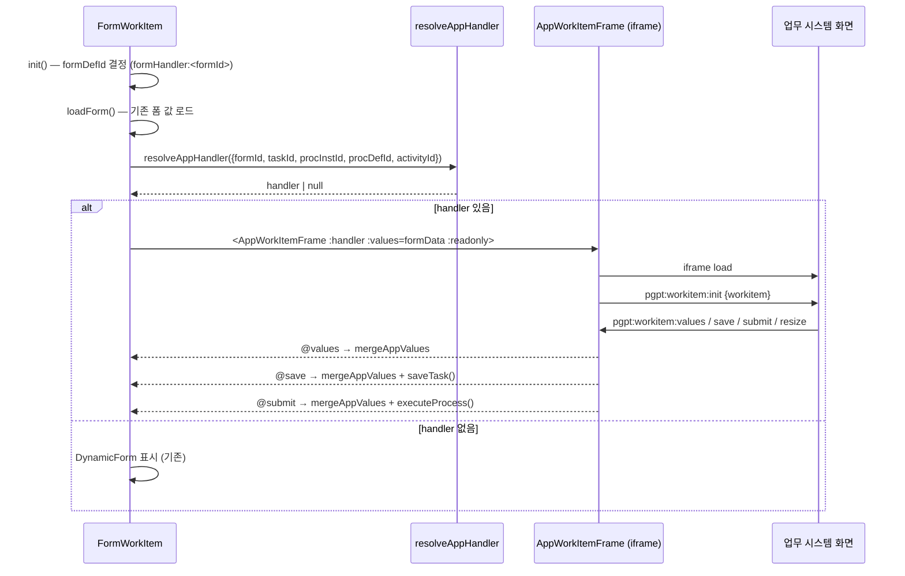
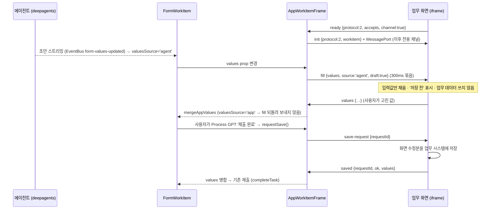

# workitem-app-handler — 구현 설명

> 계약은 [spec.md](spec.md). 이 문서는 현재 구현이 그 계약을 **어떻게** 지키는지 적는다.
> 도입 커밋: `services/frontend` 브랜치 `feat/external-app-workitem-plugin` — `78d14bf2 feat: 워크아이템 화면 플러그인`(protocol 1), protocol 2 보강은 그 뒤 커밋.

## 1. 설계 원칙

| 원칙 | 구현에서의 의미 |
|---|---|
| 데이터 계약은 폼 | `todolist.tool = formHandler:<formId>` 를 바꾸지 않는다. deepagents·completion·polling 은 수정하지 않았다 |
| 화면만 플러그인 | 바인딩은 "폼 → 앱 화면" 매핑일 뿐이다. 앱 화면이 보낸 값은 폼 값으로 병합되어 기존 저장·제출 경로를 탄다 |
| Process GPT 는 업무 시스템을 모른다 | 코드에 앱 이름·경로가 없다. 업무 시스템의 설치 스크립트가 등록 행을 넣는다 |
| 업무 데이터는 업무 화면만 쓴다 | 에이전트·폼 값은 `fill`(저장 전 초안)로만 화면에 전달된다. 저장은 화면의 저장 또는 `save-request` 응답에서만 일어난다 — 사용자가 에이전트를 멈추고 고칠 수 있다 |
| 직접 호출 금지 | 같은 출처라 `iframe.contentWindow` 함수 호출도 가능하지만 쓰지 않는다. 메시지 계약만이 결합 지점이다 |
| 같은 출처 권장 | 앱을 같은 게이트웨이 경로(예: `/primes/`)로 두면 쿠키·localStorage·출처 검증이 단순해진다 |

## 2. 구성 요소

| 파일 | 역할 |
|---|---|
| `supabase/migrations/20261018_workitem_app_handler.sql` | `workitem_app`, `workitem_app_binding` 테이블과 테넌트 RLS 정책 |
| `src/components/apps/todolist/app-handler/resolveAppHandler.ts` | 폼 식별자로 바인딩을 찾아 화면 주소·출처·모드를 만든다 |
| `src/components/apps/todolist/app-handler/AppWorkItemFrame.vue` | iframe 을 띄우고 postMessage 계약을 처리한다 |
| `src/components/apps/todolist/app-handler/README.md` | 업무 시스템 개발자용 요약 |
| `src/components/apps/todolist/FormWorkItem.vue` | 해석 호출, 앱 화면/폼 표시 전환, 값 병합·저장·제출 연결 |

### 2.1 데이터 모델

```sql
workitem_app         (tenant_id, app_id) PK, name, base_url, allowed_origin, description, enabled, created_at
workitem_app_binding (tenant_id, form_id) PK, app_id → workitem_app (cascade), view_path, mode('replace'|'beside'), enabled, created_at
```

- `tenant_id` 기본값은 `public.tenant_id()`. 두 테이블 모두 RLS 사용, 인증 사용자는 자기 테넌트 행만 SELECT/ALL.
- 마이그레이션은 로컬 Supabase(`supabase-db`)에 psql 로 적용했다.

### 2.2 해석 (`resolveAppHandler`)

1. `workitem_app_binding` 에서 `form_id = :formId and enabled` 1건을 조회한다 (`window.$supabase`, RLS 로 테넌트 한정).
2. 있으면 `workitem_app` 에서 `app_id = binding.app_id and enabled` 를 조회한다.
3. 화면 주소 = `base_url`(끝 `/` 제거) + `view_path`(앞 `/` 보정, 자리표시자 치환) 를 `window.location.origin` 기준 URL 로 만들고, `pgpt_task / pgpt_inst / pgpt_activity` 를 쿼리에 없을 때만 붙인다.
4. 반환: `{ appId, name, url, origin: allowed_origin || url.origin, mode }`. 바인딩·앱이 없거나 오류면 `null`.
5. 조회 결과는 폼 식별자별로 모듈 수준 `Map` 에 캐시한다(페이지 수명 동안 유지).

### 2.3 워크아이템 화면 연결 (`FormWorkItem`)



- 해석은 `init()` 에서 `isDryRun` 이 아닐 때 `loadForm()` 다음에 한다. 실패하면 `appHandler = null` 로 폼을 보인다.
- `readonly` = `isCompleted || !isOwnWorkItem` (기존 폼의 읽기 전용 판단과 같다).
- `mergeAppValues` 는 얕은 병합: `formData = { ...formData, ...values }`.
- 저장은 기존 '중간 저장'(`saveTask` → `backend.setVariableWithTaskId`), 제출은 기존 '제출 완료'(`executeProcess` → 체크포인트 확인 → `completeTask` → `putWorkItemComplete` → `/completion/complete`) 를 그대로 쓴다.
- `mode='replace'` 이면 '데이터 폼 보기/숨기기' 토글로 `DynamicForm` 을 펼칠 수 있다. `beside` 는 항상 둘 다 보인다.

### 2.4 메시지 처리 (`AppWorkItemFrame`)



| 시점 | 동작 |
|---|---|
| iframe `load` | 아직 협상 전이면 protocol 1 `init` (window 로) — `ready` 가 먼저 왔으면 건드리지 않는다 |
| 앱의 `ready` | `protocol` 을 정하고 `accepts` 를 지원 목록(`fill, update, save-request, ack`)과 교집합. `channel:true` 면 `MessageChannel` 을 만들어 `port2` 를 넘기며 `init` |
| 폼 값 변경 | `accepts` 에 `fill` 이 있고 출처가 `app` 이 아니면 300ms 뒤 `fill {values, source, draft:true}` |
| 상태·읽기 전용 변경 | protocol 2 + `update` 면 `update {status, readonly}`, 아니면 `init` 재전송 |
| 수신 검증 | 창 메시지는 `event.origin === handler.origin` 이고 `event.source === iframe.contentWindow` 일 때만. 전용 채널 메시지는 포트 자체가 증명 |
| `resize` | `height > 200` 일 때 `min(4000, ceil(height))` px (기본 760px) |
| `values` | 항상 `values` 이벤트로 올림 |
| `save` / `submit` | `readonly` 면 처리하지 않고 `ack {ok:false,'readonly'}`. 아니면 이벤트로 올리고 처리 뒤 `ack {requestId, ok, stage}` (`saved` / `accepted`) |
| `saved` | 대기 중인 `requestSave()` 를 그 결과로 끝낸다 |

`FormWorkItem` 쪽:
- `valuesSource`: 에이전트 초안(`form-values-updated`)이면 `'agent'`, 앱이 보낸 값이면 `'app'`(다음 틱에 `'form'` 으로 복귀), 그 밖은 `'form'`.
- `executeProcess()`: 앱 화면이 있고 앱이 직접 제출한 게 아니면 먼저 `requestSave()` — 실패·시간 초과(30초)면 경고 후 제출하지 않는다. protocol 1 앱이면 바로 통과.
- `onAppSave` / `onAppSubmit`: 값 병합 → 기존 `saveTask()` / `executeProcess()` → `ack`. 앱이 제출한 경우는 이미 화면이 저장했으므로 `save-request` 를 다시 보내지 않는다.

init 의 `workitem` 값: `taskId`(라우트 파라미터 또는 `worklist.taskId`), `procInstId`(`worklist.instId`), `procDefId`(`worklist.defId`), `activityId`(`activity.tracingTag`), `activityName`, `formId`, `status`, `readonly`, `values`(폼 값 깊은 복사), `user`(localStorage 의 `email`, `userName`).

### 2.5 실행 확인 (2026-10-18)

진행 중인 결정 워크아이템에서 실제로 확인했다: protocol 2 · 전용 채널 협상 → 에이전트 초안 이벤트로 `choice:'SPLIT'` 이 화면에 '저장 전'으로 채워짐 →
사용자가 화면에서 대체 금형(`ALT_MOLD`)으로 바꿈 → Process GPT '제출 완료' → `save-request`/`saved` → 저장된 결정 값 `ALT_MOLD`.
PriMES 작업지시 발행 이벤트는 결정 제출 7초 뒤에 처음 생겼다(초안 단계에서는 업무 데이터 쓰기 없음).

## 3. 참조 통합 — PriMES (MES)

Process GPT 코드 밖, PriMES 쪽에서 계약을 구현한 사례다(경로는 `/Users/uengine/primes`).

| 항목 | 내용 |
|---|---|
| 등록 | `ai/agents/catalog.py` 의 `WORKITEM_APP`, `WORKITEM_APP_VIEWS` → `ai/agents/install.py install_workitem_app()` 가 두 테이블에 행을 넣는다 |
| 바인딩 | 반복 수주 프로세스 활동별: 주문서 접수·수주 등록 → `/embed/order`, 소요량·발주 → `/embed/purchase`, 계획·금형 확인·결정 → `/embed/plan`, 작업지시 발행 → `/embed/work-orders` |
| 앱 쪽 브리지 | `frontend/src/screens/embed/pgptBridge.ts` — `ready {protocol:2, accepts, channel:true}`, 전용 포트 사용, `onFill`·`onUpdate`·`onSaveRequest` 등록, `save/submit` 은 `ack` 를 기다리는 Promise, `ResizeObserver` 로 `resize` |
| 초안 처리 | 각 임베드 화면은 `fill` 의 알려진 필드만 입력값에 채우고 점선 표시 + '저장 전' 배너. `save-request` 가 오면 고친 행만 PriMES API 로 저장하고 `saved` 로 응답 |
| 임베드 화면 | `frontend/src/screens/embed/*Embed.vue` — 에이전트가 한 일을 PriMES 화면으로 채워 보여 주고, 담당자는 PriMES API 로 직접 수정(수정 이력은 PriMES 이벤트) |
| 결정 화면 | `PlanEmbed.vue` — 작업지시 등록 화면에서 금형·설비·착수일·수량을 고치면 `plan_override`(JSON) 를 결정 값에 넣어 `submit`. 실행 에이전트 도구가 그 값을 반영해 작업지시를 발행한다 |
| 인증 | 같은 출처라 PriMES 로그인 토큰(localStorage `primes.auth`)을 그대로 쓴다. Process GPT 는 토큰을 넘기지 않는다 |

### 배포 — 통합 게이트웨이 (PriMES Spring Cloud Gateway :8080)

```
/api/<PriMES 컨텍스트>/**  → PriMES 서비스 (JWT 검사: mes.secured-contexts)
/ai/**                     → PriMES AI 연동 계층 :8312 (접두어 제거)
/primes, /primes/**        → PriMES UI (vite base '/primes/')
/api/** (나머지, order 10)  → Process GPT UI :5200 (vite 프록시)
/**    (order 100)          → Process GPT UI :5200
```

브라우저는 `http://localhost:8080` 한 출처만 본다. 그래서 `base_url='/primes'`, `allowed_origin=null`(같은 출처) 로 등록된다.

## 4. 운영 중 확인한 함정

| 증상 | 원인 | 조치 |
|---|---|---|
| iframe 높이가 계속 커짐 | 앱 화면이 `min-height:100vh` 이고 `documentElement.scrollHeight` 를 보고하면, iframe 높이 → 뷰포트 → 보고 높이가 서로 키운다 | 앱은 콘텐츠 요소의 높이(`getBoundingClientRect().height`)를 보고하고 `100vh` 최소 높이를 쓰지 않는다 |
| 사람 활동인데 결정 버튼이 없음 | 사람 활동 워크아이템의 담당자(`user_id`)가 비어 `isOwnWorkItem=false` → `readonly=true` | 역할에 `default` 담당자를 지정하고, 연동 계층이 비어 있는 담당자를 배정한다(PriMES 쪽 `assign_human_tasks`) |
| 앱 수정 감지가 안 됨 | 앱 쪽 계산 속성이 반응형이 아닌 기준값과 비교 | 앱 구현 문제 — 기준값을 반응형으로 둔다 |

## 5. 현재 한계

- 해석 결과 캐시를 무효화하지 않는다. 바인딩을 바꾸면 페이지를 새로 고쳐야 반영된다.
- `fill` 은 폼 값 전체를 보낸다(변경분 아님). 폼 필드와 업무 화면 입력값의 대응은 앱이 정한다.
- `valuesSource` 는 '마지막으로 바꾼 주체' 수준이다. 에이전트 초안 뒤 사람이 데이터 폼을 직접 고쳐도 `'agent'` 로 남을 수 있다.
- `submit` 의 `ack` 는 제출 '접수'(`accepted`)까지만 알린다. 엔진의 다음 단계 진행 결과는 `update`(상태 변화)로 알 수 있다.
- PriMES 참조 통합의 일부 에이전트 도구(수주·발주 자동 등록)는 아직 서버에서 직접 PriMES 에 쓴다. 이 원칙을 끝까지 적용하려면 초안 → 커밋 두 단계로 바꿔야 한다.
- 다른 출처 앱(`allowed_origin` 지정)은 계약상 지원하지만 이번 구현에서 실제로 검증하지 않았다. 다른 출처 앱은 인증 토큰을 스스로 해결해야 한다.
- 시뮬레이션·드라이런(`isDryRun`) 모드에서는 바인딩을 해석하지 않는다.
- 앱 화면이 보낸 값과 사람이 폼에 직접 넣은 값을 구분해 기록하지 않는다(둘 다 폼 값).
- 이 계약의 Playwright E2E 는 아직 없다. 시나리오는 데모 캡처 스크립트(`primes/ai/video/agentic/capture.mjs`)로만 실행 확인했다.
